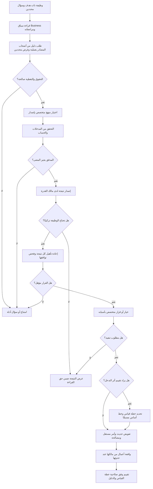
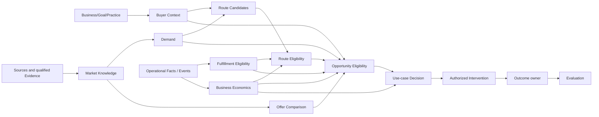

# BuilderAd — الوثيقة الهندسية المعتمدة لتحقيق القيم وبناء القدرات

**Value Delivery, Capability Engineering & Implementation Blueprint — v1.1**  
**تاريخ القرار:** 15 نوفمبر 2026  
**حالة الوثيقة:** `APPROVED_FOR_CAPABILITY_ENGINEERING` — مواصفة تفصيلية تابعة للمرجع المعماري الوحيد في المستودع؛ ليست مصدر سلطة مستقلًا ولا شهادة بتنفيذ القدرات المقترحة.  
**المستودع:** [`42Huss/builderad`](https://github.com/42Huss/builderad)  
**خط الأساس الذي تحققت منه:** `main@51944abd3df9436d400dca8c19b1fb3a1448ba07`؛ PR #69 مدمج، وFoundation على رأس `main` ناجحة وفق GitHub عند المراجعة.  
**المرجع التصميمي الأعلى:** `docs/architecture/BUILDERAD_GOVERNING_ARCHITECTURE.md`؛ و`docs/engineering/ENGINEERING_STANDARDS.md` دليل تنفيذ يقر بأنه المرجع التصميمي الوحيد.  
**مراجع واقع التنفيذ:** `docs/architecture/CURRENT_IMPLEMENTATION.md`، و`docs/execution/structural-foundation/BA-FOUNDATION-READINESS-01.md`، والشيفرة والاختبارات على البصمة المبينة أعلاه. **هذه الوثيقة تفصّل المحفظة ولا تُعدّل سلطة المرجع الأعلى؛ عند اختلاف قرار معماري تُعرض البدائل ويُعدل المرجع الأعلى بقرار صريح، لا تنشأ سلطتان متنافستان.**  
**المدخلات المقارنة:** المقترحات الثلاثة بتاريخ 15 نوفمبر 2026 الخاصة بالقيم والقدرات والمتطلبات. هذه الوثيقة توحّد قراراتها الصحيحة وتصوّب التعارضات، ولا تمنح أي اقتراح بحثي صفة قدرة منفذة.

> **قاعدة تنفيذ هذه الوثيقة:** تُضاف أي قيمة تجارية مستقبلية بوصفها وعدًا ومنفعة لها وظائف وحالات استعمال قابلة للتركيب. وتُضاف القدرة التخصصية إلى مالك المعنى الصحيح فقط عندما لا تغطيها قدرة موجودة. تُؤهَّل مصادر الأدلة والنتائج بحسب العملية والحقوق، ويملك مستهلك النتائج قاعدة التوافق والقرار. **لا يُبنى محرك لكل قيمة، ولا يُبنى محرك عالمي للقدرات أو مخزن عالمي للحقيقة.** تسري القرارات التصميمية الأعلى المعتمدة في `BUILDERAD_GOVERNING_ARCHITECTURE.md` عند التعارض إلى أن تُعدَّل رسميًا.

---

### سجل تعديل v1.1 — إغلاق المراجعتين

- **R01:** أسسنا قرار تبكير/تأخير المسؤولية المشتركة على مقارنة البدائل ودورة الحياة وقابلية تغيير الملكية والحقوق والبيانات؛ لا عدد مستهلكين إلزامي ولا يقين ضرر مستقبلي.
- **R02:** بوابة القرار الدائم تشمل **الاعتماديات المستقلة المؤثرة** ولو من مالك واحد؛ يظل مثال مالكين مختلفين حالة اختبار قوية.
- **R03:** أول مسار قيمة يقبل إعادة تركيب الموجود دون فرض قدرة جديدة أو مستهلكين اصطناعيين.
- **R04:** ربط اختيار كل وظيفة ودرجة ادعائها بواقع أهلية المدخل والمصدر/البديل والحقوق والجودة والتكلفة، لا بمجرد إدراج مزود في الفهرس.
- **R05:** فصل إفادات/أحداث المصادر عن الواقعة التجارية التي قد تشهد عليها عدة مصادر؛ لا دمج تلقائي ولا احتساب مضاعف.
- **R06:** خطة قياس سابقة للتدخل المقصود تقييمه؛ C25 المتقدم يبنى عندما تنضج بياناته.
- **R07:** ضبط الحد بين النتائج التخصصية وقرارات الوظائف، واشتراط مذكرة جدوى منهجية مختبرة عند التنفيذ فقط.
- **R08:** هذه مواصفة تنفيذ **تابعة** للمرجع التصميمي الوحيد؛ تصحيح التعارض يتم في المرجع الأعلى بقرار منفصل، دون تكليف Foundation جديد.

**نطاق الإصدار:** تنقيح حوكمة التنفيذ والعقود والأدلة داخل وثيقة التخطيط، دون تغيير عدد القيم أو القدرات ودون إجراء تعديل على SQL أو PHP أو Vue. لا تُعامل هذه المراجعة النصية بوصفها CI جديدة.

---

## 0. الحكم التنفيذي والحدود

### 0.1 ما الذي نعتمده فعلاً؟

1. **18 قيمة** في فهرس منفعة المنتج الحالي، قابلة للإضافة وإعادة التعريف بإصدارات لا تُفسد التاريخ. هذه قيم تصميمية وليست 18 مكوّنًا يجب إنشاؤها.
2. **خمس درجات لإثبات تقديم المنفعة** من التشخيص إلى الأثر. قد تُحقَّق قيمة عند مستوى معين دون أن تحتاج باقي المستويات؛ ولا يجوز خلط مستوى بآخر.
3. **عشر مسؤوليات مشتركة** تُمارَس عبر الملاك الفعليين؛ ليست عشرة خدمات أو أصناف إلزامية.
4. **25 قدرة تخصصية مرشحة** موزعة على مجالات صحيحة، مع عقود وخيارات منهجية وحدود بيانات واختبارات. عددها ليس سقفًا ولا أمر إنشاء 25 صنفًا.
5. **استقلال المصدر عن القدرة:** يمكن تلبية مطلب البيانات بإدخال مُعلن، أو ملف مؤهل، أو نظام أصلي، أو مزود خارجي، بحسب قوة الادعاء. لا يُشترط حساب إعلاني لتقديم جميع المنافع.
6. **التنفيذ العملي من الشيفرة الموجودة:** Laravel modular monolith وPostgreSQL وVue، باستعمال السلطة والإصدارات وإيصالات الأوامر والقراءات المؤهلة القائمة. لا نبدّلها بصياغات عامة لمجرد تنظيم مخطط جديد.
7. **بوابات مرتبطة بالمخاطرة:** القرار الدائم المعتمد على نتائج/تبعيات مستقلة تتطلب إعادة تأهيل وتوافقًا (ولو كان مالكها واحدًا)، والكتابة إلى مزود خارجي، وقبول واقعة أعمال، وادعاء أثر؛ لكل حالة قبول يناسب الخطر. **تُصمم خطة القياس قبل التدخل المراد تقييمه**، دون اشتراط تنفيذ منصة تقييم كاملة مبكرًا.

### 0.2 الحقائق التي فُحصت في المصدر

| المجال | مكونات موجودة في `main` | الحكم الدقيق |
|---|---|---|
| صلاحية النشاط والتفويض | `app/Foundation/Business/BusinessScope.php` و`app/Security` وعقود SQL | أساس للعزل والحقوق. لا يجوز اعتبار التفويض على Business إذنًا تلقائيًا لاستهلاك بيانات مصدر أو إجراء خارجي. |
| النشاط والممارسة والغاية | `app/Business/AdvertiserGoalPreferences.php` وBusiness/Practice revisions | النشاط وممارساته وإصداراته وتفضيلات الهدف موجودة. لا توجد تلقائيًا حقيقة مستقلة عن المشترين أو الأرباح. |
| المادة والحقوق | `app/Sources` وMaterial Read/rights في SQL | مراجع وإصدارات وتأهيل محدد للاستعمال وسحب وتصحيح؛ يعاد استخدامها بدل إعادة بناء سلطة بيانات. |
| معرفة السوق | `app/MarketKnowledge` و`Processing/MarketMethodSelector.php` و`Findings.php` | ثلاثة مناهج موجودة: `offer_equivalence:1` و`qualified_interest_change:1` و`business_feasibility:1`. قواعدها محدودة ولا تعادل منظومة ذكاء فرصة كاملة. |
| الاستهلاك الحالي | `CustomerDiscoveryConsumer.php` و`CompetitiveIntelligenceConsumer.php` | قراءات وتشخيصات تخصصية محدودة، لا تقرير شامل لأماكن وجود مشترين مؤكدين أو آلية تفوق كاملة. |
| مصدر الاستفسارات | `app/Commercial/InquiryEvidence.php` | إفادات مصدرية محددة المعنى؛ لا تعني إثبات بيع أو دفع أو عقد. |
| الإعلانات | `app/Providers/Ads` وموائمات Meta وGoogle وSnapchat وTikTok وX | وجود موائم وقراءة وتقارير لا يثبت جاهزية كل حساب فعلي أو صلاحية الكتابة أو عائدًا ماليًا. |
| حماية إعادة عرض التقييم | هجرة PR #69 واختبار `CustomerDiscoveryPracticeTest.php` | تعاد أهلية الأساس الأصلي؛ عدم وجوده/اختلاف بصمته يحجب الحكم المشتق. محفوظ ضمن حد تشغيل CI للنسخة المذكورة. |
| قرار مركب دائم، أحداث نتائج عامة، أثر سببي | مراجع تصميمية وبوابات في الوثيقة المعمارية | لا نعدّها قدرات تشغيلية مكتملة حتى ينفذ مستهلك فعلي ويثبت اختبارها. |
| واجهة المعلن | `resources/js/business-foundation/advertiserNavigation.ts` | أقسام تنقل وعرض؛ ليست إثبات تنفيذ وظيفة خلف كل تسمية. |

**تمييز الأدلة:** `SOURCE_PRESENT` يعني وجود مصدر كود، `BOUNDED_VERIFIED` يعني سلوكًا معينًا محميًا باختبارات على البصمة المحددة، `DESIGN_ONLY` يعني اتفاق تصميم غير منفذ، و`PROVIDER_UNKNOWN` يعني أن أهلية تكامل حي لم تثبت. نجاح Foundation لا يثبت قيمة تجارية أو توافر بيانات مزود أو دقة خوارزمية مستقبلية.

### 0.3 ما لا يشمله اعتماد الوثيقة

لا تعني هذه الوثيقة اختيار مزود سوق محدد، ولا إثبات إتاحة مصادر المنافسين أو معلومات المشتري، ولا ضمان جودة نموذج AI أو تنبؤ مالي، ولا إجازة تعديل بيانات منصة إعلانية. هذه قرارات منفصلة تشترط دليلًا وحقوقًا واختبارات حين يبدأ استخدامها. كما لا تنشئ صلاحيات أو جداول بمجرد تسمية عقد تصميمي.

---

## 1. المعاني الحاكمة — لا خلط بين الطبقات

| المصطلح | التعريف الدقيق | مالك المعنى/التطبيق |
|---|---|---|
| `Value` القيمة | منفعة يطلبها المعلن أو يحصل عليها، ومعيار تحققها وحدود الوعد. | تعريف منتجي قابل للإصدار؛ لا يملك أدلة أو معاملات. |
| `Goal` الغاية | نتيجة منشودة للنشاط في سياق زمني وقيود وهدف. | Business/Goals وفق نسخ التصريحات والصلاحيات. |
| `Function/UseCase` الوظيفة | سؤال أو رحلة عمل محددة، لها مستفيد، وبدائل، ومدخلات وقرار أو خطوة/امتناع. | مالك حالة الاستعمال، لا مالك جميع بياناتها. |
| `Capability` القدرة | اختصاص قابل لإعادة الاستخدام ينتج نتيجة محددة المعنى والسؤال والحدود. | مجال متخصص واحد. |
| `Method` المنهج | خوارزمية أو طريقة إصدارية تعمل داخل قدرة عندما تتحقق شروطها. | مالك القدرة، مع مدقق مستقل عند الحاجة. |
| `Evidence` الدليل | ملاحظة/تصريح/مادة أصلية ذات منشأ وتغطية وصلاحية وحقوق. | مصدر الحقيقة ومالك المادة، لا المستهلك. |
| `Finding/Result` النتيجة | حكم تخصصي مقيد بمعناه ومدخلاته وإصداره وعدم يقينه وقابلية إعادة الاستعمال. | المجال الذي أنشأ الحكم ويملك تصحيحه. |
| `Decision` القرار | اختيار أو امتناع أو تجربة بين بدائل في سياق غاية، مع أسباب وتبعيات. | وظيفة الاستعمال أو CommercialDecisions حين تكون وظيفته الفعلية. |
| `Intervention/Execution` التدخل والتنفيذ | تغيير أو إجراء بشري/خارجي مأذون، بهوية أثر وإيصال ومصالحة. | مالك العملية مع Security/Execution والموائم المختص. |
| `Outcome/Evaluation` الواقعة/التقييم | حدث عمل مقبول لدى مالكه، ثم تفسير أو مقارنة أثر بمعيار ومصدر مستقلين. | صاحب الواقعة؛ والتقييم لدى مجال التقييم. |
| `Lever` الرافعة | موضع تجاري يمكن التأثير فيه؛ ليست وحدة تشغيل أو مالكًا. | علاقة بين منفعة ونتائج وتدخلات؛ ليست Class. |
| `Provider/Adapter` المزود/الموائم | وسيلة للحصول على بيانات/تنفيذ فعل وفق عمليات مدعومة وصلاحيات حية. | Sources والمزود المختص؛ لا يقرر حقيقة تجارية بمفرده. |

**منطق العلاقة:** `Value <- UseCase -> Capability -> Method`، والقدرة تستهلك أدلة يملكها غيرها، وتنشر نتيجة يملكها مجالها. الوظيفة تقرر كيف تجمع النتائج وما أهلية ذلك. التنفيذ والقياس لا يُكتسبان ضمنًا من القراءة أو التوصية.

**لا ترتبط القيمة بواجهة منفردة.** الأقسام السبعة للمعلن تنظيم لاستعمال الوظائف؛ يمكن لوظيفة واحدة أن تظهر في «السوق والعملاء» و«القرارات والتحسين» من دون نسخ منطقها، أو دون نقل ملكية نتيجتها إلى الواجهة.

### 1.1 درجات الإثبات الخمس L1–L5

| الدرجة | وعد مسموح | لوازم قبول لا تُتجاوز | ما لا تثبته |
|---|---|---|---|
| `L1 DIAGNOSIS` | معرفة مقيدة أو تشخيص صحيح في نطاقه، أو تحديد نقص دليل مؤثر. | معنى السؤال، حد أدنى من المدخلات المناسبة، منهج صحيح، تأهيل الحقوق وإعلان المصدر والحدود؛ قد يكون المخرج `INCONCLUSIVE`. | جدوى تنفيذ، ربح، مبيعات فعلية، أثر. |
| `L2 ACTIONABLE_OPTION` | خيار أو تجربة يمكن تنفيذها ضمن قيود معروفة. | L1 ذات الصلة + صلاحية الطريق/الفعل، السعة والاقتصاديات ذات الأثر الحاسم، مقارنة البدائل اللازمة؛ وإذا كانت التجربة ستُقيَّم تُعتمد **خطة قياس قبل التدخل** (تعريف النجاح والمصدر والنافذة وخط/منهج المقارنة والتكلفة والقيود). | وقوع التنفيذ أو نتيجته؛ والخطة وحدها لا تثبت أثرًا. |
| `L3 EXECUTED` | إثبات وقوع إجراء محدد. | موافقة/تفويض جديد للعملية، هوية أمر ونسخة/بصمة، تنفيذ وإيصال أو مصالحة، معالجة عدم اليقين؛ وعدم البدء بتدخل **يُراد قياس أثره** قبل اعتماد خطة القياس الممكنة وجمع خط الأساس اللازم أو إعلان تعذر الاستدلال. | تحقق نتيجة أعمال مفيدة أو علاقة سببية. |
| `L4 OBSERVED_OUTCOME` | واقعة أعمال مرتبطة زمنيًا/تشغيليًا، صحيحة وفق تعريف مالكها. | تعريف نتيجة، مصدر واقعة مقبول، معرف وإصدار، تصحيحات ونضج، ربْط مقبول بالتدخل إن ادُّعي. | أن التدخل سبب النتيجة. |
| `L5 EVALUATED_IMPACT` | تقييم تغير أو أثر بدرجة الادعاء التي يسمح بها التصميم. | L4 مؤهلة، خط مقارنة وتكاليف وافتراضات واختبار تحيز أو تجربة/تصميم مناسب. | لا تعني سببية ما لم تصح شروط إثباتها. |

هذه **درجات قوة ادعاء** وليست سلسلة REST أو Workflow إلزامية. V18 قد تحقق منفعة أولية عند L1 دون حاجة فعلية إلى L3. وإرسال إشارة في V11 قد يصل إلى L3 بإيصال قبول، لكنه لا يعني L4 زيادة مبيعات أو L5 أثرًا على أداء المنصة.

### 1.2 مستويات تأهيل المدخلات

- `DECLARED`: تصريح مالك النشاط؛ يُستعمل بلفظ «معلن/مفترض» حتى يرد دليل مستقل.
- `SOURCE_ASSERTED`: رواية مصدر خارجي أو تشغيلي محدد؛ لا تتحول تلقائيًا إلى حقيقة أوسع من عقد المصدر.
- `QUALIFIED_OBSERVATION`: رصد اجتاز حدود المصدر والوقت والنطاق والوحدة والحقوق.
- `RECONCILED_EVENT`: واقعة قبلها مالكها وصالح تصحيحها/إلغائها، مع آثار الإصدارات.
- `UNQUALIFIED / WITHDRAWN / STALE`: لا تُرقى إلى حكم أقوى؛ تُحجب النتيجة التابعة إذا زال تأهيل أساسها.

هذه تسميات مواصفة معمارية، **وليست ادعاءً بأن enum واحدة موجودة في جميع مجالات الكود**. كل مجال يترجم حالات العقد إلى حالاته الإصدارية المصرح بها؛ ولا نحاول تعديل عقود PostgreSQL القائمة لتتبنى enum عامة بلا مستهلك.

---

## 2. مرونة القيمة: كيف تُضاف V19 وV50 دون إعادة تأسيس؟

### 2.1 تعريف القيمة

تُحفظ مواصفة القيمة أولًا في ملف مراجع برمجي ذي إصدار أو وصف مضبوط ضمن وثائق المنتج. الحقول المنطقية المطلوبة:

| الحقل | المعنى / قيد القبول |
|---|---|
| `value_key`, `definition_revision` | هوية دلالية لا تعتمد على رقم الصف أو الترجمة؛ النسخ لا تعيد كتابة التاريخ. |
| `beneficiary`, `intent`, `promise`, `non_claims` | المستفيد والوعد والحدود التي يمنع ادعاؤها. |
| `applicability` | أنواع الأعمال/الصفقات/الممارسات التي تنطبق عليها؛ ليست قائمة قطاعات جامدة. |
| `use_case_refs` | روابط وظائف مملوكة ذات عقود، لا أسماء عمليات PHP قابلة للاستدعاء عشوائيًا. |
| `claim_levels` | مستويات L1–L5 التي يمكن للوظيفة تقديمها؛ وما شروط كل مستوى. |
| `input_requirements` | أنواع الحقيقة المطلوبة، البدائل المقبولة، إلزاميتها المشروطة بمستوى الادعاء. |
| `capability_refs` | القدرات الأساسية أو الاختيارية والمخرجات الدقيقة المطلوبة منها. |
| `source_routes` | إدخال/ملف/مصدر/مزود محتمل؛ مع حالة توافر وحقوق مستقلة. |
| `method_constraints` | مواصفات اختيار المنهج والاختبارات التي تمنع تقديرًا بلا أصل. |
| `outcome_definition` | نوع واقعة النجاح والفترة والنضج وحدود التفسير. |
| `cost_and_limits` | تكلفة جمع/استخدام/تنفيذ ومعيار الجدوى. |
| `version_lifecycle` | تعديل وصف دون تغيير دلالة، أو إصدار جديد عند تغيير الدلالة/الاعتماديات. |

**قرار بنيوي:** لا ننشئ `ValueEngine` ولا table عامة للـValue الآن. لا نفترض أن مدير المحتوى يستطيع إنشاء كود أو قدرات أو صلاحيات من لوحة الإدارة. يمكن لاحقًا تمكين تحرير النص والعرض والترتيب فقط دون تمكين تجاوز العقود. تصبح قاعدة بيانات للقيم مبررة إذا ظهر مستهلك تشغيل حقيقي لدورة حياة تعريفات غير برمجية، مع ضبط إصدارها وسلطتها.

### 2.2 اختبار إضافة قيمة جديدة

عند اقتراح قيمة، نعمل بالترتيب:

1. تثبيت الوعد والمستوى المستهدف، بما فيه ما **لا** يمكن استنتاجه.
2. رسم وظيفة مستخدم واحدة على الأقل وسؤالها والمخرج المقبول، لا مجرد اسم رافعة.
3. حصر أنواع البيانات اللازمة والبدائل المسموحة وحقوقها؛ تسمية نقص المصدر بوضوح.
4. محاولة استعمال قدرات موجودة بمخرجاتها المؤهلة، لا بنسخ قواعدها.
5. إن بقي نقص **دلالي حقيقي**، إضافة قدرة أو منهج أو مالك واقعة محدود فقط.
6. إثبات قبول الإضافة بحالات مستقلة: مستخدم بلا ربط، حق مسحوب، نوع بيانات مختلف، إصدار سابق، وفشل مزود عند الحاجة.
7. تحديث فهرس القيم والروابط والاختبارات المتأثرة، دون تغيير نظام Business والسلطة ومراجع النتائج لمجرد زيادة عدد القيم.

**اختبار معاكس:** إذا كانت قيمة جديدة تتطلب تعديل كل قدرات النظام لتفهم رمزها، أو تحتاج نقل البيانات إلى جدول قيمة عالمي، فالتصميم غير محكم ويجب مراجعة حد الترابط قبل البرمجة. أما الحاجة الواقعية إلى مصدر جديد أو نوع واقعة جديد فهي **امتداد مشروع** وليست فشلًا للمرونة.

---

## 3. أنواع المصادر والربط وأهليتها

### 3.1 تصنيف مسارات إدخال/استهلاك الدليل

| الرمز | المسار | أمثلة | يثبت ماذا؟ | حدود واجبة |
|---|---|---|---|---|
| `D` | تصريح من النشاط | عرض، سعر، تغطية، سعة معلنة، هدف | ما صرّح به المستخدم بإصدار. | لا يثبت سوقًا أو تكلفة أو مبيعات مستقلة. |
| `F` | ملف أو إدخال معاملات منظم | CSV مبيعات، تقرير إنفاق، قائمة مواعيد | رصد ضمن مصدر وتحويل وحدات وتغطية بعد التحقق. | فحص منشأ، مالك، حق، شكل، تكرار، فترة، إلغاء وتصحيح. |
| `O` | نظام تشغيل يملكه النشاط | CRM، ERP، POS، متجر، حجوزات، مدفوعات | وقائع ضمن صلاحيات وتغطية موثقة. | لكل نظام دلالات وأحداث ومراحل وملكية مختلفة. |
| `A` | منصة إعلانية | Meta، Google، TikTok، Snapchat، X | أداء منصة، نطاق حساب، رصد إنفاق أو تحويل من منظورها. | لا تثبت وحدها صافي بيع أو ربح أو أثر سببي. |
| `M` | سوق/بحث/منافسة | بيانات بحث، عروض منافسين، تقارير متخصصة، أبحاث | دليل طلب أو عرض أو مقارنة محددة المصدر. | حق الاستخدام، التحيز، حد التغطية والهوية والفترة. |
| `C` | قنوات محادثة/اتصال | WhatsApp Business، Messenger، هواتف أو مركز اتصال | إفادات تواصل/وقت/حالة حسب صلاحية التقنية. | لا افتراض لقراءة رسائل أو هوية مشترٍ أو موافقة غير مثبتة. |
| `P` | شراكة/توزيع | موزع، وكيل، تاجر جملة، عقد، سجل إحالات | شروط وتغطية وطاقة علاقة محددة. | إثبات الشريك والعمولة وشروط الإحالة والخصوصية. |
| `X` | تنفيذ/نتيجة خارجية | API إرسال حدث، تعديل حملة، دفع/حجز | إيصال إجراء أو واقعة ضمن اختصاص صاحبها. | حق WRITE مستقل، idempotency، UNKNOWN، ومصالحة. |
| `I` | AI/استخراج | قراءة مستند، تصنيف اعتراض، اقتراح بديل | مسودة أو استخراج مرشح من دليل. | إرسال حقول أقل، حق المعالجة، تكلفة، إصدار، تحقق مستقل. |

كل حرف يشير إلى **فئة مدخل أو مسار** لا إلى ربط مطلوب للجميع. إدخال يدوي مؤهل بديل عن التكامل في بعض المسائل، لا في كل المسائل (خصوصًا عندما نحتاج إثبات تنفيذ مزود أو تدفق كامل غير قابل للملاحظة يدويًا).

### 3.2 تأهيل المصدر/البديل عند تصميم الوظيفة وتنفيذها — أو أبكر إذا رجّحت مخاطر التأجيل ذلك

لكل مصدر ومزيج **نوع حقيقة + عملية + نطاق + غرض** نحتاج قرارًا منفصلًا:

| الحقل | مطلوب التحقق منه |
|---|---|
| `provider_or_source` | الاسم/المالك الحقيقي، والاعتماد على موائم داخلي أو ملف أو إدخال. |
| `data_type / action` | هل ينتج الحدث أو الحقل أو الإجراء المطلوب، **لا** مجرد أن API موجودة؟ |
| `operation` | `read`, `import`, `display`, `combine`, `reuse`, `write`, `verify` وفق المصطلح المدعوم بعقد المالك؛ لا تُمنح العمليات بالقياس. |
| `rights / purpose / privacy` | مالك الترخيص، نطاق الحقول، حق الإرسال لطرف ثالث، الحذف/السحب، مدى الاحتفاظ. |
| `coverage / granularity / latency` | الأفراد/الحسابات/المناطق/الفترات، الحبيبة، تأخر البيانات وتكرارها وتصحيحها. |
| `api_and_contract` | نسخة API وصلاحيات الخطة/الحساب والقيود ومعدل الطلبات وشروط المزود وقت التنفيذ. |
| `cost / limits` | اشتراك، لكل طلب، تخزين، تسعير متغير، دقة متوقعة وقيمة مقابل التكلفة. |
| `fallback` | مصدر آخر يكافئ الدلالة، أو مستوى أدنى، أو عدم توفر. |
| `observed_verification` | رابط/اختبار/تاريخ/نسخة للدليل على الإتاحة؛ لا يكفي اسم المزود. |

تُعرض أهلية المصدر عند التحقق بحالات مثل `VERIFIED_AVAILABLE`, `CONDITIONAL`, `RESEARCH_REQUIRED`, `UNAVAILABLE`; ليست هذه بديلًا عن حالات `EffectiveCapability` الموجودة، ولا يجب استبدالها. تعتمد حالة الاستهلاك النهائية على سلطة المصدر الحالية ودعم المزوّد وحالته وحصة الاستعمال، لا على كون الحساب متصلًا فقط.

**بوابة أهلية مسار تقديم القيمة (Value Delivery Feasibility):** عند اعتماد وظيفة/درجة وعد محددة، يجب أن تتضمن ورقة التنفيذ نتيجة قابلة للتحقق لكل **نوع حقيقة مطلوب** وليس فقط لكل مزود محتمل:

| محور القرار | المطلوب إثباته قبل تنفيذ الحكم المعتمد عليه | إذا تعذر الإثبات |
|---|---|---|
| إمكانية الحصول | مصدر/إدخال/ملف محدد يمكن الوصول إليه عمليًا خلال حدود التكلفة والوقت؛ أمثلة بيانات وطريقة تحصيلها | `RESEARCH_REQUIRED` أو تجربة اكتساب دليل محدودة؛ لا افتراض توفر API |
| الأهلية القانونية والسلطوية | غرض وحق وحقول وعمليات وتفويض وخصوصية واحتفاظ صالحة للمستهلك | `BLOCKED` أو بديل مرخص، لا استعارة حق المصدر |
| الصحة والتغطية | تعريف وقياس وحبيبة وفترة وجودة ومعدل نقص/تصحيح يناسبان سؤال الوظيفة | خفض درجة الادعاء أو `INSUFFICIENT_EVIDENCE` |
| الاقتصاديات والاعتمادية | كلفة المصدر واستقراره وميزانية الاستعلام وتبعات التأخير، مقابل منفعة محتملة معقولة | منهج أرخص، إدخال بديل أو امتناع |
| مسار الفشل | بديل **متكافئ دلاليًا** أو استجابة مقيدة، وتحديد ما يبقى ممكنًا عند فقد المصدر | عدم استبدال دليل مختلف المعنى تحت الاسم نفسه |

**النتيجة التنفيذية:** `PROCEED` للمستوى المحدد أو `LIMIT_SCOPE` أو `EVIDENCE_EXPERIMENT` أو `DEFER/BLOCKED` مع السبب وحدود المخرج. هذه حالات قرار تصميمي محلي، وليست Enum جديدة مفروضة على قاعدة البيانات أو على `EffectiveCapability`. يُعاد تأهيل المصدر عند الاستعمال والكتابة؛ قبول ورقة التنفيذ لا يمنح ترخيصًا دائمًا. ويجوز حسم أهلية مصدر/حدّ مشترك مبكرًا عندما تكون كلفة تغييره لاحقًا كبيرة وفق مقارنة هندسية معقولة، دون انتظار أول مستهلك عامل.

### 3.3 قاعدة إلزامية الربط

- **إلزامية نوع الحقيقة ≠ إلزامية اسم مزود.** V05 لتحليل إنفاق إعلاني تحتاج إنفاقًا مؤهلًا، لا بالضرورة OAuth إذا أمكن استيراد كشف صحيح.
- **الكتابة لمزود تتطلب تكاملًا أو قناة مفوضة صالحة.** V11 لإرسال تحويل آلي لا تتحقق بإدخال حدث محلي وحده.
- **معلومة مذكورة في وثيقة API ليست ضمانًا بإتاحتها لحساب العميل.** نختبر دعم المنتج/الصلاحية/المنطقة/النسخة والموافقة.
- **المصدر الجديد لا يصبح مالكًا للحكم التجاري.** يبقى موائمًا، وتظل ملكية الحقيقة الأصلية والتقييم لدى المجالات المعنية.
- **تغير شروط المزود قرار إعادة تأهيل**؛ لا يصح تثبيت متطلب متغير من مزود بعينه بوصفه حقيقة معمارية دائمة.

---

## 4. المسؤوليات المشتركة التي تُبنى مرة واحدة — S01–S10

> هذه حدود مسؤولية وإعادة استخدام، وليست قائمة إنشاء Classes/Services. يبدأ القرار بفحص المسؤولية القائمة والبدائل؛ ويجوز إنشاء حد محدود مبكرًا إذا رجّحت كلفة دورة الحياة ومخاطر تأخير الملكية/الحقوق/النسخ ذلك، دون اشتراط عدد مستهلكين أو ضرر يقيني.

| الرمز | المسؤولية / المالك | السلوك المطلوب | إعادة الاستعمال / شرط التوسع |
|---|---|---|---|
| `S01` | سياق Business والغاية والإصدارات — Business/Goals | هوية Business/Practice، العرض المعلن، السوق، الهدف، النسخة والتفويض؛ عدم إسقاط سياق نشاط على آخر. | موجود بحدود معلومة؛ يضاف نوع هدف أو دور شراء إذا وجد مستهلك محدد. |
| `S02` | منشأ المادة والحقوق — Sources/Owners | المصدر والغرض والنطاق والحقل والعملية والنسخة والسحب والتصحيح وإعادة التأهيل. | مستعمل في المعرفة والمواد؛ لا يُنسخ في كل مجال. |
| `S03` | تأهيل جودة الدليل — مالك المصدر/القدرة | زمن وتغطية واكتمال وقياس وحدود تميّز النقص والقدم والتعارض. | آليات عامة لما يمكن تعميمه، وقواعد دلالية لدى المجال. |
| `S04` | توافق الأنواع والمقاييس — مالك الوظيفة + ملاك النتائج | موضوع، وحدة، عملة، فترة، جغرافيا، دلالة المقياس، conversion rule بإصدار؛ رفض الجمع غير المؤهل. | لا محول عام لكل الأرقام؛ يُثبت فقط عند حالة الجمع الفعلية. |
| `S05` | انتقاء المنهج والمدقق — مالك القدرة | اختيار طريقة حسب السؤال ونوع المصدر والإصدار؛ رفض مخرجات مخالفة معنويًا وحسابيًا. | يعاد استعمال *النمط* من MarketKnowledge، لا نقل ملكية المنهج إلى سجل عالمي. |
| `S06` | مرجع النتيجة والتبعيات — مالك النتيجة | نوع ثابت، مالك، إصدار، إعادة قراءة مؤهلة، وتبعيات لا تضيع عند إعادة الاستعمال. | الاستعمال القائم لـ`namespace/key/version` حيث ينطبق؛ امتداد بقيد المالك للأنواع الأخرى. |
| `S07` | حالات الامتناع وشرح النقص — مالك القدرة والوظيفة | `NOT_APPLICABLE`, `INSUFFICIENT_EVIDENCE`, `CONFLICTING`, `REVIEW_REQUIRED` وما يكافئها حسب المجال، مع السبب والخطوة التالية. | أسماء العرض مشتركة عند الحاجة؛ لا enum عالمية تفرغ الدلالات من معناها. |
| `S08` | سلطة الأوامر وآثار التنفيذ — Security/Execution/عملية | تفويض، scope، command ID، بصمة، إيصال، revalidation، UNKNOWN ومصالحة قبل إعادة إرسال أثر. | إعادة استعمال هياكل السلطة الحالية؛ إكمال الخارجية عند أول فعل مفوض. |
| `S09` | قبول إفادات المصدر ووقائع الأعمال والتصحيح — مالك الواقعة | يفصل **إفادة/حدث المصدر** ذي المعرف المحلي عن **هوية الواقعة التجارية** التي قد تدعمها إفادات متعددة؛ يحدد قواعد الربط والتعارض وعدم الازدواج، والنضج والتصحيح والإلغاء والنسب؛ ثم مرجع قراءة مؤهل. | لا جدول `business_outcomes` عالمي. يحدد حد الهوية والربط قبل أول حكم يستهلك واقعة؛ ويُؤسس مبكرًا عند ترجيح كلفة تصحيح هويات تاريخية لاحقًا. |
| `S10` | التكلفة والاستحقاق والحد التشغيلي — صاحب المورد/Product Access | قدرة المزود، الحصة، الميزانية، التكلفة والحق والإيقاف والأعطال عند استخدام مورد مكلف. | لا تشغيل تلقائي لمزوّد مدفوع/AI دون حد تكلفة؛ لا نظام حصص تنبؤي سابق لحاجته. |

**قاعدة توقيت التأسيس:** يُقرَّر إنشاء أو تطوير حد مشترك بعد مقارنة بدائل `REUSE / EXTEND_EXISTING / EXTRACT_SHARED / DEFER` وفق **كلفة دورة الحياة** (التصميم والتنفيذ والصيانة والهجرة)، واحتمال المستهلكين المستقبليين ومدى تغير المعنى، ومخاطر تعديل ملكية الحقيقة أو الحقوق أو النسخ والتبعيات لاحقًا، وكلفة التأجيل وقابلية الرجوع. **لا يشترط مستهلكان فعليان ولا إثبات يقيني لضرر مستقبلي** لتأسيس حد مبكر إذا رجحت مبرراته الهندسية؛ ولا يكفي توقع إعادة الاستخدام وحده لبناء تجريد جديد. قد يكون **عقد متخصص محكم أو توسيع مكوّن قائم** أفضل من استخراج مكوّن مشترك. توثَّق الافتراضات وبدائلها ودليل الترجيح وشرط إعادة النظر، بحسب حجم المخاطرة دون تحويل ذلك إلى إجراء شكلي مرهق.

## 5. مصفوفة القيم الثماني عشرة ومتطلبات تحقيق كل قيمة

**طريقة القراءة:** `L1` تشخيص أو معرفة مقيدة، `L2` خيار عملي، `L3` تنفيذ مثبت، `L4` واقعة أعمال، `L5` تقييم أثر. `D/F/O/A/M/C/P/X/I` فئات مصادر القسم 3. `C01–C25` قدرات القسم 6. لا يُشترط L3 لكل قيمة، ولا تُختلق L4 إذا كانت القيمة معلوماتية بحتة. يحدد **مالك الوظيفة** شروط الإثبات النهائية وفق نوع السؤال، ولا يحوّل ناقصًا إلى مؤكد.

### V01 — معرفة العملاء والفرص

- **الوعد:** كشف أنواع المشترين والاحتياجات وفرص السوق المناسبة للنشاط، مع فصل الفرضية عن الدليل.
- **الحد الأدنى L1:** Practice/Offering وسوق معلن أو سؤال محدد؛ عرض *فرضية مشتري* ممكن بالتصريح وحده، أما ادعاء اتجاه طلب أو فرصة سوقية فيحتاج إشارة `M/O/F` مؤهلة بالموضوع والفترة. **L2:** فحص تغطية الخدمة/اقتصادياتها وطريق الوصول إذا كانت هي شروط اختيار الفرصة.
- **المصادر/البدائل:** `D` وصف المنتج/المشتري؛ `M` بحث أو مقابلات أو بيانات سوق مرخصة؛ `O/F` معاملات واستفسارات؛ `A` كإشارة تابعة وليس شرطًا. **لا يلزم موصل إعلاني.**
- **القدرات/المناهج:** `C01,C02,C09,C23`؛ مقارنة تغير اهتمام مؤهل، توافق المشتري/الحاجة، أهلية الفرصة؛ لا اعتبار الاهتمام عدد مشترين.
- **L3–L5/التحقق:** تجربة بحث/وصول/عرض مأذونة عند الحاجة؛ تسجيل فرص أو مبيعات مقبولة؛ تقدير منفعة التجربة بخط مقارنة. **الامتناع:** لا يصح تقدير طلب عددي أو شريحة مثبتة من تصريح فقط.

### V02 — معرفة المنافسين والتفوق بميزة حقيقية

- **الوعد:** بيان فروق العرض المهمة التي يمكن للنشاط معالجتها، دون ادعاء سبب تفوق منافس بلا دليل سلوكي.
- **L1:** عرض النشاط وعرض منافس لهما هوية وشروط ومصدر وفترة وتكافؤ مؤهل. **L2:** فحص قابلية تعديل المزايا والتكلفة وملاءمة العميل عند اقتراح التدخل.
- **المصادر:** `D` عرضنا؛ `M/F` عروض وأسعار وعقود أو مقابلات مشروعة؛ `I` استخراج نص مرشح، بشرط التحقق البشري/التخصصي. بيانات مبيعات المنافس **ليست** افتراضًا.
- **القدرات:** `C03,C04,C05`، و`C06,C08` عندما يكون القرار سعريًا، ثم `C25` لقياس تجربة التفوق.
- **L3–L5:** اختبار تحسين عرض/ضمان/رسالة، ورصد تغير قبول أو بيع؛ لا تُثبت السببية بملاحظة تزامن فقط. **الامتناع:** عروض غير متكافئة أو شروط مجهولة تمنع إعلان «الأفضل» أو «الأرخص».

### V03 — تحسين المنتج والعرض والتسعير

- **الوعد:** خيارات تحسين عرض أو سعر أو باقة مع جدوى وحدود محددة.
- **L1:** وصف العرض الحالي، سعره وقيوده؛ يمكن تشخيص فجوة وصفية دون تكاليف، لكن لا إعلان جدوى مالية. **L2:** تكاليف مؤثرة، عملة/فترة، سعة عند تأثرها، وقواعد مقارنة سعر/عرض.
- **المصادر:** `D` أسعار وشروط وتكلفة معلنة؛ `O/F` متجر أو POS/ERP أو حسابات وسجلات قبول؛ `M` مقارنة عند التأهيل.
- **القدرات:** `C05,C06,C07,C08`؛ هامش مساهمة، نقطة تعادل، سيناريوهات سعر؛ مرونة سعرية إحصائية **فقط** بعد رصد كافٍ وضبط تحيز مناسب.
- **L3–L5:** تغيير مأذون مع تاريخ نفاذ، نتائج بيع/إرجاع وتكلفة مصححة، مقارنة مناسبة. **الامتناع:** لا توقع مبيعات أو «ربح أعلى» نتيجة خصم افتراضي بلا أساس.

### V04 — الوصول إلى الطلب المناسب

- **الوعد:** تحديد طرق الوصول المتاحة والمجدية نسبيًا لفئة الشراء، لا مجرد تحديد منصة إعلان.
- **L1:** فرضية مشتري وسوق وعرض، وطرق مرشحة تبين أنها افتراضات لا قنوات متحققة. **L2:** دليل قناة فعلي من حيث الدعم والحقوق والتغطية والتكلفة/الجهد والموارد حيث تؤثر في القرار.
- **المصادر:** `D/M` سياق ومعلومات سوق؛ `P` شراكة؛ `A` منصة إعلان اختيارية حسب الطريقة؛ `O/C` سجل بيع أو تواصل. **الربط الإعلاني غير إلزامي.**
- **القدرات:** `C01,C11,C12,C13` مع `C07,C08` للجدوى.
- **L3–L5:** تجربة قناة محددة، إثبات حدوث الوصول أو التواصل، قبول الطلب/البيع، تقييم جدوى القناة. **الامتناع:** لا وصف قناة `READY` من دون إذن أو قدرة موثقة لحساب/بلد/عملية معينة.

### V05 — حماية الإنفاق والقيمة

- **الوعد:** منع أو تقليل تخصيص غير مجدٍ للميزانية والموارد وفق الهدف، لا «خفض المصروف» بصرف النظر عن العائد.
- **L1:** إنفاق أو التزام موارد مؤهل وهدف ومقياس نتائج مناسب للحكم؛ يمكن اكتشاف نقص ربط الإنفاق بالنتيجة دون ادعاء هدر مثبت. **L2:** خيارات بديلة تشمل إصلاح التحويل أو تحسين العرض أو تأجيل الإنفاق مع قيود السعة والاقتصاديات.
- **المصادر:** `A` رصد إعلاني عندما يتناول الإعلان؛ `F/O` كشوف إنفاق/مبيعات/تكاليف؛ `D` ميزانية معلنة فقط للسيناريو المشروط.
- **القدرات:** `C08,C18,C19,C22,C24`، و`C07,C16` عند تأثيرهما؛ مقارنة المساهمة والتغطية والحساسية.
- **L3–L5:** تعديل مأذون ثم مقارنة إنفاق/نتائج وتكاليف؛ لا مساواة ROAS أو CPA أو النقر بالربح أو الأثر السببي. **الامتناع:** لا تقرير هدر مالي مثبت دون ربط صالح للتكاليف والنتائج.

### V06 — زيادة فرص الحجز والحضور

- **الوعد:** تقليل فاقد الحجوزات والتأكيد والحضور ضمن قدرة تشغيل صحيحة.
- **L1:** تعريف مستقل لطلب الحجز والتأكيد والحضور والإلغاء وطوابعها وسجلها. **L2:** سعة المواعيد ومصادر التأخر والأسباب التي يمكن اختبارها.
- **المصادر:** `O/F` تقويم ونظام حجوزات/CRM/سجل مؤهل؛ `D` سياسة مواعيد معلنة؛ `C` تأكيد أو تذكير إذا أتيح وبحقوقه.
- **القدرات:** `C17,C16,C07,C24`؛ انتقالات حالات، time-to-confirm، cohort/no-show rates بمقامات صحيحة.
- **L3–L5:** إجراء متابعة/تذكير بتفويض، ثم حدث حضور ناضج، وتجربة مقارنة عند ادعاء التحسن. **الامتناع:** لا اعتبار «طلب حجز» حضورًا أو بيعًا.

### V07 — إنقاذ فرص التواصل والاستجابة

- **الوعد:** كشف اتصالات لم يُرد عليها أو تأخرت وتحديد معالجة قابلة للتطبيق.
- **L1:** واقعة اتصال أو استفسار بطابع وصول وحالة اتصال/رد، مع تعريف نطاق ما نراه. **L2:** قواعد خدمة وفريق/قدرة متابعة وتأثيرها في القرار.
- **المصادر:** `C` قناة اتصال مصرح بها، `O/F` CRM وسجل مكالمات أو إدخال منظم؛ لا افتراض الوصول لمحتوى محادثات خاصة.
- **القدرات:** `C15,C14,C16,C24`؛ elapsed time، نسبة دون رد، backlog، شرائح تأخر مع تمييز اختلاف أوقات العمل.
- **L3–L5:** متابعة مأذونة، تأكيد حدوث الرد، ربط بفرصة/بيع مقبول ثم قياس تغير ملائم. **الامتناع:** لا احتساب فرصة «ضائعة بسبب التأخر» كحقيقة سببية دون اختبار.

### V08 — رفع جودة العملاء وفرص البيع

- **الوعد:** زيادة ملاءمة فرص البيع وصدق قياس جودتها، لا مجرد رفع عدد Leads.
- **L1:** تعريف معتمد لنوع الفرصة ومعلومات تسمح بتطبيق القاعدة. **L2:** مصدر قبول/رفض ونتائج لاحقة أو توثيق شروط تخصيص فريق المبيعات.
- **المصادر:** `O/F` CRM/طلبات/نماذج واستفسارات؛ `D` معايير النشاط؛ `A` مصدر إشارة عند التأهيل، دون اعتباره وحده حكم الجودة.
- **القدرات:** `C01,C14,C16,C24`؛ قواعد قبول واضحة؛ تعلم آلي فقط بعد تسميات تاريخية ناضجة وتقييم معايرة وانحياز/انجراف.
- **L3–L5:** تغيير سياسة فرز مأذون، نتائج قبول وفرص متقدمة ومبيعات، ثم مقارنة عادلة. **الامتناع:** لا توقع إتمام بيع من نموذج غير مُعاير ولا خلط «استفسار» بـ«عميل».

### V09 — تعزيز الثقة وقوة الرسالة

- **الوعد:** تحسين دقة الرسالة والضمان والوعد، ومعالجة اعتراضات موثقة.
- **L1:** رسالة وعرض وادعاءات يمكن التحقق منها، أو اعتراضات لها منشأ مشروع. **L2:** خيارات صياغة/دليل ثقة متوافقة مع سياسات النشاط وقدرة الوفاء.
- **المصادر:** `D/F` مواصفات وشهادات؛ `M` مراجعات/مقابلات مرخصة؛ `C` اعتراضات حقيقية مأذون بتحليلها؛ `I` استخراج وتصنيف تحت تحقق.
- **القدرات:** `C03,C04,C05,C25`؛ تصنيف موضوعات الاعتراض، مطابقة الادعاء والدليل، اختبار رسالة.
- **L3–L5:** تغيير رسالة مأذون، متابعة اعتراض/استجابة/بيع، وتقييم أثر تجربة. **الامتناع:** منع ادعاء ضمان أو نتيجة لا يستطيع النشاط إثباتها.

### V10 — رفع جودة التحويل وإتمام الشراء

- **الوعد:** اكتشاف عوائق انتقال المشتري إلى شراء/عقد/حجز مكتمل وتحسينها.
- **L1:** مراحل معرفة وواقعة/طابع ومقام لكل انتقال، وتعريف الإتمام الصحيح. **L2:** مقارنة خيار تحسين وتجربة مع قيود الدفع أو الوفاء بحسب السبب.
- **المصادر:** `O/F` متجر أو دفع أو CRM أو عقود أو سجل حالات؛ `D` تعريف مسار العمل؛ `A` اختياري لتحليل مصدر المرور فقط.
- **القدرات:** `C16,C17,C24,C07`؛ تحليل funnel مع تأخر ونضج وحالات drop-off وتصحيح.
- **L3–L5:** تدخل في الخطوة، رصد بيع مدفوع/عقد صحيح/حضور بحسب القطاع، وتقييم الفرق. **الامتناع:** لا عدّ بداية Checkout بيعًا مكتملًا.

### V11 — تغذية الإعلانات بإشارات تحويل نظيفة

- **الوعد:** إمداد مزود الإعلان بأحداث أعمال سليمة ومسموح بها، مع تمييز إيصال التسليم من أثر التحسين.
- **L1:** قابلية تعريف حدث تجاري مؤهل وربطه بنوع حدث مزود؛ قد يظهر `BLOCKED` إذا غاب المعرف أو الترخيص. **L2:** دعم الوجهة ونوع العملية والحق والمطابقة والقيود والحصة.
- **المصادر:** `O/F` واقعة أعمال، `A/X` موائم إرسال/تحقق للوجهة؛ **الإرسال الآلي يتطلب قناة مزود صالحة وحق WRITE مستقلًا**.
- **القدرات:** `C24,C20,C18` مع `S02,S08,S10`؛ event mapping، idempotency/deduplication، تجريد بيانات، receipt/reconcile.
- **L3–L5:** إيصال إرسال/رفض/UNKNOWN، ثم نتائج أعمال لاحقة عند وجودها، وقياس أثر الإشارة إن أمكن. **الامتناع:** نجاح API لا يساوي تحسن وصول أو مبيعات.

### V12 — تحسين الربحية والتحصيل والاقتصاديات

- **الوعد:** فهم مساهمة النتائج والتكاليف والتحصيل والمخاطر المالية عند مستوى بيانات مناسب.
- **L1:** سعر/إيراد أو سيناريو، وتكاليف ذات الصلة وعملة وفترة لتعريف مقياس اقتصادي محدود. **L2:** مقارنات أسعار/قنوات/تدخلات مع تصحيح تكاليف وقيود وتحصيل عند تأثيره.
- **المصادر:** `D` تقديرات معلنة؛ `O/F` متجر، دفعات، ERP، فواتير، رسوم، مرتجعات؛ `A` إنفاق إعلاني إذا كان جزءًا من التكلفة.
- **القدرات:** `C08,C06,C24,C22`؛ هامش مساهمة ونقطة تعادل، نقد مستحق/محصل، حساسية وتخصيص. النتيجة **ليست صافي الربح** إن لم تتوفر التكاليف اللازمة.
- **L3–L5:** تعديل مأذون، وقائع إيراد وتحويلات ورسوم واسترداد، ثم قياس تغير اقتصادي مناسب. **الامتناع:** لا دمج عملات دون سعر تحويل مؤهل بتاريخ ومعيار.

### V13 — تطابق الطلب مع السعة وجودة الوفاء

- **الوعد:** معرفة الطلب الذي يمكن خدمته قبل جذبه أو التعهد به، وموضع القيد التشغيلي.
- **L1:** خدمة أو منتج وسوق وفترة وسعة أو قيد مصرح به؛ يسمح بتقييم **مشروط** فقط. **L2:** موارد فعلية/مخزون/حجوزات والتزامات مع قدرة على التخصيص عند اقتراح رفع الطلب.
- **المصادر:** `D` طاقة معلنة؛ `O/F` مخزون، جداول، مواعيد، شحن، عقود تشغيل.
- **القدرات:** `C07,C09,C17,C24`؛ interval capacity matching، قيود مورد، coverage، وقائع إلغاء وتأخر.
- **L3–L5:** تغيير خطة أو توزيع موارد بتفويض، إثبات خدمة/تأخير/إلغاء، وقياس الوفاء ضمن نطاقه. **الامتناع:** السوق المعلن ليس دليل قدرة تسليم فعلية.

### V14 — زيادة الاستبقاء وقيمة العلاقة

- **الوعد:** فرص تجديد أو تكرار أو استعادة علاقة مجدية ضمن موافقات صالحة.
- **L1:** تاريخ تعاملات أو تجديدات بهوية ربط شرعية وتعريف فترة وأهلية؛ لا معنى للفوج من عملية واحدة. **L2:** بدائل تواصل/عرض وتكاليف الاحتفاظ وحقوق الرسائل.
- **المصادر:** `O/F` CRM، متجر، اشتراكات، نتائج خدمة؛ `C` متابعة مأذونة؛ `D` تفضيلات وعلاقة معلنة.
- **القدرات:** `C21,C08,C24,C25`؛ cohort retention، RFM عند ملاءمته، survival analysis مع الرقابة على عدم نضج الفوج، قيمة هامشية للعلاقة.
- **L3–L5:** تجربة متابعة أو عرض مفوض، رصد تجديد/إعادة شراء ناضج، اختبار المنفعة. **الامتناع:** لا تقدير LTV يقيني لبيانات قصيرة أو غير قابلة للربط.

### V15 — اكتشاف مصادر نمو وتوسع جديدة

- **الوعد:** العثور على فرصة توسع يمكن اختبارها مع شروط خدمة وجدوى واضحة.
- **L1:** عرض وسوق مستهدف ومصدر اهتمام/فجوة مع إعلان حدودها. **L2:** سعة وتكلفة وبدائل وصول وحدود قانونية أو تعاقدية حيث تؤثر في القرار.
- **المصادر:** `D/M` نشاط وسوق؛ `O/F` مبيعات وسعة وتكلفة؛ `P` شركاء؛ `A` مصدر إشارة/طريق اختياري.
- **القدرات:** `C02,C07,C08,C09,C10,C11,C13,C22`؛ stage-gate eligibility، سيناريو جدوى، اختبار دخول/عدم دخول.
- **L3–L5:** تجربة توسع صغيرة مأذونة، وقائع نتائج ناضجة وتكلفة، تقييم مقارنة. **الامتناع:** لا توصية استثمار توسع مؤكدة من مؤشر بحث وحده.

### V16 — تحسين جودة القرار وإثبات أثره

- **الوعد:** قرار أو امتناع مفسّر بمخرجات تخصصية صالحة، ثم تحقق من جدواه.
- **L1:** سؤال وهدف وبدائل وقيود، أو بيان سبب تعذّر المفاضلة. **L2:** نتائج ملاك مؤهلة للعملية، توافق موضوع/إصدارات/وحدات، حالات تعارض وحساسية وتكلفة المعلومات الناقصة.
- **المصادر:** بحسب وظيفة القرار: `D/F/O/A/M/P`؛ لا مزود عالمي مطلوب. **L3:** تنفيذ مأذون لكل إجراء وليس لتوصية عامة.
- **القدرات:** `C22,C23,C24,C25` مع أي قدرة مستخدمة؛ قرار use-case-owned؛ عند الحفظ المعتمد على تبعيات مستقلة مؤثرة تُطبق بوابة 7.5، ولو اتحد المالك.
- **L4–L5:** واقعة نتيجة ذات مالك مستقل، تقييم مقارنة مع إعلان الإسناد/السببية. **الامتناع:** عدم توافق نتيجة واحدة حاسمة يمنع ترقية القرار.

### V17 — فتح قنوات توزيع وشراكات مجدية

- **الوعد:** اختيار شريك/موزع أو قناة إحالة محتملة وفق تغطية وشروط وموارد وجدوى.
- **L1:** نوع مشترٍ وعرض وشريك أو طريقة توزيع موصوفة؛ لا ادعاء قابلية تشغيل الشريك بلا تحقق. **L2:** تغطية مثبتة أو معلنة بوضوح، عمولة، سعة، عقد وقيود وتكلفة.
- **المصادر:** `P` اتفاقات وشروط وإحالات؛ `D` العرض؛ `O/F` مخزون/طلبات ونتائج؛ `M` بيانات سوق/شركاء عند ترخيصها.
- **القدرات:** `C01,C07,C08,C11,C12,C13,C21`؛ channel economics، أهلية التغطية، مقارنة direct/distributor.
- **L3–L5:** تأهيل اتفاق أو تجربة شراكة مفوضة، قبول إحالات وصفقات، تقييم الجدوى الصافية. **الامتناع:** لا اعتبار مجرد توفر موزع دليلًا على وصول فعلي.

### V18 — بدء تحقيق قيمة دون تكاملات إلزامية

- **الوعد:** منح المعلن فائدة محددة أو سؤالًا مؤثرًا منذ البداية اعتمادًا على ما يصرح به، دون أرقام أو تكاملات مختلقة.
- **L1:** Business/Practice/Offering/Goal على الأقل بالقدر المناسب للسؤال، مع مسار توضيح ما ينقص. **L2 عند الإمكان:** خطوة أو تجربة بسيطة قابلة للتطبيق من دون حاجة إلى مصدر خارجي إذا كان الدليل كافيًا لها.
- **المصادر:** `D` بالدرجة الأولى؛ `M` مرخص لتحسين العمق، وليس شرط الدخول. **لا إلزام بمتجر أو موقع أو حساب إعلان.**
- **القدرات:** `S01,S07,C01,C23` وتقييم ممارسة محدود قائم عند ملاءمته؛ `I` اختياري فقط إذا أثبت فائدة وحق معالجة.
- **L3–L5:** ليست جزءًا لازمًا من وعد البداية؛ قد تتولى قيمة تخصصية أخرى التتبع عند تنفيذ إجراء. **الامتناع:** لا تصدير فرضيات المشتري أو السوق على أنها نتائج بحث مثبتة.

### 5.1 ملخص لوازم التكامل حسب القيمة

| القيمة | الحد الأدنى الممكن دون تكامل | أول نوع دليل/مصدر إضافي يرجّح جودة الحكم | اتصال إلزامي في حالة محددة |
|---|---|---|---|
| V01 | وصف عرض ومشتري مفترض | `M/O/F` طلب/احتياج | لا؛ إلا إن تطلب الادعاء بيانات متاحة فقط من مصدر معين |
| V02 | عرض صاحب النشاط فقط يعطي فحص جاهزية، لا مقارنة منافس | `M/F` عرض منافس موثق | لا |
| V03 | سيناريو على تكاليف وأسعار معلنة | `O/F` طلبات وتكاليف فعلية | لا |
| V04 | خيارات وصول افتراضية معلنة | `M/P/A` أهلية وتكلفة قناة | نعم لتنفيذ إجراء آلي عبر منصة بعينها |
| V05 | نموذج ميزانية نظري لا حكم هدر فعلي | `A/O/F` إنفاق ونتيجة | لا لقراءة تقرير مستورد؛ نعم لكتابة تعديل مزود آلي |
| V06 | تعريف رحلة حجز وأسئلة | `O/F` تواريخ وحالات | نعم للتذكير الآلي عبر قناة خارجية |
| V07 | سياسة الرد وأسئلة بيانات | `C/O/F` اتصال وتوقيت | نعم للمتابعة الآلية الخارجية |
| V08 | قواعد تأهيل من تعريف نشاط | `O/F` حالات فرص/نتائج | لا |
| V09 | تدقيق ادعاءات العرض الداخلية | `M/C/F` اعتراضات ومراجعات مؤهلة | لا |
| V10 | تعريف مراحل ومواطن بيانات ناقصة | `O/F` انتقالات شراء/عقود | لا |
| V11 | تقييم جاهزية حدث ومطابقة | `O/F` حدث تجاري، `A/X` وجهة | **نعم لإرسال حدث آلي فعلي** |
| V12 | سيناريو اقتصادي على بيانات مصرح بها | `O/F` إيراد/تكلفة/تحصيل | لا |
| V13 | ملاءمة مشروطة لسعة معلنة | `O/F` قدرة وطلبات تشغيل | لا |
| V14 | تعريف فترات/علاقة، لا تحليل فوج فعلي | `O/F` تاريخ متكرر وهوية شرعية | لا |
| V15 | فرضية توسع وسؤال حاسم | `M/O/F/P` طلب وسعة/تكلفة/وصول | لا |
| V16 | تحديد قرار لا يمكن حسمه وسؤال ناقص | مصادر نتائج القدرات المشاركة | يتبع نوع التنفيذ، لا القيمة ذاتها |
| V17 | فرضية قناة/شريك | `P/O/F` شروط ونتائج | نعم لتفعيل إجراء آلي خارجي عند اختياره |
| V18 | **فائدة أولية فعلية وفق التصريح** | أي دليل مؤهل يرفع المستوى | **لا** |

---

## 6. سجل القدرات التخصصية — C01–C25

**معرّفات `Cxx` هنا فهرس بحث وتنفيذ لهذه الوثيقة فقط.** لا تُستخدم مفاتيح إنتاج، ولا تعني وجود صنف باسم `Cxx`. عند إنشاء قدرة حقيقية تُختار هوية دلالية مستقرة من مالكها، مثل `commercial.economics.contribution_margin`, مع إصدار عقد ومناهج متخصصة.

**المنهج في العمود التالي هو تصميم حساب أو استدلال قابل للاختبار، وليس إعلانًا أن لدينا الآن بيانات تكفي لتشغيله بدقة.** لا يُنشأ منهج متقدم دون التحقق من افتراضاته وتكلفته ومقارنته ببديل أبسط.

### 6.1 قدرات المشتري والسوق والعرض

#### C01 — فهم نظام الشراء وملاءمة المشتري

- **المالك:** `MarketOpportunity` للملاءمة السوقية؛ مالك `SalesConversion` يحتفظ بحالة الشخص/الفرصة التشغيلية ولا يُستبدل به.
- **السؤال:** من يُحتمل أن يحتاج العرض؟ ما أدوار المستخدم والمؤثر والمقيّم والموافق والدافع؟ وأي جزء تدعمه الأدلة؟
- **المدخلات:** `PracticeRef+Revision`, `Offering`, نموذج البيع وفرضية العميل (`D`)، مقابلات/بيانات احتياج مؤهلة (`M/O/F`) إن وُجدت؛ لا نعامل صاحب حساب BuilderAd مشتريًا.
- **المنهج:** تمثيل حالات أدوار شراء **متعددة وقابلة للتعديل**، وربط احتياج-عرض بقواعد انطباق واضحة؛ إذا استُخدم AI لاستخراج الأدوار فهو مصدر مرشحات لا حقيقة.
- **المخرج:** `BuyerContext` بإصدار ومنشأ وحالة فرضية/مؤهلة، مع قائمة مجهولات مهمة؛ يستهلكه `C09,C11,C14,C17`.
- **اختبارات القبول:** B2B متعدد أصحاب قرار، B2C مباشر، موزع، اختلاف مشتري ودافع، تعدد ممارسات داخل Business، تغيير تصريح بلا ترقية تاريخية. **الحالة الآن:** تصميم وبيانات Business يمكن إعادة استخدامها؛ استنتاج المشترين المتقدم غير مثبت.

#### C02 — الطلب واتجاهاته وموسميته

- **المالك:** `MarketOpportunity` يستهلك نتائج `MarketKnowledge` المؤهلة؛ `MarketKnowledge` يظل مالك المنهج السوقي الذي أنتج القياس.
- **المدخلات:** سلسلة أو قياسان مؤهلان لنفس المقياس والموضوع والجغرافيا/الفئة والفترة، حق قراءة مناسب؛ عند الموسمية نحتاج دورات كافية وغطاء متسق.
- **المنهج:** مقارنة تغير مقياس متكافئ بعد توحيد المقامات/الفترات؛ اختبارات ربط المصدر؛ نماذج اتجاه/موسمية فقط إن كانت عينة وتغطية الرصد تسمحان.
- **المخرج:** تغير اتجاه بمرجعي قياس وفترة وقيد تفسير، أو `NOT_COMPARABLE/INSUFFICIENT_DATA`، لا «عدد مشترين» أو «نية مؤكدة».
- **اختبارات القبول:** فترتان متداخلتان، موسمية ناقصة، مصدران بمقياس مختلف، تصحيح قراءة قديمة، سحب حق أحد القياسين. **القائم:** `qualified_interest_change:1` في نطاقه المحدود.

#### C03 — تكافؤ العروض قبل مقارنتها

- **المالك:** `OfferStrategy` لمعنى المقارنة التجارية؛ مصدر عرض السوق ونتيجته الأصلية عند `MarketKnowledge` عندما هو ناشرها.
- **المدخلات:** هوية صنف/خدمة ومواصفات كمية/نوعية، شروط ضمان وخدمة، نطاق جغرافي وفترة، مصدر وحقوق، وحدة وسعر عند المقارنة المالية.
- **المنهج:** قواعد مساواة صريحة للهوية وحزمة الخدمات وشروط البيع؛ `EQUIVALENT / NON_EQUIVALENT / UNRESOLVED`؛ لا fuzzy matching ليحسم تكافؤًا ماليًا بلا إثبات.
- **المخرج:** أساس مقارنة مؤهل وأسباب الرفض وتغطية الفروق؛ يستهلكه `C04,C05,C06`.
- **الاختبارات:** منتج مشابه مختلف الضمان، خدمة باسم واحد مختلفة المدة، نفس السعر بكمية مختلفة، غياب حق عرض المنافس. **القائم:** `offer_equivalence:1` كدليل منهجي محدود.

#### C04 — تشخيص الفجوة التنافسية

- **المالك:** `OfferStrategy`.
- **المدخلات:** `C03` مثبت أو فروق معلّمة بعدم التكافؤ، ومزايا/أسعار/ضمانات/ثقة مؤهلة ذات منشأ، وسياق مشتري `C01` عندما يلزم ترتيب الأهمية.
- **المنهج:** مقارنة حقول متجانسة، تحديد فجوة أو ميزة وفق معيار معلن، تحليل حساسية الافتراض؛ لا وزن تنافسي من 100 دون تبرير واختبار.
- **المخرج:** فجوات مع الدليل والحدود وخيارات تحقق، لا تعليل سببي لتفوق منافس دون نتائج شراء. **الاختبارات:** تضارب مصدرين، فقد شرط، منافس خارج السوق، تغير إصدار عرض المنافس.

#### C05 — تشخيص تحسين العرض والثقة

- **المالك:** `OfferStrategy`.
- **المدخلات:** `C04` أو اعتراضات العملاء المؤهلة، قدرات تقديم العرض، هدف القيمة، تكلفة أو سعة عند تأثيرهما.
- **المنهج:** قائمة فرضيات تحسين قابلة للاختبار، كل فرضية مقترنة باعتراض/فجوة ودليل/قيود؛ فحص صدق الوعد وعدم مخالفة القدرة التشغيلية.
- **المخرج:** `OfferChangeOption` أو `EVIDENCE_REQUIRED`؛ يستهلكه التسعير والقرار وتجربة الرسالة. **الاختبارات:** ضمان غير قابل للتنفيذ، ادعاء بلا إثبات، تعديل يضر هامش الربح، رسائل عربية/إنجليزية متسقة مع نفس المعنى.

### 6.2 الاقتصاديات والوفاء والفرص

#### C06 — سيناريوهات التسعير والشروط

- **المالك:** `OfferStrategy` يملك سيناريو العرض، ويطلب نتيجة مالية متخصصة من `BusinessEconomics/C08`.
- **المدخلات:** تكلفة ذات صلة، السعر الحالي/المقترح، عملة، خصم ورسوم وشروط، قيود سعة أو طلب عند تأثيرها.
- **المنهج:** مقارنة هامش المساهمة والتعادل لسيناريوهات محددة؛ تحليل حساسية متغير واحد أو أكثر؛ **لا** تقدير استجابة الطلب للسعر بلا عينة تجريبية مناسبة.
- **المخرج:** بدائل بسيناريو مالي مؤهل أو نقص شرط حاسم. **الاختبارات:** سعر أقل من تكلفة متغيرة، رسوم مكررة، وحدة/عملة خاطئة، افتراض مرونة غير موثق.

#### C07 — أهلية السعة والوفاء

- **المالك:** `FulfillmentFit`؛ كل مالك مخزون/موعد/شحن يحتفظ بواقعة مورده.
- **المدخلات:** `OfferingRef`, نطاق خدمة، نافذة زمن، حجم طلب مطلوب/مفترض، رصيد مخزون أو طاقة أو موظفين والتزامات.
- **المنهج:** قيود interval/quantity/location، استبعاد ما هو خارج التغطية ثم اختبار السعة المتبقية بعد الحجوزات؛ تمييز الطاقة المعلنة من التشغيلية المؤكدة.
- **المخرج:** `WITHIN / OUTSIDE / UNKNOWN` مع كمية وفترة وسبب إن كان المقياس مؤهلًا؛ **ليس** ربحية. **الاختبارات:** حجزان متزامنان، مخزون محجوز، تغطية معلنة بلا دليل تسليم، انتهاء صلاحية جدول. **القائم:** `business_feasibility:1` لا يغطي السعة؛ لا يُعاد تسميته تمكينًا لـC07.

#### C08 — اقتصاديات الوحدة والتدخل

- **المالك:** `BusinessEconomics`؛ يستهلك أحداث الإيراد والتكلفة عند ملاكها، وليس مالك كل معاملة مالية.
- **المدخلات:** تعريف الإيراد (إجمالي/صافي)، رسوم وخصومات ورديات وتكاليف متغيرة/ثابتة بحسب نوع الحكم، كمية، عملة، فترة، مستندات/تصريحات.
- **المنهج:** جداول قواعد نوعية للإيراد الصافي وهامش المساهمة والتعادل، وفصل التدفق النقدي عن الربح المحاسبي، ومنع دمج العملات بغير تحويل مؤهل بتاريخ؛ حساب الفواصل/الحساسية عندما تكون المدخلات تقديرية.
- **المخرج:** `ContributionAssessment` أو سيناريو لا يتجاوز الأدلة، مرجع حساب ومدخلات وقيود؛ يستهلكه `C06,C09,C13,C19,C22`.
- **الاختبارات:** مرتجع بعد البيع، عمولة مزود، خصم وضريبة مع تعريف صحيح، عملتان، بيانات ناقصة، فرق مالك/حق مصدر، سيناريو معلن مقابل أرقام محققة. **ليس** «محرك ربحية» عالميًا قبل تعريف كلفة كل حالة.

#### C09 — أهلية الفرصة التجارية القابلة للتحقيق

- **المالك:** `MarketOpportunity` بوصفه حكم جدوى فرصة محددة؛ يحتفظ `C22` بمفاضلة تدخلات النشاط إذا زادت البدائل/الموارد.
- **المدخلات:** حاجة/مشتري `C01`، دليل سوق `C02` عند ادعاء الطلب، عرض `C03/C05` عند تأثيره، سعة `C07`، اقتصاديات `C08`، وأهلية طريق `C12/C13` حسب مستوى الحكم.
- **المنهج:** `gated feasibility`: (1) تحديد السؤال والمقياس؛ (2) استبعاد عدم الانطباق أو الحق المسحوب؛ (3) تحديد القيود الصلبة؛ (4) مقارنة سيناريوهات مؤهلة؛ (5) عرض عدم اليقين؛ (6) اختيار تجربة أو امتناع. **عند التنفيذ** يثبت عقد نوع العمل معنى الفرصة ووحدة الجدوى ومتى تلزم C07/C08/C12، وما البديل عند غيابها، مع أمثلة مضادة للسعة الصفرية أو التكاليف الناقصة؛ ولا تُدَّعى جدوى ربحية إذا كان المتاح مجرد اهتمام. **لا** جمع درجات مؤشر طلب وهامش ربح بضربهما.
- **المخرج:** فرصة **مشروطة بالنطاق** `ELIGIBLE / CONDITIONAL / UNKNOWN / BLOCKED` مع أدلة وأسباب وقيود وما الذي يجعلها قابلة للاختبار.
- **الاختبارات:** طلب مرتفع وسعة صفر؛ هامش سلبي؛ سوق خارج التغطية؛ دليل طلب مسحوب؛ وجهة وصول غير مؤهلة؛ مخرج مبكر L1 لا يتظاهر بـL2. **الحالة:** تصميم؛ لا توجد فرصة تجارية مكتملة بمجرد وجود منهج MarketKnowledge محدود.

#### C10 — أهلية التوسع

- **المالك:** `MarketOpportunity` مع وظيفة قرار توسع مملوكة لحالة الاستعمال.
- **المدخلات:** فرصة `C09` وسوق/عرض جديد، تكلفة دخول، سعة وفاء، طريق وصول، مخاطر قابلة للاختبار.
- **المنهج:** عتبات أهلية قابلة للتفسير، نطاق سيناريوهات، تحديد اختبار سوق مصغّر، مقابل عدم التوسع؛ عتبات القرار يحددها النشاط/السياق لا أوزان اعتباطية عامة.
- **المخرج:** `TEST / DO_NOT_EXPAND / NEED_MORE_EVIDENCE` وسبب/خطة قياس. **الاختبارات:** مصدر اهتمام غير مكافئ، تكلفة تأسيس ناقصة، عجز خدمة في المنطقة، تغير خطة نشاط.

### 6.3 الوصول والمبيعات

#### C11 — توليد طرق وصول مرشحة

- **المالك:** `DemandReach`.
- **المدخلات:** BuyerContext من `C01`, نطاق العرض والسوق وقيوده، دلائل قنوات عند توفرها.
- **المنهج:** توليد *مرشحات* من أنواع طرق واقعية (بحث/محتوى/شراكة/موزع/بيع مؤسسي/إعلان/إحالة/فعاليات)، مع توضيح سبب ترشيح كل طريق؛ لا تعتبر مرشحات AI قنوات متاحة.
- **المخرج:** `RouteCandidate` منشؤه وفرضياته ونوع الاتصال والخطوة التالية. **الاختبارات:** شراء B2B متعدد الأدوار، خدمة محلية، توزيع جملة، قناة غير متاحة جغرافيًا. **لا** عنوان أو هوية أفراد للاستهداف بلا حق.

#### C12 — أهلية طريق أو قناة وصول

- **المالك:** `DemandReach` لقرار أهلية الطريق، و`Sources/Provider` لإثبات دعم التقنية والصلاحية الفعلية.
- **المدخلات:** مرشح C11، قدرة مزود/شريك بحسب العملية، المنطقة، نوع المشتري، النطاق، الحق، التكلفة/الحصة/السعة.
- **المنهج:** فحص قيود متعددة المحاور؛ `READY / CONDITIONAL / UNKNOWN / BLOCKED / HUMAN_HANDOFF` بحسب عقد الوظيفة؛ لا تفويض ضمني من `connected=true`.
- **المخرج:** RouteEligibility مؤهل مع أسبابه وحدود صلاحيته؛ يستهلكه `C13,C09,C10,C22`. **الاختبارات:** OAuth ناجح لكن operation غير مدعومة؛ سحب تفويض؛ تأخر/غياب إثبات خطة مزود؛ قناة شريك بلا موافقة.

#### C13 — مفاضلة طرق الوصول

- **المالك:** `DemandReach`؛ لا يملك حقيقة تكلفة الوحدة أو ميزانية النشاط.
- **المدخلات:** خيارات C11/C12، نتيجة اقتصادية C08 حيث يلزم، سعة C07، حدود الطلب/التغطية، هدف وقيود النشاط.
- **المنهج:** استبعاد القنوات غير المؤهلة، مقارنة معايير ذات وحدات صحيحة ومدد ملائمة، تحليل حساسية، ثم توصية تجربة إذا لم تكف الأدلة للترتيب. **عند التنفيذ** تثبت قابلية الحصول على بيانات تكلفة القناة ومقامها (زيارة/فرصة/بيع/عقد) وفترة إسنادها؛ إذا لم توجد مقامات اقتصادية متكافئة تُعرض بدائل مؤهلة أو تجربة، لا ترتيب رقمي زائف.
- **المخرج:** `ROUTE_OPTION / TEST_OPTION / INCONCLUSIVE` مع الافتراضات وخطة تحقق، لا عدد مبيعات مضمون. **الاختبارات:** عمولة شريك مقابل تكلفة إعلانية بمقامات مختلفة، إحصاءات ناقصة، تضارب سعة، قناة غير مرخصة.

#### C14 — أهلية الاستفسار أو الفرصة

- **المالك:** `SalesConversion`؛ يستهلك سياق المشترين لكنه يملك الحالة التشغيلية للفرصة.
- **المدخلات:** تعريف نشاط للفرصة المؤهلة، وقائع واستفسارات زمنية من `InquiryEvidence` أو نظام آخر، ونتائج قبول عند توفرها.
- **المنهج:** قواعد قرار واضحة أولًا، مع `UNKNOWN` إذا لم يكف الحقل؛ نموذج احتمالي لاحق عند تسميات مراجعة وتقييم معايرة وإنصاف وانجراف.
- **المخرج:** `QUALIFIED / UNQUALIFIED / NEEDS_REVIEW` وفق معايير نشاط محددة، وليس استنتاج مشترٍ مؤكد. **الاختبارات:** حقول ناقصة، انتحال مصدر، تغيير قاعدة التأهيل، نتيجة بيع متأخرة، عملاء أفراد مقابل شركات.

#### C15 — فاقد التواصل والاستجابة

- **المالك:** `SalesConversion`.
- **المدخلات:** أحداث اتصال/رد، وقت، سياسة ساعات العمل، قناة، مالك الفرصة، حالة التحديث، مصدر أصلي.
- **المنهج:** قياس زمن الاستجابة الصحيح، كشف backlog والحالات غير المعالجة، الشرائح حسب القناة والأفواج، اختبار هل المخرج دليل ارتباط أو مجرد تأخر زمني.
- **المخرج:** `RESPONSE_GAP` مع حجم مثبت ومقام وفترة، أو `INSUFFICIENT_EVENT_COVERAGE`؛ لا إثبات «خسرنا X مبيعات» من زمن الرد وحده.
- **الاختبارات:** رد بعد ساعات العمل، تكرار webhook، رسائل مجهولة، مصادرتان لهما طوابع مختلفة، سحب حق قناة.

### 6.4 التحويل والحجز والإعلانات

#### C16 — انتقالات البيع واختناقات التحويل

- **المالك:** `SalesConversion`.
- **المدخلات:** مراحل محددة لكل نشاط، معرفات معاملات/فرص، أزمنة ومصادر وحالات انتهاء وتصحيح ومدة نضج.
- **المنهج:** transition/cohort funnel بمقامات صحيحة، بقاء الحالات المفتوحة دون اعتبارها سقوطًا، تحليل مدة انتقال، تفكيك حسب نوع مسار.
- **المخرج:** FunnelDiagnostics مع أسباب فنية/تشغيلية محتملة ومواطن نقص، لا نسبة تحويل زائفة. **الاختبارات:** دفع غير مكتمل، عقد متأخر، إعادة فتح فرصة، متعدد الفرص لنفس العميل، نافذة نضج لم تنته.

#### C17 — الحجز والتأكيد والحضور

- **المالك:** `SalesConversion` مع ملكية واقعة الموعد لدى نظامها التشغيلي.
- **المدخلات:** booking/request IDs، `requested/confirmed/attended/cancelled/no_show` وفق عقد نظام الحجز، وقت وسعة، مصدر.
- **المنهج:** state-transition eligibility ومعدلات التأكيد/الحضور/الغياب ونوافذ التأخير وفحص قيود السعة.
- **المخرج:** فجوة حجز قابلة للتحقق أو تجربة تذكير؛ **لا** خلط بين طلب موعد وحضور وبيع. **الاختبارات:** نقل موعد، تأكيد مكرر، إلغاء متأخر، موعد خارج النطاق.

#### C18 — تأهيل رصد الأداء الإعلاني

- **المالك:** `AdvertisingPerformance`، وموائمات المزود مسؤولة عن النقل والتعيين والتطبيع المسموح.
- **المدخلات:** حساب/حملة/معرف جيل/فترة/عملة/إنفاق/مقاييس وختم اكتمال ورصد وتصحيح؛ سلطة النطاق.
- **المنهج:** validity check عبر source, currency, window, completeness, generation, identity؛ فصل تقديرات أو تحويلات مزود عن وقائع Business.
- **المخرج:** رصد مؤهل لدلالة المزود أو `PARTIAL/STALE/UNKNOWN`; لا `ROAS=profit`. **الاختبارات:** تقرير جزئي، تغير جيل، إعادة ضبط Spend، عملة غير موثقة، حساب آخر، تواريخ غير متزامنة. **القائم:** موائمات الرصد و`SharedRealityInterpretation`؛ تُمدد لا تُنسخ.

#### C19 — تقييم الإنفاق الإعلاني ضمن النتيجة التجارية

- **المالك:** `AdvertisingPerformance` لحكم الإنفاق، مع `BusinessEconomics` لجدوى المساهمة و`Outcomes` لأحداث الأعمال.
- **المدخلات:** C18 ومخرجات بيع/نتيجة C24، نموذج ربط وتأهيل بين النطاقات، C08 وC07 عند تأثيرهما.
- **المنهج:** مقارنة كلفة/نتيجة ذات تعريف واحد وفترة نضج، اختبار حساسية عند نقص الإسناد، بدائل `KEEP / TEST / CHANGE / PAUSE / INCONCLUSIVE` بحسب سبب مثبت، وليس تحسينًا آليًا على مؤشر CTR.
- **المخرج:** حكم مشروط مع البدائل والدليل ونقصه، **لا** أمر تغيير ميزانية بحد ذاته. **الاختبارات:** حساب مزدوج لتحويل، إيراد مرتجع، قناة بلا ربط مبيعات، حملة فيها Spend ولا Outcome، اختلاف نافذة زمن.

#### C20 — إرسال إشارات التحويل المؤهلة

- **المالك:** `AdvertisingPerformance` لطلب الإرسال التجاري؛ `Execution/Security` لسلطة الأمر؛ الموائم يملك عقد واجهة المنصة.
- **المدخلات:** واقعة C24 مقبولة، وجهة، مخطط أحداث مزود مثبت، هوية/موافقة ومعرف إزالة تكرار، صلاحية `write`, غرض وحد إرسال.
- **المنهج:** event mapping versioned، تقليل حقول/تجزئة حين يقتضي العقد، dedupe ومفاتيح أوامر وإرسال مؤهل ومصالحة `UNKNOWN`.
- **المخرج:** `SENT/ACKNOWLEDGED/REJECTED/UNKNOWN/RECONCILED` بحسب الحقيقة؛ لا ادعاء زيادة التحويلات. **الاختبارات:** فقد الرد بعد وصول الحدث، تكرار الطلب، انتهاء التفويض، حقول خصوصية غير مأذونة، اختلاف API/version. **الحالة:** ليست جاهزية إرسال شاملة بمجرد وجود موائمات القراءة الخمسة.

### 6.5 الاحتفاظ والقرار والنتيجة

#### C21 — أفواج الاحتفاظ وقيمة العلاقة

- **المالك:** `CustomerRetention`؛ مالك كل معاملة يحتفظ بها وبحق تصحيحها.
- **المدخلات:** أحداث تعامل متكررة معرفات ربط شرعية، تعريف cohort/renewal/churn، فترات نضج، إيراد وتكلفة عند ادعاء قيمة مالية.
- **المنهج:** cohort retention، repeat purchase وRFM **عند ملاءمة نموذج البيع**؛ بقاء/خطر عند وجود مراقبة ونضج ودعم قياسي. حساب LTV بحدود افتراضات واضحة.
- **المخرج:** `RETENTION_DIAGNOSTIC / OPPORTUNITY / INCONCLUSIVE` مع نطاق وفوج ومصدر؛ يستهلكه V14/V17/V12 حسب السؤال. **الاختبارات:** أشخاص بلا موافقة ربط، اشتراك قيد النضج، رد مبالغ، عميل واحد له صفقتان، تسرب بيانات بين الأنشطة.

#### C22 — تركيب البدائل التجارية والقرار

- **المالك:** **مالك وظيفة القرار الفعلية**؛ `CommercialDecisions` يملك مسار قرار متعدد المجالات عند وجوده، ولا يحوز جميع خوارزميات المجالات.
- **المدخلات:** Goal+Revision، Business/Practice، نتائج مالكين بمرجع وإصدار وحقوق العملية، قيود وتعارض موارد ونطاقات.
- **المنهج:** التأهيل المستقل لكل مدخل، `compatible?` للموضوع والفترة والوحدة/العملة والسياق، الاستبعاد بشروط صلبة، مقارنة البدائل وفق أولويات صريحة وحساسية وامتناع.
- **المخرج:** `DECIDE / TEST / ASK / NO_CHANGE / BLOCKED` بأسباب وتبعيات؛ **حفظ القرار الدائم غير مسموح قبل بوابة القسم 7.5**. **الاختبارات:** نتيجتان مستقلتان تحت مالك واحد، ونتيجتان من مالكين مختلفين، وسحب حق إحداهما، وتكرار مراجعة، وتغير هدف أثناء انتظار القفل، وعدم تداخل حكم مستقل مع حكم محجوب.

#### C23 — اختيار السؤال التالي الأعلى منفعة

- **المالك:** مالك حالة الاستعمال؛ لا يحتاج `AI Agent` عالميًا.
- **المدخلات:** مجموعة بدائل حقيقية أو سؤال غير محسوم، سجل الأسباب الحاسمة، تكلفة/إمكان الحصول على كل مدخل ناقص، أثر تغيره على الاختيار.
- **المنهج:** decision sensitivity أو **تقريب محدود لقيمة المعلومات**؛ قد تكفي قاعدة حاسمة «تكلفة الوحدة مجهولة وتبدّل إشارة الجدوى»؛ لا ادعاء حساب VOI احتمالي دون احتمالات معايرة. **عند التنفيذ** يحدد بدائل القرار والمتغير الحاسم ونطاق تبديله ومقدار تكلفة الحصول عليه، ويختبر أن السؤال المقترح قادر بالفعل على تغيير الاختيار في حالة مضادة.
- **المخرج:** سؤال محدد أو مهمة إدخال واحدة مع تفسير لماذا تسبق غيرها وبدائلها؛ يستهلكه V18 ووظائف لاحقة. **الاختبارات:** سؤال غير مؤثر، جمع بيانات مرتفع التكلفة، مدخل لا يُسمح بطلبه، أول دقيقة بلا أي موصل.

#### C24 — تأهيل وقائع النتائج التجارية

- **المالك:** كل مالك واقعة بحسب نوعها (طلب/دفع/حجز/عقد/تحصيل/إلغاء)، مع واجهة قبول/استعمال عند المستهلك المختص؛ **ليس** مخزنًا عامًا جديدًا لكل النتائج.
- **المدخلات:** `source_event_id` **مقيّد بهوية المصدر/الحساب**، نوع الإفادة ونسختها ونطاقها ووقتها وتصحيحها؛ و`business_occurrence_ref` عند وجود ربط أثبته مالك الواقعة، و`occurrence_kind/state/revision` حسب معنى نوع الواقعة؛ والمبلغ/الكمية فقط حين يلائمان الدلالة، مع lineage والحقوق والغرض.
- **المنهج:** التمييز أولًا بين `SourceAssertion`/`SourceEvent` (ما قاله كل مصدر، بمعرفه وسياقه) وبين `BusinessOccurrence` (واقعة عمل يقبل مالك نوعها إثباتها). تحقق provenance وفريدية **داخل المصدر** وإصداراته، ثم ربط الإفادات بالواقعة فقط بدليل ارتباط مؤهل (مثل مرجع طلب/دفع قابل للتحقق) وقاعدة تخصصية للهوية. اختلاف `source_event_id` بين المتجر وCRM والدفع **لا يعني ثلاث مبيعات**، كما لا يجيز دمجها تلقائيًا. الإفادات المتعارضة أو غير القابلة للربط تبقى مستقلة/قيد مراجعة؛ تُحفظ تصحيحات المصدر وهوية الواقعة منفصلتين وتُمنع مضاعفة العد/الإيراد عبر المستهلكين. لا تُنقل الملكية إلى مخزن مركزي ولا يتحول event transport إلى حقيقة تجارية.
- **المخرج:** مرجع واقعة مقبولة أو إفادة غير مربوطة/مرفوضة/قيد مراجعة، مع نضج وتبعيات؛ يغذي `C08,C16,C19,C20,C21,C25` **فقط بعد قبول معنى الواقعة**. **الاختبارات:** webhook مكرر، متجر+CRM+دفع يسجلون البيع نفسه، طلبان مختلفان لهما مبلغ متساو، دفع جزئي/مكرر، إفادات متعارضة دون دليل ربط، استرداد لاحق، إلغاء عقد، سحب حق المصدر، اختلاف توقيتات؛ لا جمع مضاعف ولا دمج اعتباطي. **القائم:** `InquiryEvidence` مصدر إفادات، لا نظام Outcome شامل.

#### C25 — تقييم المنفعة والتجارب والتعلم

- **المالك:** `Outcomes & Evaluation` لقاعدة التقييم، مع مالك التدخل والواقعة بحسب الاختصاص.
- **المدخلات:** intervention ref، هدف ومقياس، baseline أو مجموعة مقارنة، نتائج C24 مصححة وناضجة، تكلفة ونافذة قياس، تصميم/افتراضات الاختبار.
- **المنهج:** رصد قبل/بعد **بوصفه وصفًا فقط**؛ مقارنة تجريبية أو شبه تجريبية عند صحة الافتراضات، تقدير عدم اليقين والتحقق من التوازن/التداخل، من دون تسمية الإسناد التقني سببًا مؤكدًا. **اختيار التصميم وبيانات الأساس يسبق التدخل المراد تقييمه**؛ إذا لم تسمح البيانات/الظروف بفرضيات السببية تُنتج نتيجة وصفية أو `INCONCLUSIVE` ولا تُرقّى بأثر رجعي.
- **المخرج:** `OBSERVED_CHANGE / ASSOCIATED / CAUSALLY_SUPPORTED / INCONCLUSIVE` وفق اختبارات صلاحية صريحة، وتوصية إعادة تقييم جديدة إذا تغيرت الوقائع. **الاختبارات:** موسم مؤثر، حالة لم تنضج، انقطاع تسجيل، استرداد متأخر، تدخلات متعددة، نموذج ادعاء سببي بلا ضابط.

### 6.6 قدرة مشتركة أم وظيفة أم اسم خوارزمية؟

يُمنع إنشاء محرك مستقل إذا كان اسم القدرة مجرد حالة استعمال تُركّب نتائج. مثلًا `C09` قد يبدأ بوظيفة مملوكة لمجال الفرص تستهلك نتائج `C02,C07,C08,C12`، لا يحتاج في البداية إلى «محرك فرص عالمي» له جداول عامة مستقلة. وبالمثل `C23` خوارزمية ترتيب سؤال داخل وظيفة القرار، لا كيان أو موظف AI.

**قرار استخراج القدرة/العقد المشترك:** نفحص هل توجد دلالة حقيقية واحدة يمكن أن يملكها مجال واحد وتستهلكها وظائف متعددة، وما إن كانت واجهة قائمة قابلة للتوسيع دون ازدواج. نقارن `REUSE` و`EXTEND` و`EXTRACT` و`KEEP_SPECIALIZED` و`DEFER` على أساس صحة الدلالة وكلفة دورة الحياة ومخاطر تغيّر حقوق/إصدارات/بيانات مشتركة لاحقًا. **لا يُشترط وجود وظيفتين عاملتين أو اختبار مستهلكين اثنين مسبقًا**؛ قد يبرر مستقبل قريب عالي الاحتمال أو صعوبة ترحيل الهويات تأسيسًا مبكرًا. ولا يكفي تشابه الاسم أو احتمال إعادة الاستخدام للانتقال إلى تجريد عالمي. اختبارات القبول تستعمل المستهلكين المتاحين فعلًا والحالات المضادة، ولا تُصطنع وظيفة ثانية لتبرير التصميم.

**حدود القرار المركب:** C09 يملك أهلية **الفرصة نفسها** ضمن تعريف MarketOpportunity؛ C13 يملك مقارنة **طرق الوصول** وفق معاني DemandReach؛ C22/مالك الوظيفة يختار **بين تدخلات وموارد النشاط** عندما تتلاقى نتائج المجالات أو قرارات فرعية. لا يعيد C22 حساب الهامش أو أهلية القناة. S09 مسؤولية سلامة الهوية والنسخ وإفادات المصدر عند مالك الواقعة، وC24 اسم تخطيطي لتأهيل **معنى واقعة نتيجة أعمال** عبر تلك الملكية، لا مخزنان أو كاتبان لنفس السجل.

---

## 7. عقود الربط والملكية ودورة تنفيذ القيمة

### 7.1 أنواع الروابط المعترف بها

| العلاقة | مالكها أو موضع الحقيقة | سلوكها عند تغيّر السياق |
|---|---|---|
| `VALUE_DELIVERED_BY_USE_CASE` | تعريف القيمة/واجهة المنتج | ربط وصفي، لا تفويض أو تشغيل. |
| `USE_CASE_CONSUMES_RESULT` | وظيفة المستهلك | تثبت المخرج المطلوب ومستواه وعملية الاستهلاك، لا تستورد خوارزمية المنتج. |
| `DATA_DEPENDENCY` | مالك النتيجة/المادة مع مرجع مصدرها | تعاد أهلية المصدر وحقه عند القراءة والحفظ؛ سحب حق حاسم يحجب الحكم المشتق. |
| `CONTEXT_DEPENDENCY` | مالك الوظيفة التي حكمت بالانطباق | تغير نسخ Goal/Practice/Offering المؤثرة يستدعي مراجعة؛ تغيّر غير مؤثر لا يبطل الحكم عبثًا. |
| `METHOD_DEPENDENCY` | مالك القدرة | نسخة منهج ومدقق وتوافق معنى؛ لا يُعاد تفسير التاريخ بنسخة صامتة. |
| `EXECUTION_DEPENDENCY` | عملية التنفيذ وSecurity | الموافقة/السعة والحق حاليّة عند الإرسال، لا تكفي موافقة قديمة قبل قرار. |
| `RESOURCE_CONFLICT` | مالك الميزانية/الطاقة أو وظيفة المفاضلة | يمنع اختيار خطتين معًا إن كان مجموعهما يتجاوز موردًا مؤهلًا. |
| `POTENTIAL_INFLUENCE` | فرضية وظيفة/تدخل ذات دليل | ليست علاقة سببية مثبتة؛ يجب اختبارها. |
| `VERIFIED_CAUSALITY` | مالك التقييم ومنهجه | لا تُعلن إلا عندما ينجح اختبار تصميم الاستدلال السببي ضمن السكان والفترة. |

لا يلزم graph DB لهذه العلاقات الآن. يكفي حفظ مراجعها وتبعياتها **عندما يوجد حكم/قرار دائم يستهلكها**، مع واجهات قراءة مُجازة ومحددة من ملاك الحقائق. يمكن اشتقاق إسقاط قراءة أو فهرس علاقات لاحقًا دون نقْل ملكية الحقائق إليه.

### 7.2 تسلسل دورة عمل القدرة — المسار المصرح به



**لا يُفهم من الأسهم أن جميع الوظائف يجب أن تمر بكل العقد.** يمكن لوظيفة L1 إنهاء دورة القراءة والعرض دون قرار محفوظ أو إجراء. وتجري خطة القياس **قبل** تدخل يُراد تقييمه؛ أما مسار التنفيذ دون تقييم أثر فيسجل ما وقع فقط وفق معنى الإيصال أو الواقعة. كما أن كشف عدم وجود دليل مفيد يمكن أن يحقق V18 دون اختراع نتيجة سوق.

### 7.3 عقد القدرة عند تنفيذها — الحد الأدنى الملزم

قبل أول PR لتنفيذ قدرة نكتب **ورقة عقد قصيرة، وليس فئة عامة جديدة**، تغطي:

| الجزء | الحقول أو القاعدة العملية |
|---|---|
| `semantic identity` | مالك المجال، اسم دلالي، إصدار العقد، السؤال ومجال الانطباق. |
| `input type` | أنواع مراجع الأدلة والسياق المقبولة، ملاكها، حالة تأهيلها ومراجعاتها، والفصل بين إفادة المصدر والواقعة التجارية إن كان الحكم يعتمد عليها. |
| `access & purpose` | عملية الاستهلاك الدقيقة والحقول/الغرض؛ لا إعادة استخدام `display` كتصريح `combine`. |
| `required_if` | شرط ضرورة كل مدخل بالنسبة للمخرج **الذي ستدعيه الوظيفة**، لا boolean دائم للقيمة كلها؛ مع نتيجة فحص إتاحته وحقوقه ودقته وتكلفته وبديله قبل الإنتاج. |
| `method` | مرجع منهج مدعوم في كود مالكه، **مذكرة جدوى منهجية مختصرة**: الحد الأدنى الفعلي للبيانات وصلاحية الافتراضات، البديل الأبسط، اختبار الدقة/مرجع الحساب، أمثلة مضادة، تكلفة التشغيل، وخيار الامتناع؛ ثم زمن/نسخة التنفيذ. |
| `validator` | قبول عقدي ودلالي وحسابي مستقل عند وجود خطر مخرج كاذب؛ حالات رفض محددة. |
| `result` | نوع وإصدار، دلالات حالة ومعنى المقاييس، القيود والنسب والسبب؛ لا سجل نتائج عام. |
| `dependency lineage` | المراجع والنسخ وحقوق الاعتماد التي إذا تغيرت تتأثر أهلية الحكم. |
| `re-use` | كيفية إعادة قراءة النتيجة لدى مالكها، وتجديد تأهيل المستهلك لغرضه المحدد. |
| `failures` | غير منطبق، نقص، تعارض، حق مسحوب، مصدر قديم، خطأ منهج/مزود، ميزانية منتهية. |
| `test acceptance` | أمثلة حقيقية/اصطناعية منضبطة للصحيح والخاطئ و**الأمثلة المضادة** والحدي والحقوق والتزامن والإصدارات، واختبار المخرج الذي يجب حجبه أو تخفيض درجته إذا نقص مصدر. |

**نموذج توضيحي لا يُنفّذ كـAPI عامة** (يصف حدود عقد واحد للنتيجة الاقتصادية):

```yaml
# Example only. Not a new persisted universal schema or a runtime endpoint.
capability: commercial.economics.assess_contribution
owner: BusinessEconomics
contract_revision: 1
question: "What is the contribution of this specific outcome or scenario?"
inputs:
  - kind: revenue_evidence_or_declared_scenario
    must_retain_provenance: true
  - kind: qualified_relevant_costs
    required_if: "claim is actual or comparable contribution"
  - kind: currency_and_period
    required_if: "amounts are combined"
method:
  family: domain_accounting_rules
  selectable_by: domain_owner_only
output:
  domain_type: ContributionAssessment
  includes: [basis, currency, period, limitations, input_refs, method_ref]
  may_abstain: [INSUFFICIENT_COST, INCOMPATIBLE_CURRENCY, SOURCE_RIGHT_WITHDRAWN]
consumers: [offer_pricing_use_case, opportunity_feasibility_use_case, advertising_allocation_use_case]
```

الحقول `includes` **مثال لوصف عقد**، لا تصريح بإضافة `generic_results` أو `global_capability_registry` أو تعديل جميع APIs لتفهمه. تترجم أنواع المخرجات عبر كل مالك وبواجهات مخصصة، مع **مرجع ضيق مشترك فقط** عند عبور حد المالك.

### 7.4 مراجع نتائج عابرة للمجالات: حد ضيق

عند الحاجة الفعلية لعبور مجال، يستلزم المستهلك معرفة: **مالك النتيجة، نوعها، هوية الإصدار المرجعي، سياق Business المناسب، العملية التي يحق بها القراءة، وآلية إعادة التأهيل**. دلالة الأرقام والتغطية تعود إلى عقد المالك المختص، لا إلى envelope عالمي يفترض أن كل نتيجة تحمل مبلغًا وفترة وconfidence.

- لا ينسخ المستهلك نتيجة مرخصة أو حقولًا خاصة إلى سجل مركزي لمجرد تسهيل التركيب.
- لا يُستعمل `read receipt` كحق دائم، ولا يُفترض أن ظهور نتيجة في UI يجيز ضمها إلى قرار.
- يُثبَّت `dependency basis` الذي استخدمه الحكم بصورة تُمكّن إثبات أثر السحب والتصحيح، مع حماية معلومات الأساس غير المسموح بعرضها.
- حكم L1 محلي مؤقت يمكن عرضه دون حفظ قرار دائم. إن أصبحت هناك حاجة للاعتماد طويل الأمد تُحدد آلية حفظ واعتماد معاملة المالك الفعلي أولًا.

### 7.5 بوابة **القرار التجاري الدائم المعتمد على تبعيات مستقلة** — بحسب خطر الحالة، لا عدد الملاك

**شرط الدخول:** وظيفة ستُصدر أو تُعيد استعمال **قرارًا محفوظًا** يعتمد صحته على نتيجتين أو أكثر، أو نسخ/أدلة/حقوق/سياقات مستقلة يجب إعادة تأهيلها معًا، أو قرار واحد عالي الأثر يحتاج حفظ أساسه وسبب إمكان استخدامه لاحقًا. **لا يشترط مالكان مختلفان**؛ فنتيجتان من مجال واحد لكن من مصادر وحقوق وإصدارات مستقلة قد تستلزمان الحدود نفسها. مثال مالكين مختلفين (FulfillmentFit وBusinessEconomics) يبقى حالة قبول مهمة، **لا تعريفًا حصريًا**. إن كان الحكم قراءة عابرة غير محفوظة، تُطبق أهلية العرض/الجمع الملائمة دون إنشاء تخزين عام للقرار.

قبل السماح بحفظ القرار أو إعادة عرضه بوصفه حاليًا، يثبت **مالك وظيفة القرار** وفق خطر الحالة:

1. ملكية معاملة القرار داخل Business الصحيح، الهدف والسياق بإصدارات، وهوية الأمر، وسبب القرار وبدائله المؤثرة.
2. حصر **جميع** التبعيات التي قد تغير صحة القرار، سواء كانت نتائج من مالكين مختلفين أو من مالك واحد، أو نسخ هدف/تغطية/مقياس/رخصة، مع مرجع مؤهل يظل عند مالكه.
3. إعادة تأهيل كل قراءة/نتيجة **لعملية الاستعمال الفعلية** (`display` أو `combine` أو غيرها وفق عقد المالك)، والحقول والغرض والنطاق؛ لا استعارة حق عملية لأخرى ولا استعارة Business grant.
4. قاعدة توافق متخصصة: موضوع ومجتمع وفترة وزمن نضج ووحدة وعملة وجغرافيا وسعة وتعريف مقياس حسب أثرها على السؤال، لا حقول إلزامية عالمية لجميع القرارات.
5. سلامة التزامن: إذا تغير إذن أو دليل/إصدار أو سياق **مؤثر** قبل الالتزام، يفشل الحفظ أو يعاد التأهيل قبل اعتماده؛ لا اعتماد استنادًا إلى فحص قديم.
6. أهلية العرض اللاحق: لا يعود القرار «حاليًا» بعد سحب حق أو تبدل معنى مؤثر؛ يبقى سجل تاريخي دون تسريب المحتوى، وتظل النتائج المستقلة المؤهلة قابلة للاستخدام.
7. اختبار PostgreSQL/API موجه يشمل **مصدرين/إصدارين مستقلين من مالك واحد**، و**مالكين مختلفين**، واختلاف فترة/موضوع/وحدة، وسحبًا متزامنًا، ونسخة قديمة ونتيجة مستقلة لا تتأثر.

**هذه بوابة صلاحية القرار الدائم عند ظهوره**؛ ليست فرضًا لبناء `commercial_decisions` أو قاعدة قرار عامة أو مانعًا لتشخيص عابر. يجوز تحديد حد حفظ ضيق مسبقًا إذا رجحت مخاطره البنيوية وفق §4 و§11.1، لكن لا يُنشر قرار مركب محفوظ دون تحقق بوابته.

### 7.6 بوابة تنفيذ خارجي وأتمتة — أول write حقيقي

التوصية لا تفوض التنفيذ. عند قرار تفعيل فعل عبر منصة أو رسالة أو مصدر، نثبت: صاحب الحق، نوع العملية، هوية الأثر/الطلب وبصمته، موافقة صريحة قابلة للسحب، وقت إعادة الفحص، وسجل حالة `ACCEPTED/QUEUED/SENT/UNKNOWN/CONFIRMED/REJECTED/RECONCILED` وفق العقد الحقيقي. عند ضياع رد مزود بعد الإرسال **لا يُعاد الإرسال تلقائيًا** ما لم توجد هوية deduplication وضمان حالة عند المزود أو مصالحة آمنة. الإلغاء أو التعويض أمر جديد تحت سلطة جديدة. لا تملك AI اختيار أو استدعاء أدوات كتابة لمجرد أنها أنتجت توصية.

### 7.7 بوابة هوية الوقائع وقياس الأثر — التخطيط المبكر والتقييم عند الجاهزية

**أولًا: قبل قبول واقعة تجارية للاحتساب:** يحدد مالك نوع الواقعة `SourceEvent/Assertion` المستقل عن `BusinessOccurrence`. يُثبت نطاق معرف المصدر، ومعيار ربط الإفادات المتعددة بواقعة واحدة أو إبقائها منفصلة، وحالات التعارض والتكرار والتصحيح والنضج وحقوق الاستعمال. وجود متجر وCRM ودفع لا يساوي ثلاثة مبيعات، كما لا يجوز دمجها لمجرد تساوي المبلغ أو الوقت. إن لم توجد أدلة الربط يُحفظ الأصل كمعلومة مصدرية أو تُطلب مراجعة؛ لا يُنتج رقم مبيعات موحد غير مؤهل.

**ثانيًا: قبل التدخل المراد تقييم نتيجته أو أثره**، يحدد مالك التدخل/الوظيفة ورقة **Measurement Plan** قصيرة: تعريف النجاح ونوع الواقعة المقبولة ومالك مصدرها، السكان/الوحدة/الفترة ونقطة البداية والنافذة ونضج النتائج، تكلفة التدخل، طريقة المقارنة أو ما يمنعها، الافتراضات والتداخلات المتوقعة، والأدلة الواجب جمعها قبل التغيير. تُحفظ هوية الخطة/نسختها مع التدخل المعني إن كان هناك تدخل دائم. إذا تعذر خط الأساس أو المقارنة، يجوز تنفيذ فعل مأذون عند مبرر مشروع، **لكن يحظر الادعاء السببي أو الأثر المقاس** وتُعرض حدود الرصد بصدق.

**ثالثًا: عند وقوع النتيجة** تُؤهل واقعة النوع المناسب بمعنى مستقل عن مصدر الإعلان: `paid sale`, `accepted lead`, `confirmed booking`, `attendance`, `contract`, `collection`, `refund` وغيرها. يتعامل C25 مع وقائع مصححة وناضجة في نافذة معرفة، ويختار منهجًا يناسب الافتراضات والبيانات. **Attribution** لا يعني **incrementality**، ووضع الخطة لا يثبت الأثر. بناء منصة تقييم/تعلم عامة مؤجل؛ أما **قرار ما سنقيس وكيف سنحتفظ بالدليل** فلا يؤجل إلى ما بعد التدخل.

---

## 8. الخوارزميات: كيفية اختيارها والتحقق منها برمجيًا

| نوع المسألة | البداية الصالحة عادةً | متى نتطور؟ | معيار التحقق |
|---|---|---|---|
| أهلية/تطابق/حقوق | قواعد نوعية وقيود ونسخ صريحة | عند حالات مركبة فعلية تستلزم قواعد أكثر | صحة/رفض حالات الحدود والحقوق والتزامن. |
| أسعار وتكاليف | قواعد حساب مساهمة مع تعريف وحدات | تحسين سيناريوهات ومعايرة حساسيتها | إعادة الحساب مستقلًا وحالات إرجاع/رسوم/عملة. |
| سعة ومخزون/مواعيد | قيود interval/quantity وcoverage | تحسين تخصيص موارد عندما توجد حركة تشغيل | تمنع oversell وconflict وتفسر خارج التغطية. |
| طلب واتجاه وموسمية | مقارنة مقياس/فترة متكافئين | نموذج زمني عند بيانات كافية وتحقق backtesting | استقرار المعنى والتغطية ورفض التغيرات غير القابلة للمقارنة. |
| فرص بيع | قواعد أهلية معلنة | نموذج احتمالي عند تسميات ناضجة وعينة/تقييم مناسب | معايرة، precision/recall، drift حسب شرائح ملائمة، حماية من تسرب الهدف. |
| نصوص/عروض/اعتراضات | استخراج محدد القواعد وتوثيق الأصل | AI متخصص حين يثبت فائدة أعلى مقابل التكلفة | صحة الاستخراج/المصادر/الحقوق، مدقق مستقل، fallback. |
| طرق وصول | قيود أهلية ثم مفاضلة خيارات | تحسين متعدد المعايير أو تجارب مقارِنة عندما تدعمها البيانات | عدم تحويل طلب محتمل إلى مبيعات متوقعة بلا دليل. |
| القرار/السؤال الناقص | شروط حاسمة وتحليل حساسية | قيمة معلومات احتمالية عند تقديرات احتمالية معايرة | هل تغيّر المعلومة القرار حقًا؟ هل تكلفة الحصول عليها مجدية؟ |
| قياس أثر | وصف تغير وبيان حد إسناده | اختبار مضبوط أو شبه تجريبي حيث تنطبق الافتراضات | صلاحية baseline، النضج، المتغيرات الخارجية، فواصل عدم اليقين. |

### 8.1 قواعد حسابية لا يجوز الخلط بينها

**مثال اقتصاديات:**

`Contribution = QualifiedNetRevenue - RelevantVariableCosts`

تحديد `QualifiedNetRevenue` يحتاج قرارًا بشأن خصومات ورسوم ومرتجعات وضرائب وما إذا كانت مبالغ مثل VAT تدخل في تعريف الإيراد. لا يجوز جمع تكاليف غير متجانسة، أو عدّ رسوم دفع مرتين، أو اعتبار contribution صافي الربح. إذا كانت المدخلات افتراضية فالمخرج **سيناريو**، لا نتيجة أعمال مؤكدة.

**مثال نسبة انتقال:**

`StageTransitionRate = QualifiedTransitions / EligibleCohortAtRisk`

يجب تحديد أهلية دخول المقام، ووقت النضج، وما إذا كان الحدث قابلًا للتكرار، وكيف تُعالج الحالات المفتوحة والإلغاءات. قسمة جميع الاستفسارات على المبيعات الدافعة قد تكون مضللة إذا كانت الفترات أو المجتمعات مختلفة.

**مثال منفعة تحسين قرار:**

لا نجمع `+20% search interest` مع `10% margin` في «ربح متوقع». يُستخدم الأول كإشارة طلب محدودة، والثاني كمعنى اقتصادي مستقل. يحتاج تقدير الإيراد المتوقع معدل تحويل مؤهلًا وحجم مجتمع قابل للوصول وسعة وفترة ودليلًا ضد الانحياز، وإلا يظل الاختيار تجربة أو سؤالًا.

### 8.2 كيف نستخدم AI دون إنشاء ثغرة دلالية أو أمنية؟

- يُستدعى من **داخل** قدرة لها سؤال ومستهلك وحق نقل بيانات، وليس صلاحية عابرة للمجالات.
- يكون prompt والنص المسترجع محتوى غير موثوق، لا يمنح دورًا أو حقًا أو أمر كتابة.
- تُقلّل الحقول المرسلة ويُتحقق من سياسة المعالجة والاحتفاظ والمناطق والحقوق وتكلفة كل نداء.
- المخرجات المرشحة لا تصبح `Finding` مؤهلة إلا بمدقق مجال يمكنه رفضها أو طلب مراجعة.
- لا يوضع استنتاج إحصائي في حقل `confidence` موحد إذا كانت المقاييس لا تدعم معنى احتماليًا حقيقيًا.
- عند غياب AI أو فشله أو تجاوز ميزانيته: fallback إلى منهج حتمي، أو نقص دليل، أو موافقة بشرية، لا اختلاق جواب.
- إدخال أي نموذج يتطلب مجموعة تقييم تمثل أخطاءه المهمة، لا اختبار مثال ناجح واحد فقط.

### 8.3 مذكرة منهج تنفيذية قصيرة — لا تؤلف 25 خوارزمية قبل الحاجة

قبل اعتماد **أي منهج إنتاجي جديد** لـC01–C25 يحدد المالك في عقده: (أ) سؤال الحكم ومستواه ومثالان صحيحان وحالات مضادة؛ (ب) بيانات متاحة فعلًا وحبيبتها وحقوقها ومقدار النقص؛ (ج) الافتراضات وحدود الانطباق؛ (د) البديل الأبسط وتكلفته؛ (هـ) طريقة تحقق مستقلة ومرجع حساب/تقييم ودقة أو انحراف مقبولين **بحسب نوع المنهج**؛ (و) التكلفة وميزانية التشغيل وآلية الامتناع/الاسترداد؛ (ز) إصدار العقد والمنهج وخطة تحديثه. لا نفرض إحصاء أو AI حين يكفي قانون حساب/أهلية صحيح.

- **C09:** تعريف الجدوى خاص بطبيعة النشاط والسلعة والفترة ودرجة الحكم؛ إثبات أن غياب تكلفة أو سعة حاسمة يمنع وصف الفرصة بأنها مجدية، مع بقاء فحص الطلب المحدود ممكنًا.
- **C13:** لا مقارنة رقمية لكلفة طريقين بمقامين أو أطوال دورة شراء غير متكافئة؛ تثبت البيانات أو تختار تجربة بدل الادعاء بأن إحدى القنوات أفضل ماليًا.
- **C23:** ترتيب سؤال ناقص وفق أثره الحقيقي على البدائل وتكلفة جمعه؛ لا نموذج قيمة معلومات احتمالي دون توزيع احتمالات مؤهل.
- **C25:** اختيار baseline أو تصميم اختبار قبل التدخل المقصود تقييمه؛ لا تبرير سببية لاحقًا باختيار فترة مناسبة للنتيجة المرغوبة.

هذا شرط **لحزمة المنهج التي سننفذها فقط**، وليس مشروع إعداد مواصفات تنفيذية كاملة للقدرات الخمس والعشرين مقدمًا.

---

## 9. خريطة القدرات والقيم والمسارات البرمجية

### 9.1 مصفوفة إعادة الاستخدام

| القيمة | قدرات المحور الأساسية | أخرى عند شروط L2/L3/L4/L5 |
|---|---|---|
| `V01` | `C01,C02,C09` | `C07,C08,C11,C12,C23,C24,C25` |
| `V02` | `C03,C04,C05` | `C06,C08,C24,C25` |
| `V03` | `C05,C06,C08` | `C07,C24,C25` |
| `V04` | `C01,C11,C12,C13` | `C02,C07,C08,C24,C25` |
| `V05` | `C08,C18,C19,C22` | `C07,C16,C24,C25` |
| `V06` | `C17,C16` | `C07,C24,C25` |
| `V07` | `C15,C14` | `C16,C24,C25` |
| `V08` | `C01,C14,C16` | `C24,C25` |
| `V09` | `C04,C05` | `C03,C24,C25` |
| `V10` | `C16` | `C07,C17,C24,C25` |
| `V11` | `C20,C24` | `C18,C25` |
| `V12` | `C08,C06` | `C24,C22,C25` |
| `V13` | `C07` | `C09,C17,C24,C25` |
| `V14` | `C21` | `C08,C24,C25` |
| `V15` | `C02,C09,C10` | `C07,C08,C11,C12,C13,C22,C24,C25` |
| `V16` | `C22,C23` | قدرات البدائل المعنية، `C24,C25` |
| `V17` | `C11,C12,C13` | `C01,C07,C08,C21,C24,C25` |
| `V18` | `C01,C23` على مستوى الفرضيات/الأسئلة | نتائج تخصصية أخرى عند توافر دليل؛ لا اتصال إلزامي |

هذه مصفوفة مرجعية **للاستهلاك المحتمل**، وليست دورة إطلاق إلزامية لكل قيمة أو اعتمادًا متبادلًا دائريًا. تقرر كل وظيفة متى تكون مدخلات المستوى إلزامية وأي بديل مقبول؛ لا تسجل كل الحواف في قاعدة بيانات الآن.

### 9.2 اتجاه التبعية — منع الدورات والنسخ



هذا اتجاه **تدفق نتائج وتصريح استعمال** لا استيراد أصناف بين المجالات في الاتجاهين. نتائج التحويل والمبيعات والإعلانات والاحتفاظ مسارات مستقلة يمكنها تغذية القرار بحسب الوظيفة. لا يجوز أن تستدعي `BusinessEconomics` خوارزمية `CommercialDecisions` لتحديد قيمة الإنفاق، ثم يعود القرار ليستدعي الاقتصاديات في دورة برمجية.

### 9.3 التوزيع داخل المستودع الحالي

**المبدأ:** `Modular Monolith` واحد. ملكية منطقية واضحة، وتحقيق محدود للتوسع داخل حدود المشاريع القائمة؛ لا تقسيم خدمات على الشبكة قبل وجود سبب تشغيلي. أمثلة مسارات حقيقة مقابل امتدادات مقترحة:

| المسؤولية | مسار قائم/نقطة امتداد | القرار |
|---|---|---|
| Business/Goals | `app/Foundation/Business/BusinessScope.php`, `app/Business` | إعادة الاستخدام. تعديل مسار بيانات الممارسة أو الهدف عند مستخدم حقيقي، مع إصداراته وصلاحياته. |
| الصلاحيات والمصادر | `app/Security`, `app/Sources`, ملفات SQL ضمن `database/migration-sql` | لا بناء حق عالمي جديد، ولا استخراج الصلاحيات من الواجهة. |
| MarketKnowledge | `app/MarketKnowledge/Processing/MarketMethodSelector.php`, `Findings.php`, `MarketProcessing.php` | إضافة منهج متخصص مع القبول والدلالة وإصدار جديد إذا لزم. لا تشغيل كود منهج من اسم قادم من المستخدم. |
| Ad providers | `app/Providers/Ads/{Meta,Google,Snapchat,TikTok,X}`, `SharedRealityInterpretation.php` | قنوات قراءة/تفسير متخصصة. حق الكتابة وإرسال إشارات التحويل يحتاج امتدادًا مختلفًا ومؤهلًا. |
| الاستفسارات | `app/Commercial/InquiryEvidence.php` | المصدر الخاص بإفادات الاستفسار؛ لا يُعاد تعريفه مخزنًا عامًا للمبيعات. |
| مجالات مستقبلية | `MarketOpportunity`, `OfferStrategy`, `DemandReach`, `FulfillmentFit`, `BusinessEconomics`, `SalesConversion`, `CustomerRetention` عند تنفيذها | أسماء **ملكية منطقية**؛ إنشاء directory/class مرتبط بقدرة أو مستهلك محدد، لا إنشاء مجلدات فارغة الآن. |
| القرار والتنفيذ والقياس | مالك وظيفة القرار، Security/Execution وOutcome owners | لا تخزين قرار مركب عام دون بوابة 7.5؛ لا كتابة/أثر قبل بوابتي 7.6 و7.7. |
| الواجهة | `resources/js/business-foundation`, وVue/TS تخصصية حسب الاستعمال | تعرض حالة ودليل وحدود وموافقة؛ لا تحسب اقتصاديات أو حقوقًا بنفسها. |
| العقود المنشورة | `contracts/application.openapi.json` وغيرها بحسب المسار | تحديث API/TS/SQL بالتزامن عند نشر عقد فعلي؛ عدم إنشاء endpoints وصفية بلا مستهلك. |

### 9.4 قواعد PostgreSQL/Laravel/Vue العملية

1. **PostgreSQL**: يملك سلامة المعاملة والعزل والحقوق المحمية وإيصالات الأوامر وثبات النسخ. تُضاف migrations أمامية عند إدخال عقد حفظ أو سلطة جديدة، مع owner/grants/role/schema seal واختبارات ترقية ببيانات حقيقية البنية. لا يُعاد كتابة تاريخ مطبق.
2. **Laravel/PHP**: قواعد المنهج والتفسير والمدققات المختصة عند المجال؛ لا تنفيذ للخوارزمية المالية في Controller أو Vue؛ لا استدعاء موائم مزود يحمل صلاحيات المستخدم من خدمة دومين غير مؤهلة.
3. **HTTP/API**: لا يرد حقل محجوب ضمن سبب أو exception أو log؛ تتحول حالات المجال إلى استجابات متعاقد عليها، وطلبات command_id تعاد بنفس الدلالة أو ترفض لتعارضها.
4. **Vue/TS**: تعرض درجة الوعد وأهلية البيانات وأسباب التوقف وخيار الإجراء؛ AR/EN وRTL وmobile-first وتوافق مستهلك الواجهة مع إصدار العقد؛ لا `fake data` على لوحة أول دقيقة.
5. **الأذونات**: Business agency/staff scopes تعزل النشاط، وحق المصدر/الغرض منفصل، وحق إرسال بيانات خارجية إجراء مستقل، وإلغاء التفويض يؤثر على القراءة أو التنفيذ اللاحق ضمن تاريخه.
6. **العمل الممتد**: queue/scheduler عند حاجة خدمة مثبتة، مع recovery وdead-letter/unknown semantics بحسب نمط الأمر؛ لا ينقل Job سلطة أبدية من المستخدم.
7. **تجارب AI**: خدمات النموذج أدوات/مناهج قابلة للاستبدال. فشلها لا يفتح مخرجًا غير مؤهل.

---

## 10. أول ثلاثة مسارات برمجية نموذجية لاختبار صحة المعمارية

### 10.1 تجربة «فرصة سوق مناسبة قابلة للخدمة» — V01/V04/V13/V15

**الطلب:** نشاط يبيع جهازًا ويتلقى إشارة طلب في منطقة جديدة. **الحقائق:** MarketKnowledge قد يثبت تغير اهتمام، Business يصرح بسوقه، وFulfillmentFit يختبر القدرة الفعلية، وBusinessEconomics يفحص مساهمة سيناريو بيع.

**تسلسل القبول:**

1. قراءة Goal/Practice/Offering بالنسخ الحالية والصلاحيات المؤهلة.
2. قراءة إشارة السوق من MarketKnowledge؛ إذا كانت مجرد `source_asserted` يُصرَّح بحد معناها. لا تعويل على اسم المدينة وحده لإثبات الطلب.
3. عند غياب السعة الفعلية نُخرج `CONDITIONAL` أو سؤال سعة؛ لا نبني تقدير ربح على قدرة خدمة غير مثبتة.
4. عند وجود تكاليف سيناريو معلنة تُخرج C08 سيناريو مساهمة لا صافي ربح فعلي.
5. تخرج C09 حكم فرصة مشروطًا، ثم C12/C13 طريق وصول ممكن/مجهول.
6. عند قرار دائم يعتمد تبعيات مستقلة مؤثرة تطبق بوابة 7.5، ولو كانت نتائجها تحت مالك واحد؛ وقبلها يجوز عرض تشخيصات مؤهلة متفرقة دون ادعاء قرار دائم.

**اختبار فاصل:** إشارة طلب صاعدة مع سعة صفر => **لا توصية لزيادة الطلب**. إشارة طلب مفيدة لكن التكلفة مجهولة => **لا حكم ربح مؤكد**. سحب حق الإشارة قبل إعادة العرض => **لا يعاد الحكم المشتق**.

### 10.2 تجربة «لماذا إنفاق الإعلان لا يحقق نتيجة؟» — V05/V07/V08/V10/V12

1. `C18` يصادق على حدود تقرير الحملة وإنفاقها؛ يرفض البيانات الجزئية أو غير المعتمدة كحقيقة حاسمة.
2. `C14–C16` تقرأ الاستفسارات/المراحل من مصادرها. إذا لم يتوفر الربط بين الحملة وواقعة البيع، لا يحق حساب CPA تجاري يقيني.
3. `C08` يحسب اقتصاديات نتيجة مختصة من واقع مالي أو سيناريو صريح.
4. وظيفة القرار تُقارن أربعة بدائل محتملة: إبقاء الإنفاق، تغيير الاستهداف، إصلاح التأخر في الرد، معالجة عرض/سعة — **فقط** عندما تتوفر الأدلة اللازمة لكل مقارنة.
5. عند نقص دليل تكلفة الخدمة، C23 يقترح السؤال الذي قد يقلب القرار بدل إخراج نصيحة إنفاق واثقة.

**اختبار فاصل:** 100 استفسار منصة بلا نتيجة بيع مقبولة => لا تُعلن ربحية ولا هدر محسوب. وجود بيع فعلي متأخر أو مسترد يصحح التقييم بدل تكرار الرقم القديم.

### 10.3 تجربة «ابدأ بلا حساب إعلان أو متجر» — V18

1. يحصل النظام على وصف Business/Practice وOffering وGoal وشروط سوق معلنة بالحد الأدنى اللازم؛ لا يستجوب المستخدم عن بيانات لن يستخدمها بعد.
2. يستخدم قاعدة سؤال متخصص واضحة لاستخراج **أهم معلومة ناقصة** للهدف، أو يعرض توصية مشروطة يستلزمها التصريح المتاح.
3. يعرض ملخص ما يعرفه وما لا يعرفه، والخطوة التالية، مع مصدر كل ادعاء؛ لا يملأ لوحة التحكم بإنفاق أو مبيعات افتراضية.
4. إضافة مصدر لاحقًا تُرقّي مستوى الحكم بإصدار جديد، ولا تعيد تفسير التصريح القديم على أنه دليل مستقل.

**اختبار فاصل:** نشاط خدمي بلا موقع ولا موصل => يجد سؤالًا وخطوة صادقة. إذا لم يثبت له سوق أو عملاء => لا يدعي أماكن وجود المشترين ولا حجم السوق.

---

## 11. برنامج التنفيذ المعتمد — حزم محددة وليست مشروع تأسيس جديد

**القاعدة:** نبدأ من `main` المدمج، ونتأكد من البصمة والاختبارات الخاصة بالمجال قبل أي تغيير. لا نُجري Foundations شاملة محليًا لكل مهمة؛ يستخدم CI بواباته المطلوبة عند PR، ويجري التطوير اختبارات موجهة وحدودًا متأثرة. لا Commit/Push/PR/Deploy تلقائيًا بمجرد اعتماد هذه الوثيقة.

| الحزمة | التنفيذ المحدد | إعادة الاستخدام/الإضافة | دليل القبول | التبعيات/متى تُنفذ |
|---|---|---|---|---|
| `P0 — Contracts in evidence` | تثبيت مواصفات Value/UseCase/Capability/Source في هذا المرجع، وربط أول حالتي استخدام بأسماء ملفات وعقود قائمة وإصداراتها | توثيق واختبار ربط، **لا** إنشاء مخزن قيمة عام | اختبار مراجعة: مصدر كل حق ومالك كل نتيجة، عدم تعارض المراجع، استعراض قيمة مستقبلية افتراضية | الآن، دون فتح Foundation أخرى |
| `P1A — Buyer & Demand slice` | عقد BuyerContext (فرضية/دليل)، واستعمال منهج السوق القائم لتأهيل إشارة واحدة؛ رفض الاستنتاجات الأوسع | Business/Practice وMarketKnowledge، توسع متخصص لـC01/C02 إن لزم | B2C/B2B ومشتري/دافع مختلف، غياب إشارة، موضوع سوق غير مطابق، سحب حق | مستقلة نسبيًا؛ تؤهل P2 |
| `P1B — Economics & Capacity slice` | تنفيذ عقد محدود C08 لسيناريو مساهمة، وC07 لأهلية وفاء محددة النوع | سياق Business قائم، ومالك تكاليف/سعة معلن أو مستورد بعقد واضح عند الحاجة | إعادة حساب مستقل، تحويل عملة غير مؤهل، انعدام سعة، نسخ وتصحيحات/حقوق | تُبنى بالتوازي مع P1A إن توفرت المدخلات |
| `P1C — First operational outcome need` | عقد معنى وهوية واقعة واحدة يناسب أول مستهلك، مع **فصل مصدر الإفادة عن الواقعة** وتحديد قواعد الربط والتعارض والتصحيح | InquiryEvidence للإفادة فقط؛ مالك الواقعة يقبل المعنى؛ لا مخزن نتائج عالمي | لا خلط lead/paid sale؛ مصدران يرويان بيعًا واحدًا لا يضاعفانه؛ إفادتان بلا إثبات ربط لا تدمجان؛ استرداد/عزل | قبل أول ادعاء نتيجة مالية أو تحويل فعلي؛ يجوز تحديد حد الهوية مبكرًا إذا كانت الهجرة اللاحقة مكلفة |
| `P2 — Reach & Opportunity` | إنشاء وظيفة محددة تستعمل **النتائج المؤهلة المتاحة** لـC11–C13/C09 بحسب درجة الادعاء، مع امتناع صحيح عند نقص سعة/اقتصاديات/تغطية حاسمة | إعادة استعمال موجود أو قدرة تخصصية محلية عند النقص، دون محرك عام | طلب مرتفع خارج خدمة لا يصير خيارًا مجديًا؛ قناة بلا إذن blocked؛ توافق المدخلات المستخدمة فقط | عند توفر أدلة وحقوق ومنهج ومخرج قابل للاختبار للحالة، لا بعد عدد ثابت من المدخلات أو مراحل P1 |
| `P3 — First dependency-sensitive durable decision` | عند حاجة قرار محفوظ يعتمد تبعيات مستقلة: تنفيذ بوابة 7.5 لدى مالك الوظيفة | واجهة ضيقة ونسخ/إيصالات قائمة؛ لا مخزن عالمي | نتيجتان من مالك واحد بمصدرين مستقلين، ونتيجتان من مالكين مختلفين، سحب/تزامن/سياق/عرض | قبل نشر القرار الدائم؛ يجوز تبكير تصميم الحد عندما ترجح كلفة تغييره وفق §11.1 |
| `P4A — Conversion & Sales` | تمديد C14–C17 لمسار بيع/حجز واحد بمراحل ووقائع محددة | InquiryEvidence عند ملاءمته، مصدر التشغيل الفعلي | تسلسل مراحل وتوقيت، مقام ونضج، عدم دمج القطاعات | بالتوازي حيث توجد بيانات أعمال حقيقية |
| `P4B — Advertising intelligence` | استعمال قراءة المزودين الموجودة مع C18، ثم C19 فقط عند توفر واقعة أعمال واقتصاديات ملائمتين | Ads provider adapters وSharedRealityInterpretation | رصد جزئي، mismatch حساب/عملة، تكلفة لا تساوي ربح، عدم يقين الإسناد | لا يتوقف على P4A إذا وُجد مصدر نتائج آخر |
| `P4C — Offer & Retention` | C03–C06 وC21 حسب مسار مستخدم ودليل فعلي؛ إظهار حساسية الأسعار ونضج الأفواج | منهج offer_equivalence القائم في حدوده، نتائج دفع/CRM إن وجدت | عروض غير متكافئة؛ بيانات ربح ناقصة؛ cohort غير ناضج | متوازٍ عند الحاجة، وليس مرحلة إجبارية |
| `P5 — External action & signal writing` | أول موائم كتابة مؤهل بما فيه C20، مع idempotency، تفويض، UNKNOWN، مصالحة، حق إرسال مستقل، و**خطة قياس سابقة** عند إرادة تقييم أثره | Security/Execution القائم + موائم جهة الكتابة الحقيقي | رد ضائع، طلب مكرر، سحب قبل الإحالة، وفشل مزود؛ تعريف نتيجة النجاح لا يساوي إيصال API | عندما توجد قيمة تنفيذ حقيقية وتوثيق دعم المزود؛ تحديد خطة القياس لا ينتظر P6 |
| `P6 — Impact & Learning` | تنفيذ/توسيع خوارزميات C25 ونماذج التعلم عندما تتوافر النتائج والتصميم المناسب؛ **تُخطط المقاييس وخط الأساس مسبقًا في P2/L2–L3 عند قصد تقييم تدخل** | Results/Outcomes المتخصصة، لا منصة تعلم عالمية | خطة مؤرخة قبل التدخل، تأخر/استرداد، تحيز وموسم وفشل إثبات السببية، تكلفة تجربة | تنفيذ التحليل المتقدم عند صلاحية الدليل؛ لا تأخير تعريف القياس وجمع الأدلة حتى P6 |

### 11.1 ما الذي يحكم ترتيب الحزم عند التنفيذ؟

لا نعتمد ترتيبًا مقدسًا ولا عدد مستهلكين حاليين شرطًا للبدء. تُختار الحزمة بموازنة **المنفعة الممكن إثباتها، والبيانات/الحقوق الفعلية، وصحة المنهج، وتكلفة التشغيل، وإعادة الاستخدام المتوقعة، ومخاطر تأخير حدود الملكية والهوية والنسخ والتبعيات**. قد يكون تأسيس عقد ضيق الآن أقل كلفة من ترحيل بيانات أو إعادة تعريف حقوق لاحقًا، ولو لم يظهر مستهلك ثانٍ بعد؛ كما قد يكون توسيع مكوّن موجود أرشد من تجريد جديد. **لا يُشترط إثبات ضرر مستقبلي يقينًا**: يكفي تقدير هندسي مسبب وقابل للمراجعة للبدائل والاحتمال والحجم وقابلية الرجوع. نرفض بناء نظام توقع/مخزن/محرك عام بالافتراض فقط، لكننا لا نرفض حدًا صغيرًا بالغ الأهمية لمجرد أن مستهلكه لم يعمل بعد.

**بوابة بدء الحزمة التي ستنفذ وظيفة أو منهجًا:**

1. وظيفة وسؤال ومستفيد وقيمة/درجة وعد محددة، مع مالك القدرة/الوظيفة والقرار.
2. **تقييم أهلية مسار البيانات §3.2** لكل مدخل حاسم: إمكانية الحصول والحقوق والجودة والتغطية والتكلفة والبديل الفعلي؛ إن لم تتوافر البيانات يجوز `EVIDENCE_EXPERIMENT` أو خفض مستوى المنفعة، لا تنفيذ خوارزمية باسمها فقط.
3. مراجعة المصدر الفعلي والعقود الموجودة وخيارات `REUSE/EXTEND/EXTRACT/KEEP_SPECIALIZED/DEFER` مع سبب يتعلق بدورة الحياة، لا عدد المستهلكين.
4. **مذكرة منهج §8.3** مختصرة للقدرة المعنية فقط، بافتراضات ومدقق/مرجع صحيح وأمثلة مضادة وحالات امتناع وتكلفة.
5. إذا كان التنفيذ سيُقاس أثره، توثيق **Measurement Plan قبل التدخل**؛ وإذا سيوثق قرارًا دائمًا/إجراء خارجيًا، تطبيق بوابة §7.5/§7.6 المناسبة.
6. اختبار موجّه للأخطاء المعنوية والحقوق والإصدارات والواجهات المتأثرة، وتوثيق قرار `PROCEED / LIMIT_SCOPE / EVIDENCE_EXPERIMENT / DEFER` مع سبب.

### 11.2 أول تكليف برمجي يجب أن ينتج ماذا؟

**ليس** إنشاء 25 مجلدًا ولا 18 مسار URL. **مقياس أول مهمة هو منفعة تجارية صحيحة ومثبتة**، سواء تحققت بتركيب نتائج موجودة، أو إعادة استعمال قدرة واحدة، أو امتداد محدود لمنهج، أو تطوير قدرة جديدة فعلًا. لا نفرض إنتاج مخرج تخصصي جديد أو مستهلك ثانٍ مصطنع لزيادة كمية الكود.

- **وظيفة واحدة محددة** بنتيجة/سؤال/خطوة نافعة وحدود ادعاء معلنة. ويُختبر مستهلك ثانٍ فقط إن كان موجودًا أو لازمًا لصحة حد إعادة الاستخدام، لا كشرط عددي مسبق.
- **جرد دقيق للقدرات والنتائج القائمة** وإظهار ما أُعيد استعماله كما هو، وما يحتاج تصحيحًا/امتدادًا، وما يلزم إضافته فقط.
- **مخرج مؤهل** من عقد قائم أو مخرج تخصصي جديد **إذا لزم**، مع إثبات النوع والنسخة والحقوق والامتناع عند نقص المدخل.
- **أهلية بيانات حقيقية** وفق §3.2، ومدقق/مرجع حساب ملائم وفق §8.3 عند إدخال منهج جديد؛ لا افتراض إتاحة مزود.
- **خطة قياس سابقة** إذا كان هناك تدخل يُراد تقييمه، واختبارات دقيقة PHP/SQL/API/Vue/المتصفح بحسب مسار التنفيذ المتأثر، دون Foundation محلية شاملة بلا داعٍ.
- **دليل منفعة وسلامة** يميز `BUILT/PROVEN`, `SOURCE_PRESENT`, `DESIGN_ONLY`, `PROVIDER_UNVERIFIED`، ويشرح الحدود والأثر على واجهة المعلن والحقوق.

**مرشح اختبار تركيب مهم لا فرض لأول عمل:** `Opportunity × Fulfillment × Unit Economics` عندما تتوافر نتائج مؤهلة ومستهلك حقيقي. إذا كانت بيانات الاستفسارات القائمة تسمح بمنفعة أقوى وأسرع، أو كانت نتائج مؤهلة قائمة تكفي لوظيفة محددة، يبدأ التنفيذ منها. ترجيح الأولوية محكوم بجدوى المخرج ومخاطر التأجيل، لا بأسماء الحزم.

---

## 12. اختبارات القبول غير القابلة للاستبدال بتقرير إنشائي

### 12.1 مصفوفة الانحدار — حالات تمنع قرارات تجارية خاطئة

| الحالة | المتوقع | نوع الاختبار المناسب |
|---|---|---|
| مصدر يحمل `finding` لكن لا يمنح `practice_basis`، وتقييم سابق مبني على basis | يمنع إعادة عرض الحكم السابق، ويتيح تقييمًا جديدًا محدودًا ببيانه الخاص عند الحق الصحيح | PostgreSQL/HTTP موجود في PR #69؛ يحفظ كضمان |
| مصدر معرفة حالي وسوق غير مطابق | `NOT_APPLICABLE` أو حكم خارج التغطية؛ لا «عميل موجود هنا» | MarketKnowledge/Opportunity |
| مشتري موظف في شركة لكن الدافع شركة أخرى | فصل الأدوار وعدم بناء استهداف شخصي من حساب صاحب Business | BuyerContext/domain |
| دليل ارتفاع بحث بلا إنفاق أو بيع | إشارة طلب فقط، لا ربحية ولا رقم مشترين | MarketOpportunity/Economics |
| مقارنة منتجين مختلفي الضمان أو سعة الخدمة | `UNRESOLVED` أو فصل المعنى قبل مقارنة السعر | OfferStrategy |
| تقرير منصة إعلانية جزئي أو بعملة مجهولة | لا تشخيص إنفاق نهائي ولا جمع عملات عشوائي | AdvertisingProvider/Performance |
| اهتمام مرتفع لكن سعة خدمة صفر أو خارج التغطية | يمنع خيار جذب طلب غير قابل للخدمة | Fulfillment + Opportunity |
| بيانات تكلفة معلنة دون رسوم أو استردادات عند الحكم على الربح | سيناريو مشروط أو نقص، لا صافي ربح | Economics |
| قبض متأخر أو استرداد بعد قرار | إصدار واقعة وتصحيح تقييم، لا حذف التاريخ أو إعادة إعلان نتيجة قديمة | Outcome/Evaluation |
| تقرير Leads بلا رابطة مبيعات مؤهلة | لا يعلن CAC فعليًا ولا conversion-to-sale موثوقًا | Conversion/Ads |
| قناة مزود متصلة لكن حق WRITE منتهي | `BLOCKED` عند إجراء الكتابة | Security/Provider |
| ضياع رد المزود بعد تنفيذ الإجراء | `UNKNOWN` والمصالحة قبل إعادة الإرسال | Execution/Adapter |
| متجر وCRM ومزود دفع يرسلون إفادات عن عملية شراء واحدة | احتساب واقعة بيع مؤهلة **مرة واحدة فقط** بعد إثبات الربط، مع حفظ الإفادات المستقلة وتصحيحها | S09/C24 owner + integration |
| إفادتان بمبلغ متساوٍ ولا دليل على أنهما لواقعة واحدة | عدم دمجهما تلقائيًا وعدم إطلاق إجمالي مؤهل قبل الحسم | S09/C24 conflict cases |
| قرار دائم يعتمد إصدارين/ترخيصين مستقلين من **مالك واحد** | التأهيل والتوافق والسحب وإعادة العرض ضمن بوابة §7.5 نفسها | Durable decision same-owner dependency |
| تنفيذ تجربة يراد إثبات أثرها دون baseline/Measurement Plan سابق | منع الادعاء بالأثر؛ التنفيذ المأذون قد يكون ممكنًا فقط بوصف نتيجة الرصد وحدودها | Measurement plan + evaluation |
| قرار من نتيجتين مختلفتي المالك وفترة غير متوافقة | رفض اعتماد القرار أو تحديد الحاجة لمقارنة صالحة | Composite decision gate |
| سحب ترخيص نتيجة واحدة بعد حفظ قرار | حجب المخرجات التابعة، واستمرار ما لا يعتمد على المادة | Cross-owner requalification |
| نشاطان بوكالة مشتركة | لا انتقال بيانات أو تفويض عند سحب حق أحدهما | Security/Business/RLS |
| نشاط جديد بلا متجر أو موقع أو إعلان | نتيجة محدودة صادقة وسؤال عملي، دون أرقام حملة | V18 API+browser |
| AI يعرض سعرًا وهميًا أو تعليمات كتابة داخل مستند | رفض الاستخراج أو فصل المحتوى عن السلطة، دون أثر خارجي | AI method validation |
| حد مشترك يُحتمل استعماله لاحقًا لكن لا يملك سوى مستهلك حالي واحد | قرار مسبب بإعادة استعمال/توسيع/استخراج/تأجيل وفق دورة الحياة والمخاطر، دون خلق مستهلك صوري أو تجريد عالمي | Architecture decision + targeted proof |

### 12.2 قواعد نجاح الأثر التنفيذي

- **صحة المجال**: نجاح حساب مع قيود محاسبية/إحصائية وصور خطأ معروفة، وليس نجاح تنفيذ كود فقط.
- **صحة النسخ**: كل تعديل مهم يصدر عقدًا أو نتيجة جديدة، ولا يعيد كتابة تفسير التاريخ صامتًا.
- **صحة السلطة**: `Business` والتفويض وحقوق المصدر والعملية جميعًا مستقلة ومُعاد تأهيلها عند المستهلك.
- **صحة الاستهلاك**: لا تستعمل وظيفة نتيجة مخصصة للعرض في جمع مقيد أو كتابة خارجية بلا إذن.
- **صحة تجربة المعلن**: تظهر درجة الوعد ومصدره وسبب الامتناع وخطوة تالية قابلة للتطبيق؛ لا صفحة فارغة ولا أرقام مصطنعة.
- **صحة الموارد**: لا عميل مزود مدفوع يعمل بلا سياسة تكلفة/حد، ولا job يحمل إذنًا منتهيًا، ولا اختبار يترك موارد مشتركة دون تنظيف.
- **صحة التوسع**: مثال قيمة جديدة قابل للتوصيف ثم التنفيذ بإضافة موضعية، مع رفض افتراض تعديل جميع المجالات.

### 12.3 معايير قبول PR لأي قدرة

لكل طلب دمج يجب تقديم **أدلة محددة** لا تقرير Foundation عام يتكرر:

1. `base SHA / head SHA / changed paths` وبيان الفرق وسبب اعتمادياته.
2. عقد نوع القدرة ومصدر الحقيقة والمستهلك المتأثر وتقرير ماذا أُعيد استخدامه.
3. أمثلة إدخال/نتيجة مقبولة ورفض/امتناع، مع **نتيجة أهلية المصدر والبديل والحقوق والتغطية والتكلفة** وفق §3.2، وخطة قياس سابقة للتدخل إذا كان تقييم أثره ضمن نطاق PR.
4. Tests لاكتشاف الاختراق الدلالي والحقوق والتزامن/الهجرة **عند تأثيرها**.
5. فحوص عقد API/TS ومتصفح في رحلات الواجهة المعدّلة، وعربية/إنجليزية/RTL؛ دون إعادة اختبارات غير متأثرة بلا سبب.
6. تحقق CI المطلوب على رأس PR النهائي، ثم مستقل عن نجاح CI على `main` سابق أو مرشح محلي مختلف.
7. قرار `READY_FOR_MERGE / TARGETED_CORRECTION_REQUIRED / SPECIFIC_BLOCKER` مع وصف البوابة المانعة بدقة. لا تُعد معمارية بحثية بديلًا عن اختبار تشغيل.

---

## 13. أمثلة التوسع دون كسر الأساس

### 13.1 V19 افتراضية: تقليل المرتجعات الناتجة عن عدم تطابق التوقعات

- **المعنى:** تقليل طلبات إعادة منتج بسبب اختلاف الوعد التجاري أو مواصفات العرض عن الواقع.
- **المعتمد عليه:** `C05` تشخيص العرض، `C16` مرحلة الشراء، `C24` واقعة الإرجاع وتصحيحها، `C08` تكلفة المرتجع، `C25` تقييم تجربة تصحيح الوعد.
- **المطلوب الجديد فقط:** إذا لم يوجد مالك حدث مرتجع موثوق، يُعرّف نوع واقعة `ReturnAccepted/ReturnRefunded` لدى مصدره التشغيلي؛ وإذا لم يوجد تشخيص سبب المرتجع يُضاف منهج متخصص لدى OfferStrategy/SalesConversion وفق المعنى الحقيقي.
- **ما لا يتغير:** Business، عزل النشاط، الحقوق الأساسية، هوية النتائج المنشورة، وإصدار مخرجات القدرات الأخرى. لا `V19Engine`.
- **القبول:** لا يستنتج «سبب المرتجع» من وجود المرتجع وحده؛ مصدر السبب/التصريح والواقعة والتصحيح يجب أن يكونا مؤهلين.

### 13.2 V20 افتراضية: تقليل فقد المبيعات بسبب نفاد المخزون

- **الوظيفة:** اختبار أثر انقطاع توفر صنف على الطلب الممكن، ثم مقارنة رفع المخزون أو تحويل الطلب أو خفض الترويج.
- **إعادة الاستخدام:** `C02` الطلب، `C07` السعة/المخزون، `C08` تكلفة المخزون، `C22` المفاضلة، `C24` الطلبات/البيع، `C25` القياس.
- **امتداد مشروع:** نموذج مهلة توريد ومخاطر توفر متخصص **إن كان** ضروريًا لمستهلك قرار حقيقي وتتوفر سجلات توريد تساعد على اختباره.
- **الامتناع:** بلا مخزون/مهلة مؤهلين، يُطلب المصدر أو يعرض سيناريو لا «خسائر نفاد مؤكدة».

هاتان تجربتان لا تضعان سقفًا عند 20 قيمة؛ توضحان كيف تبقى العقد المشتركة، وتُضاف المعاني الجديدة في محلها فقط.

---

## 14. القرارات النهائية ومخاطر الانحراف

| القرار | الحالة | ممنوع أو مشروط |
|---|---|---|
| إضافة قيم بالتركيب من وظائف وقدرات | **معتمد** | لا يلزم `ValueEngine` أو قواعد بيانات عالمية. |
| 18 قيمة حالية وقابلية الزيادة | **معتمد كفهرس** | لا اعتماد عدد نهائي أو ترجمة تعريف إلى صنف برمجي. |
| 10 مسؤوليات مشتركة | **معتمد كحدود ملكية** | لا إنشاء 10 خدمات أو tables تلقائيًا. |
| 25 قدرة مرشحة | **معتمد للتخطيط والتحقق** | لا تُسمى منفذة ولا تتحول إلى 25 PR إلزاميًا. |
| المالك يحتفظ بحقيقة النتيجة | **معتمد** | لا نقل سجلات مبيعات/منافسة/سعة إلى global results. |
| حقوق الحقل والغرض والعملية | **معتمد ومطلوب قبل كل استهلاك** | لا استعارة Business grant أو display permission. |
| L1–L5 | **معتمد لمستويات الوعد** | لا ادعاء تنفيذ أو نتيجة أو سببية بمستوى تشخيص. |
| مصادر وموائمات قابلة للاستبدال | **معتمد** | أهلية مزود حي وتكلفة وحقوقه تُثبت عند الحاجة. |
| عقد القرار الدائم الحساس للتبعيات | **بوابة قبول وفق خطر التبعيات قبل نشر القرار** | لا حفظ/إعادة عرض حكم يعتمد مصادر أو حقوقًا أو إصدارات مستقلة بلا توافق وإعادة تأهيل، ولو كانت تحت مالك واحد. |
| الكتابة الخارجية والأتمتة | **مشروطة بعملية مأذونة حقيقية** | لا إعادة إرسال عمياء عند UNKNOWN ولا اكتساب AI سلطة. |
| وقائع النتائج وتقييم أثرها | **هوية الواقعة وخطة القياس تسبقان الحكم/التدخل المعني؛ التنفيذ المتقدم بقدر الحاجة** | لا مضاعفة أو دمج إفادات مختلفة دون دليل؛ لا منصة Outcome عالمية ولا سببية بلا خطة وتصميم مناسب. |
| التنفيذ من الشيفرة الموجودة | **ملزم** | لا نسخ Foundation ولا إحياء Workspace ولا تجاوز مزايا PR #69. |

### 14.1 حالات الخطر المستقبلية التي ينبغي احتسابها دون بنائها اليوم

- تغير مزود/رخصة بيانات: وجود بديل متكافئ أو `UNAVAILABLE` صريح، وحق تصحيح/انسحاب كامل.
- دخول قطاع جديد: اختلاف المشتري والصفقة والواقعة والتكلفة يستلزم عقودًا تخصصية، لا تفريغها إلى JSON عام بلا معنى.
- تكامل محادثات/AI: حقوق نقل وخصوصية واحتفاظ، منع أوامر من النص غير الموثوق، مراجعة أثر التكلفة.
- اتساع حجم الاستدعاءات: حدود كلفة وتوازي وعمل مؤجل مع مصالحة وقفل، لا إدخال message broker مسبقًا دون ضغط مثبت.
- تعلم عبر الأنشطة: عزل الحقوق وعدم استخدام بيانات نشاط آخر أو نماذج مدربة منها دون أساس صريح قانوني وعملي.
- تراكم نسخ القرار والنتائج: استرجاع قابل للتأهيل/المراجعة مع lineage، وعدم خسارة التصحيحات وتاريخ السلطة.
- تعدد العملات والأسواق: تعريف مالي ومقارنة عملة/ضرائب/مدد وفق المصدر، لا جمع قيم مختلفة المعنى.
- اعتماد أعمى على شريك أو مستخدم: التفريق بين تصريحات النشاط وإثبات خارجي، وشرط عملية الكتابة على كل مورد.

### 14.2 معيار تغيير هذا القرار

يجوز تحسين هذه المواصفة بدليل هندسي/تجاري أو ترجيح دورة حياة مسبب، لا لأنها تحمل عنوان «معتمدة». إذا غيّر الاقتراح **قرارًا معماريًا أعلى** في `BUILDERAD_GOVERNING_ARCHITECTURE.md`، تُراجع بدائله وآثار الملكية والحقوق والنسخ ثم يُعتمد التعديل **هناك أولًا** أو بالتزامن بقرار واحد، لا بإبقاء سلطتين متعارضتين. تتناسب دراسة البدائل والاختبارات وخطة الهجرة/الرجوع مع الخطر؛ ويُسجل المستهلك الحالي أو المستقبلي المرجح والمجهول، دون اشتراط عدد صوري من البدائل أو إثبات ضرر يقيني.

**الحد الفاصل بين التصميم والتنفيذ:** هذا المرجع يحدد مسؤوليات وشروطًا قابلة للتنفيذ، أما كل قدرة ومصدر وخوارزمية جديدة فتحتاج أدلتها واختباراتها قبل تحويل الحالة من `DESIGN_ONLY` إلى `BUILT/VERIFIED`. لا توجد وثيقة قادرة مسبقًا على إثبات صحة بيانات سوق لم تُقتنَ بعد أو أفعال مزود لم تُنفّذ.

---

## 15. ملحق التتبع والمصادر

### 15.1 مصادر GitHub المباشرة المستخدمة

- [المرجع الهندسي الحاكم](https://github.com/42Huss/builderad/blob/main/docs/architecture/BUILDERAD_GOVERNING_ARCHITECTURE.md): القيم الـ18 والرافعات الـ15 ووظائف البحث الـ30 وحدود الملكية.
- [خريطة التنفيذ الحالية](https://github.com/42Huss/builderad/blob/main/docs/architecture/CURRENT_IMPLEMENTATION.md): واقع المصدر وفرق `verified / design / absent` ضمن حدها التاريخي.
- [تقرير Foundation Readiness](https://github.com/42Huss/builderad/blob/main/docs/execution/structural-foundation/BA-FOUNDATION-READINESS-01.md): إصلاح إعادة استعمال نتائج ممارسة وحدود قرار متعدد الملاك.
- [BusinessScope](https://github.com/42Huss/builderad/blob/main/app/Foundation/Business/BusinessScope.php) و[AdvertiserGoalPreferences](https://github.com/42Huss/builderad/blob/main/app/Business/AdvertiserGoalPreferences.php): سياق النشاط والغاية.
- [MarketMethodSelector](https://github.com/42Huss/builderad/blob/main/app/MarketKnowledge/Processing/MarketMethodSelector.php) و[Findings](https://github.com/42Huss/builderad/blob/main/app/MarketKnowledge/Processing/Findings.php): اختيار منهج سوقي ومدققات تخصصية.
- [CustomerDiscoveryConsumer](https://github.com/42Huss/builderad/blob/main/app/MarketKnowledge/CustomerDiscoveryConsumer.php) و[CompetitiveIntelligenceConsumer](https://github.com/42Huss/builderad/blob/main/app/MarketKnowledge/CompetitiveIntelligenceConsumer.php): مستهلكا المعرفة الحاليان.
- [InquiryEvidence](https://github.com/42Huss/builderad/blob/main/app/Commercial/InquiryEvidence.php): إفادات الاستفسارات وحدودها.
- [EffectiveCapability](https://github.com/42Huss/builderad/blob/main/app/Sources/EffectiveCapability.php) و[موائمات الإعلانات](https://github.com/42Huss/builderad/tree/main/app/Providers/Ads): أهلية المصدر حسب العملية وأدلة الاتصال.
- [PR #69](https://github.com/42Huss/builderad/pull/69) و[Foundation على main بعد الدمج](https://github.com/42Huss/builderad/actions/runs/43739007110): خط الأساس الذي تمت مراجعته.

### 15.2 المصادر المقارنة لهذه الوثيقة

- المقترح الأول: `نص ملصق(20261115-173259).txt` — فكرة معمارية تحقيق القيمة وجداول متطلبات مختصرة.
- المقترح الثاني: `نص ملصق (2)(20261115-173350).txt` — سجل القيم، درجات L1–L5، القدرات المشتركة، مصادر وموائمات ومرونة التوسع.
- المقترح الثالث: `نص ملصق (3)(20261115-173407).txt` — مصفوفة 18 قيمة، عشر مسؤوليات مشتركة، 25 قدرة تخصصية، ترابط برمجي وخطط بناء.

**قواعد التعارض بين المراجع:** الكود والاختبارات المقبولة على البصمة المحددة يحددان **ما هو منفذ**؛ و`BUILDERAD_GOVERNING_ARCHITECTURE.md` هو **سلطة القرار التصميمي الوحيدة**؛ وهذه الوثيقة **تفصيل هندسة القدرات التابع لها**، و`ENGINEERING_STANDARDS.md` دليل تنفيذ محافظ على العقود. أطالس القيم/الوظائف/القدرات البحثية أمثلة قابلة للنقد لا أوامر إنشاء. عند اختلاف تفصيل مع المرجع الأعلى تُراجع البدائل وتُصحح السلطة التصميمية أولًا، وعند اختلاف وثيقة تاريخية مع سلوك فعلي يُختبر المصدر بدل إعلان الاختلاف واقعًا إنتاجيًا.

---

## القرار الملزم المختصر

**BuilderAd منظومة قرارات وتحقيق قيمة تجارية تقوم على أدلة ونتائج تخصصية وحقوق وإصدارات واضحة.** تُضاف القيم بتركيب وظائف وقدرات أو بامتداد محدود لدى المالك الصحيح. الحد الأدنى الصادق قيمة فعلية، لكنه لا يمنح تلقائيًا حق القرار المؤثر أو التنفيذ أو ادعاء النتيجة. **وقت تأسيس المسؤولية المشتركة قرار هندسي بموازنة دورة الحياة والاحتمالات والبدائل؛ لا يُشترط مستهلكان أو ضرر يقيني، ولا يكفي توقع إعادة الاستخدام وحده.** يفصل النظام الإفادة المصدرية عن الواقعة التجارية ويمنع تضاعفها، ويؤهل قرارًا دائمًا بحسب تبعياته لا عدد ملاكه، ويحدد القياس قبل التدخل المراد تقييمه. تختار كل وظيفة مدخلاتها ومناهجها وحقوقها بعد التحقق من أهلية الحصول عليها وتختبر الحكم قبل نشره. **هذه وثيقة هندسة تفصيلية تابعة للمرجع التصميمي الوحيد**؛ يظل هدف النظام أفضل نتيجة تجارية ممكنة ضمن موارد النشاط وقيوده، لا تحسين مؤشرات إعلانية منفصلة عن ذلك الهدف.
