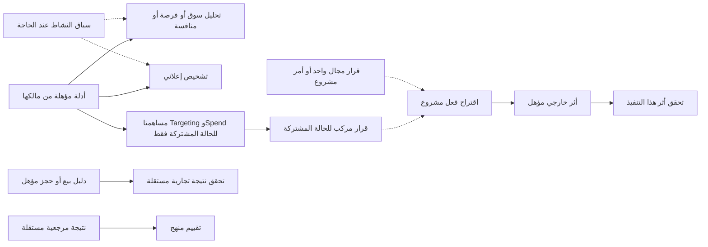

# BuilderAd — برنامج البناء التأسيسي المرن

`BA-STRUCTURAL-FOUNDATION-001 / Stage A v1.2 candidate / 2026-11-01`

**الهدف:** ترتيب بناء المسؤوليات المعروفة على أساس الملكية والتبعيات والتغطية والأدلة، دون جعل أول ميزة تجارية حاكمة للمعمارية أو بناء جميع الوظائف المستقبلية الآن.

**الحالة:** برنامج مرشح للمراجعة والاعتماد؛ ليس إثبات اكتمال القدرات أو تفويضًا مفتوحًا بتنفيذها. [التكليف المختار](OWNER_MANDATE.md) محفوظ منفصلًا عن إضافاته اللاحقة. المرحلة الحالية وثائق وفحص مصدر فقط؛ لم تبدأ Stage B.

## 1. الأساس والنطاق

خط الأساس المفحوص: `c747f6d8a8f2011fa5dcc368da2aa4e8449e0565`، في شجرة `ba-commercial-expertise-001`. تعديل AGENTS.md السابق محفوظ ولا يُنسب إلى هذا البرنامج.

D1 وD2 وD3 والواجهة العامة منجزة ضمن نطاقاتها المدمجة. لا يعاد بناؤها، ولا يساوي نجاحها اكتمال القرار أو التنفيذ الإعلاني أو التعلم. دليل Foundation التاريخي على هذا main: [41287174337](https://github.com/42Huss/builderad/actions/runs/41287174337). لم يُعد تشغيله في هذه المهمة، ولا يثبت تشغيلًا إنتاجيًا أو صلاحية تجارية أو معرفة فعلية بالسوق.

المرجع الملزم للمعاني: [Core governance](../../BUILDERAD_CORE_EXECUTION_GOVERNANCE.md)، [نموذج التحكم](../../BUILDERAD_PROJECT_CONTROL_MODEL.md)، [الثوابت وحدود الحماية](../../BUILDERAD_EXECUTABLE_ARCHITECTURE.md). يعاد استعمال حالات وإثباتات وقبول نموذج التحكم، ولا تنشأ سلطة حوكمة أو حقيقة موازية.

الاتجاه التاريخي المقبول Targeting + Spend محفوظ في [اشتقاق المسار](../../BUILDERAD_CURRENT_CRITICAL_PATH_DERIVATION.md) و[التصميم الدلالي](../../superpowers/specs/2026-10-06-joint-targeting-spend-semantic-design.md). لا يحوله هذا البرنامج إلى شرط لكل قدرة سوقية أو تجارية، ولا يستبدله تلقائيًا بتشخيص Meta أو صفحة توصيات. اختلاف نطاق تجاري جديد يُحل عند مالكه؛ لا يُحشر في Targeting أو Spend.

## 2. شرط المرونة واختيار التقنية — توجيه المالك 2026-11-01

**التقنية الأفضل هي التي تخدم المسؤولية الفعلية ومعناها وقيودها المثبتة بأفضل توازن قابل للتفسير؛ المرونة تعني إمكان الإضافة والتعديل والاستبدال بأثر محدد، ولا تعني تنفيذ كل احتمال مقدمًا.**

- لا تصبح PHP أو Python أو نموذج AI أو SQL أو خدمة مستقلة أو مزود بعينه شرطًا عقائديًا. يُفضل الموجود عندما يفي بالمتطلبات، ويجوز اقتراح بديل عندما تثبت فائدته وتكلفة دمجه وتشغيله.
- يُقارن البديل عند الحاجة بحسب صحة الدلالة، الأمن والحقوق، الاعتمادية، الأداء والحجم المتوقعين، التكلفة الكلية، قابلية الاختبار والصيانة، ومهارات التشغيل. لا تُخترع أوزان أو معايير أداء عامة دون حمل معروف.
- لا تستبدل بنية سليمة لمجرد الحداثة، ولا تُبقى بنية ثبت عجزها لمجرد أنها قائمة. تغيير عقد أو سلطة محمية يستلزم القرار المختص؛ التفاصيل التنفيذية العادية تُحسم داخل الحزمة.
- المعرفة وهوياتها وإصداراتها واعتمادياتها وحقوقها داخل حدود BuilderAd؛ تبقى بروتوكولات المزود وصيغه واعتماداته خلف محول يخصه حيث توجد حاجة فعلية. لا يفرض كود المزود اعتمادًا داخل Core مخالفًا لـ INV-001.
- فصل الأداة لا يلغي ترخيص البيانات ولا يضمن استمرار جمعها. تبقى المعرفة المحتفظ بها قابلة للاستعمال فقط ضمن حقوقها وصلاحيتها؛ تُحجب الاستنتاجات المعتمدة على أدلة مفقودة أو مسحوبة دون إسقاط الوظائف المستقلة.
- لا يُعد هدف المعلن أو Campaign أو حساب إعلاني شرطًا عامًا لكل تحليل. تُطلب هذه المدخلات عندما يعتمد معنى الحكم عليها.
- الغاية المعلنة قابلة للتغيير عبر مالك Current Intent وعقده الحالي، مع حفظ النسخة والتاريخ. تغيرها يعيد تقييم المشتقات التي اعتمدت عليها فقط؛ لا يعيد كتابة الأدلة الأصلية أو النتائج التاريخية، ولا يجعل كل معرفة قديمة باطلة. هذه قاعدة تصميم للحزم القادمة وليست ادعاء بوجود محرك إعادة تقييم عام.
- البرنامج ليس قائمة مغلقة لوظائف المنتج: يجيز قرار المالك تغيير الاتجاه التجاري أو إضافة قدرة أو نوع نتيجة أو معرفة؛ يسجل الأثر على المالك والدلالة والحقوق والتبعيات والاختبارات، ويغير الجزء المتأثر فقط. تغيير معنى حاكم يحتاج قراره المختص، ولا تعيد التفاصيل الاعتيادية فتح المعمارية.
- لا تنشأ واجهات عامة أو جداول أو خدمات فارغة لمستقبل محتمل. تُثبت الحاجة بتباين حالات معروف، ثم ينفذ أصغر حد دلالي مستقر يخدمها.

**إثبات الشرط داخل كل حزمة:** يضاف في سجلها سبب التقنية، البديل المؤثر إن وجد، الحدود المملوكة، أثر التغيير والاستبدال، واختبارات الحالات التي يختلف فيها المصدر أو المنصة أو القطاع. للحزم المحلية التي لا تتخذ قرارًا تقنيًا جديدًا تكفي عبارة موثقة «الآلية الحالية كافية» مع السبب، دون دراسة مقارنة شكلية.

## 3. التغطية في الاتجاهين

[خريطة التغطية](CAPABILITY_COVERAGE.csv) تحفظ **87 صفًا وظيفيًا** مستخرجًا من جداول Blueprint §3.1–3.8، عبر **8 أقسام تنقل**، مع موضع المصدر وأعمدته الأصلية وبصمته. هذه ليست 87 خدمة معتمدة أو 87 قدرة تشغيلية مثبتة. تقييم الكود في الصفوف على مستوى الأسرة الوظيفية فقط؛ لم يُتحقق تشغيليًا من كل صف.

مرجع Blueprint الخارجي: `C:/dev/builderad sections/09_PRODUCT_BLUEPRINT/BuilderAd_Competitive_Product_Blueprint_Decisive_AR_v1.1_2026-10-26.md`؛ ومرجع الخبرة المختار في مجلده `COMMERCIAL_ADVERTISING_EXPERTISE`. هذه مراجع اتجاه وتصميم، وليست تفويضًا بتنفيذ كل المقترحات. العدد «13 قسمًا» في المرفق الإضافي غير مثبت هنا، فلا يستخدم لتقرير اكتمال الجرد.

| الأسرة المعروفة | الاحتياجات المؤثرة في الأساسات | حدود الاستنتاج | الحزم المرتبطة |
|---|---|---|---|
| النشاط والغاية والسوق والقطاع | تصريحات مؤهلة، ملكية، زمن، قيود وسياق عند الحاجة | البلد المعلن ليس تغطية خدمة؛ الغاية ليست نتيجة متحققة | F02، D01، O01 |
| الطلب والعملاء والوصول والمنافسة | هوية موضوع وعرض، إشارات قابلة للمقارنة، جغرافيا وقنوات وحقوق | الاهتمام ليس شراءً؛ الجغرافيا ليست وصولًا؛ السعر ليس تفوقًا | F03، E01، X01، D02 |
| الإعلانات والإبداع وكفاءة الإنفاق | معرفة المنصات الخمس، القياس، الموارد، بدائل القرار، سلطة أثر مستقلة | نموذج محلي لا يثبت مزادًا أو ربحية أو قدرة API | X01، D02، D03، D04، A01، A02، R01 |
| القياس والحماية والمبيعات والرحلة والاحتفاظ | أحداث مؤهلة، تعريفات تجارية، إزالة تكرار، أصل ووقت وتغطية | Purchase لا يساوي دفعًا أو ربحًا؛ الربط والإسناد لا يثبتان السببية | F03، O01، V01، V02، L01 |
| العمليات والإدارة والوكالات والتكلفة والاستحقاقات | هوية وسلطة واستهلاك وتكلفة وإجراءات مفهومة | ظهور زر لا يمنح حقًا؛ وجود Commercial لا يثبت فوترة شاملة | F01، C01، U01، R02 |

كل صف من المصدر المحدد له ارتباط تخطيطي أولي. عمود construction_groups هو ارتباط بالمسؤوليات وليس قائمة أسلاف إلزامية، ولا يثبت وحده أن الحزمة مطلوبة لهذه الوظيفة. عند بوابة جاهزية الحزمة تُفصل الصفوف المؤثرة إلى احتياج لازم/مشروط/غير منطبق مع المالك والحقوق والاختبار. لا توصف تغطية بقية الصفوف بأنها محللة فرديًا. العلاقة متعدد إلى متعدد: لا تُكرر الأدلة أو الإحصاء عندما تتطابق الدلالة، ولا تُدمج معان مختلفة لمجرد تشابه الأرقام. المصادر المقترحة فئات اختيارية، لا قرارات شراء أو تكامل.

**حد الاكتمال:** التغطية الحالية كاملة بالنسبة إلى صفوف الجداول المحددة، وليست ادعاء مطابقة كل عبارة في جميع دراسات الأرشيف. أي متطلب معتمد إضافي يكشف لاحقًا يُربط أو يسجل كفجوة قبل قبول الحزمة المتأثرة، دون إعادة بدء البرنامج كله.

**أُنجزت المطابقة التأسيسية المحدودة في §12:** Core وملحق السوق والمزودين، وقرارات مرجع الخبرة CAEI-01–19 وحالاته T01–30، ومتطلب المنصات الخمس، وصفوف Blueprint المحددة. هذه مطابقة مسؤوليات/قيود لا دراسة كل وظائف الأرشيف أو إثبات تنفيذها. قبل برمجة قدرة: تعمق المناهج والآليات الخاصة بها وفق Blueprint §11.1، مستفيدًا من الدراسات الموجودة دون تكرارها.

## 4. الملكية والموجود والفجوات

| المسؤولية | الموجود المفحوص | ما لا يثبت وجوده |
|---|---|---|
| F01 الهوية والسلطة والعزل | Session/Grant/Staff/Service authority وBusinessScope وعقود SQL | إتمام جميع أفعال المستقبل أو نشر إنتاجي |
| F02 الحقائق والتصريحات | Business وCurrent Intent وDTM وObject Purpose بتاريخ وحقوق | قدرة تشغيل أو مبيعات مستنتجة من التصريحات |
| F03 الأدلة والمعرفة | D1 أصل وحقوق وتصحيح؛ D2 ثلاث طرق محددة؛ D3 معرفة ونشر ومستهلكان محدودان | محرك معرفة أو تحليل شامل أو نظام قرار |
| D01 سياق المستهلك | Business مستقل؛ سياق معالجة مؤهل؛ عقود أقدم تستخدم سياق Workspace | عقد وصل مكتمل لكل مجال قرار مستقبلي |
| X01 الخبرة المتخصصة | MarketMethodSelector وMarketProcessingTask وFindings وTrustedCompletion ضمن D2 | واجهة عامة لكل العلوم أو المنصات؛ لا يلزم تعميمها الآن |
| D02/D03 القرار المتخصص | اتجاه N06 Targeting وN07 Spend مقبول دلاليًا | تنفيذ جوهري لهذين المجالين مثبت ضمن نطاق الفحص الحالي |
| D04 التركيب | ملكية N08 واتجاه تركيب مساهمات المجالات | مخطط قرار مركزي شامل أو سلطة تنفيذ |
| A01/A02 الفعل | حدود السلطة وقنوات قراءة أصلية مؤهلة وأعمال تجارية محددة | محرك تعديل حملات عام أو معالجة أثر خارجي مجهول شاملة |
| O01/V01/V02 النتائج والتحقق | Current Intent يمثل المعنى المرغوب؛ سجلات ملاحظات وصلاحية وتصحيح | وقوع نتيجة تجارية أو تحقق أثر تدخل أو سببية تلقائية |
| L01 التعلم | إصدار الأدلة والمناهج والتاريخ كمدخلات | دورة ترقية معرفة سببية أو تعلم ذاتي تشغيلي |
| U01 الواجهات | Business والواجهة العامة والصيانة وعمليات معرفة داخلية محددة | اكتمال رحلة معلن لكل قدرة في الجرد |
| C01/R01/R02 التشغيل والإصدار | Commercial وحدود تكلفة/حقوق، قراءة مزودي الإعلان الخمسة وCI | اشتراكات وفوترة شاملة، صلاحية كل مزود حي، أو جاهزية إنتاج |
| G01 الوكيل | يمكنه مستقبلًا استهلاك القدرات المقيدة | وكيل يملك الحقيقة أو يمنح نفسه صلاحية |

السجل أعلاه تقييم حدود وليس تغييرًا لحالات السجلات الأصلية. اكتمال الأب في نطاقه لا يغلق أبناء المستقبل ولا يعاد فتحه تلقائيًا بسببهم. لا تُنشأ وحدة برمجية لكل رمز في هذا البرنامج.

## 5. مصفوفة حماية الأساسات

الأسماء أدناه ملفات موجودة مفحوصة؛ لم تُشغّل اختبارات جديدة ضمن Stage A. PASS السابق يبقى في نطاقه ونسخته، والاختبار المخطط ليس حماية منفذة.

| الثابت | الحماية الموجودة | حدود الإثبات والفجوة | الحزمة التي توسعها عند التنفيذ |
|---|---|---|---|
| INV-001 استقلال Core عن المزود | `tests/Unit/CoreDependencyBoundaryTest.php` | أسماء PHP المباشرة في 5 مجلدات، 3 استثناءات؛ لا إثبات عام للديناميكي وSQL والمتصفح | X01، R01 |
| INV-002 صفر اتصالات حالة صالحة | `tests/Feature/ArchitectureSourceOptionalityTest.php` | أسطح HTTP وتصريحات محددة؛ لا يجيز حكمًا يحتاج دليلًا مفقودًا | D01، D02، D03 |
| INV-003 عزل فشل المصدر | `tests/Feature/Providers/ProviderAccessStoreTest.php` | لا يغطي كل مستهلك قرار مستقبلي أو عطل البنية المشتركة | R01، D04 |
| INV-004 ملكية الحقيقة | `tests/Feature/BusinessFoundationTest.php` و`tests/Feature/MarketEvidenceOriginTest.php` | الحقائق والتصريحات والأدلة ضمن حدودها؛ لا ملكية نتائج تجارية غير مصممة | D01، O01 |
| INV-005 صدق حالات المعرفة | `tests/Feature/MarketKnowledgeConsumersTest.php` | مستهلكان محدودان، لا تحقق سببي | D02، V01، V02 |
| INV-006 حياد التصريحات | `tests/Feature/ArchitectureSourceOptionalityTest.php` | لا تحويل التصريح إلى حقيقة مصدرية أو اشتراط مزود | D01 |
| INV-007 فصل القرار والتنفيذ | `tests/Feature/Security/ServiceAuthorityTest.php`؛ القاعدة الحالية جزئية | اختبار السلطة ليس إثبات دورة قرار/فعل مستقبلية | D04، A01، A02 |
| لا تثبيت نتيجة مصنوعة من صلاحية قراءة فقط | `tests/Feature/MarketProcessingCompletionSecurityTest.php` و`tests/Feature/MarketKnowledgeCompletionSecurityTest.php` | إقرار تنفيذ منفصل وبصمة ومعاملة وإعادة عرض؛ ليست حماية من اختراق المنفذ الموثوق | X01، D04 |
| حقوق مستقلة للأصل المشترك وعزل الخاص | `tests/Feature/MarketKnowledgeAuthorityTest.php` و`tests/Feature/MarketBusinessFindingTest.php` | منح/سحب وقراءة ذات نطاق؛ لا يعمم الترخيص من الإتاحة العامة | F03، C01 |
| إعادة التأهيل بعد الانتظار والتصحيح | `tests/Feature/MarketKnowledgeConcurrencyTest.php` | حالات التزامن الموجودة؛ يثبت الانتظار الحقيقي لا مجرد timeout | D01، A02 |
| إسقاط واجهة مفهوم بلا تسريب | `tests/Feature/MarketKnowledgeOperationsIntegrationTest.php` و`tests/market-knowledge-operations.test.mjs` | لا يكفي Backend لإتمام أسطح مستخدم جديدة | U01 |
| ترقية آمنة وسلامة الأثر | `tests/Feature/BusinessQualifiedImportTest.php` | استيراد مؤهل بعينه؛ ترحيلات الحزم الجديدة تتطلب إثباتًا مناسبًا | الحزمة المعدلة للمخطط |

لا تُعدل حالات INV الحالية لإظهار اكتمال نظري. تُوسع الحماية عندما تنفذ دلالة جديدة مقبولة.

## 6. برنامج الحزم وسجل القبول

هذه معرفات تخطيط محلية، وليست Nodes جديدة أو ترتيبًا تسلسليًا إلزاميًا. F01–F03 إعادة استعمال للأساسات، والبقية حزم مرشحة تحتاج تعريف الدلالة المحدودة قبل كودها. الحد الأدنى لسجل كل حزمة: المالك، السؤال والمخرج المسموح، baseline، حالة التصميم/التنفيذ، revision الفعلي، أدلة الاختبارات ونطاقها، مراجعة مستقلة، قبول المالك، دليل landing، المستثنى، والخلفاء المؤهلون. **كل حزمة جديدة هنا: لا revision تنفيذي ولا قبول ولا landing؛ اختباراتها أدناه شروط مستقبلية.**

| المعرف | المسؤولية/المخرج | التبعية الفعلية أو الشرط | قبول السلوك الذي سيختبر |
|---|---|---|---|
| F01 | إعادة استعمال السلطة والعزل | نطاق الأثر والمورد الفعلي | لا انتحال أو منح ذاتي؛ يحفظ المسار القائم |
| F02 | إعادة استعمال تصريحات النشاط والمعنى | مالك التصريح وسلطته عند الحاجة | لا افتراض هدف/حساب لكل سؤال |
| F03 | إعادة استعمال D1–D3 | الدليل والغرض والحق والزمن | تصحيح وسحب مستقلان؛ لا معرفة مشتركة خاصة بنشاط |
| E01 | تأهيل مدخلات سؤال القرار وشاهد صلاحيتها | فقط الأدلة التي يحتاجها الحكم المختار | يميز المصدر والمجهول والتعارض وما يجوز استنتاجه |
| D01 | تسليم سياق مؤهل إلى مستهلك مجال | F01/F02، سؤال مستهلك واضح | Business مستقل، نسخة وحقوق، رفض سياق أجنبي أو متقادم |
| X01 | منهج متخصص عند الحاجة | F03 أو مدخل مؤهل بدلالته | اختيار وإصدار وامتناع؛ استبدال الأداة لا يمنح حقوقًا |
| D02 | Targeting substantive contribution | سياق/أدلة السؤال من مالكها القائم؛ E01/D01 أسماء مسؤوليات لا خدمات واجبة؛ X01 إن لزم | مساهمة موجهة غير تكرار تصريحات أو مقياس حملة |
| D03 | Spend substantive contribution | مقدمات استخدام الموارد؛ سياق مؤهل من مالكه القائم عندما يعتمد الحكم عليه، دون افتراض مكوّن D01 مستقل؛ E01/X01 عند الحاجة | الإنفاق ليس تلقائيًا توزيع ميزانية أو ROI؛ لا قيود مصطنعة |
| D04 | تركيب مساهمات مجالات محددة | مساهمات D02/D03 للحالة المشتركة؛ سلطة كل مجال | تفسير التعارض والامتناع؛ لا تعديل أو أولوية خفية |
| A01 | إعداد اقتراح إجراء وتأهيله؛ الموافقة سلطة مستقلة عن سلطة اقتراحه ولو ضمن حزمة واحدة | قرار أو أمر مشروع محدد؛ المورد وسلطة الأثر | التوصية لا تنفذ نفسها؛ إعادة فحص السلطة عند الأثر |
| A02 | تنفيذ أثر خارجي محدد والتعافي من المجهول | A01 + قدرة مزود وبيئة مؤهلتان لهذا الأثر | إعادة المحاولة لا تضاعف الأثر؛ المجهول ليس نجاحًا ولا فشلًا مصطنعًا |
| O01 | قبول وقوع نتيجة تجارية محددة | تعريفها ومالكها ودليلها | شراء مسجل ليس دفعًا أو ربحًا تلقائيًا؛ لا مصدر حقيقة مكرر |
| V01 | تحقق واقعة أو نتيجة/أثر محدد | أدلة الادعاء من مالكها؛ A02 فقط لأثر تنفيذه؛ O01 فقط للنتيجة التجارية | تنفيذ الأمر لا يثبت نجاح الهدف؛ يميز الملاحظة والأثر |
| V02 | منهج قياس/تجربة/اقتصاديات عند الحاجة | فروض المنهج وأدلته؛ ليس شرطًا لكل عملية حسابية | لا سببية من الإسناد أو الارتباط؛ عدم كفاية العينة واضح |
| L01 | تقييم منهج وترقيته أو سحبه | نتائج وتقييمات مؤهلة مرتبطة بالإصدار | لا تعميم غير مشروع؛ مراجعة وإمكان الرجوع وحفظ التاريخ |
| U01 | سطح المستخدم المناسب للحزمة | قدرة فعلية وسلطة واستحقاق | عربية وRTL ورسائل بسيطة وحالات نقص/رفض/قدم؛ دليل متصفح مستقل |
| C01 | الاستحقاق والاستهلاك والتكلفة | خدمة وخطة وأهلية معتمدة إذا انطبقت | لا تجاوز حقوق أو اشتراكات ولا اختراع فوترة قبل تحديدها |
| R01 | تأهيل المزودين الخمسة للإصدار | قدرة كل مزود وحقوقه ونسخته والبيئة المعنية | اختبار كل مزود في نطاقه؛ غياب واحد لا يعطل الوظائف المستقلة |
| R02 | قبول الإصدار والتشغيل | الحزم الداخلة فعليًا في الإصدار وأسطحها ومهاجراتها | Foundation والعمليات والاستعادة والأمن وفق الادعاء؛ لا نشر تلقائي |
| G01 | وكيل مستهلك لقدرات موثوقة | الأدوات الفعلية وحدودها وميزانية/سلطة | لا امتياز إضافي للوكيل أو تعليمات النموذج؛ مؤجل ما لم يدخل النطاق |

قبل بدء حزمة برمجية يثبت ملف تقدمها مسارات التعديل والعقود والاستهلاك والاختبارات المحددة. لا يكتب هذا البرنامج أسماء أصناف فارغة لجميع الحزم البعيدة. لا يتطلب كل منهج أداة جديدة أو كل قدرة شاشة مستقلة؛ internal-only يحتاج سببًا.

## 7. التبعيات حسب المستهلك، لا عمود فقري إلزامي

**تصحيح المراجعة:** الرسم السابق خطّي أكثر مما ينبغي. الحواف الآتية تصف شروطًا محلية لا ترتيب حزم عالميًا. لا يوجد مسار إجباري يمر بـ Targeting ثم Spend ثم التركيب ثم التنفيذ الخارجي لجميع القدرات، ولا تُستعمل علاقات CSV لتوليد مثل هذا المسار.

| المصدر → المستهلك | نطاق الشرط وسببه | ما لا يعنيه |
|---|---|---|
| F01 → استعمال محمي | أي قراءة/كتابة تحتاج سلطة مورد صحيحة | لا اشتراط غاية أو تركيب قرار |
| F02/D01 → حكم يعتمد على تصريح نشاط | فقط إذا احتاج السؤال السياق، وعندها تراعى نسخة التصريح وحقوقه | التحليل السوقي العام لا يحتاج نشاطًا وهميًا |
| F03 → E01 | فقط عندما يستعمل الحكم أصلًا سوقيًا أو مخرجًا داخل D1–D3 | Shared Reality أو دليل مبيعات مشروع لا يمر إلزاميًا بـ D1–D3 |
| E01 → D02 أو D03 | الأدلة المحددة اللازمة لاستنتاج المجال نفسه؛ من مالكها القائم | لا إنشاء خدمة تأهيل ثانية ولا حافة Targeting → Spend |
| D02 + D03 → D04 | الادعاء المشترك التاريخي الذي يعد بقرار يجمع المساهمتين تحديدًا | التركيب العام قد يجمع مجالات أخرى؛ الفعل المحدود لا يحتاج مجالين |
| D04 → A01 | فقط اقتراح الأثر المنبثق من ذلك القرار المركب | أمر مشروع أو قرار مجال واحد يستعمل مالكه وسلطته مباشرة |
| A01 → A02 | تنفيذ الأثر الخارجي المحدد يحتاج تأهيله وسلطة الأثر | القراءة أو التشخيص لا يحتاجان سلطة تغيير حساب |
| A02 → V01 | إذا كان الادعاء تحقق أثر ذلك التنفيذ | التحقق من مبيعات أو جودة قياس مستقل لا يحتاج إجراء إعلاني سابقًا |
| O01 → V01 | عند التحقق من وقوع نتيجة تجارية وفق تعريفها وأدلتها | لا يلزم الهدف المعلن لكل حقيقة بيع؛ الغاية مطلوبة لقياس تحقيقها |
| V01/V02 → L01 | إذا بني تقييم المنهج على تحقق/تجربة بعينها | يمكن تقييم منهج بمرجع مستقل مؤهل دون تنفيذ حملة |
| X01/C01/U01/R01/R02 | المنهج/الاستحقاق/السطح/المزود/الإصدار حسب النطاق الفعلي | ليست جميعها متطلبات لكل وظيفة أو شروط تطوير محلي |

الفروع الثلاثة الأولى وملاحظة النتائج وتقييم المناهج مسارات مستقلة حيث تستوفي أدلتها وسلطتها. الرسم للتوضيح؛ وصف كل حافة في الجدول هو الذي يحدد انطباقها. لا يشترط تركيب قرار أو أثر خارجي ليكون التحليل مكتملًا في نطاقه. التعلم الذي يؤثر في قرار لاحق يخص إصدارًا وزمنًا لاحقين، وليس حلقة اعتماد تنفيذية مغلقة.

### 7.1 حكم إعادة الاستخدام والفجوة الأولى

| المجموعة | القرار الحالي ودليله | أثره على العمل التالي |
|---|---|---|
| F01/F02/F03 | REUSE: مالكو السلطة والتصريحات وD1–D3 موجودون | لا إعادة تأسيسهم ولا نقل دلالاتهم |
| E01 | REUSE للتأهيل الموجود؛ REJECT إنشاء طبقة عامة بلا مستهلك: `database/sql/market_processing/capture.sql::processing_authorize` يستعمل material_use_plan وrequire_material_use ويقرأ الحقول المرخصة ويعيد التأهيل. Shared Reality مسار آخر للأدلة الإعلانية | لا عيب مثبت في هذا التأهيل لمجرد غياب مستهلك Targeting |
| D01 | REUSE للمدخل الحالي في D2: `MarketProcessingTask` يحمل businessContext اختياريًا؛ capture.sql يأخذ context_version وdeclared_markets عند منح business.context.read. `BusinessScope::read` وintent/purposes يملكون المسارات الأخرى | EXTEND فقط بعد تحديد حاجة مستهلك لا يغطيها الإسقاط القائم؛ الغاية ليست مفقودة عمومًا لأنها ليست في إسقاط D2 المحدود |
| X01 | REUSE طرق D2 المحدودة؛ DEFER تعميمها؛ EXTEND/ADD فقط لمنهج مسمى ذي مدخلات وفروض واختبارات | لا سجل إضافات أو واجهة عامة مفترضة |
| D02/D03/D04 | DEFER التنفيذ غير المحدد؛ المعاني المقبولة باقية | يلزم أول سؤال جوهري ومدخله وعقده قبل READY |
| A01/A02 | REUSE السلطة؛ DEFER أثر جديد حتى تحديد الأمر/المنصة/التعافي | التركيب ليس شرطًا لكل أمر |
| O01/V01/V02/L01 | REUSE الأصل والتاريخ؛ DEFER عقد النتيجة أو القياس/التعلم الجديد حتى تعريف الادعاء | لا إطار Outcome أو تعلم عام ولا A02 شرطًا مستقلًا |
| U01/C01 | REUSE الواجهة والسلطة والاستحقاقات القائمة؛ EXTEND فقط للقدرة المسماة | حدود المستخدم والتكلفة لا تستنتج من اسم الحزمة |
| R01/R02 | REUSE التشغيل والبوابات؛ EXTEND دليل جاهزية الادعاء/البيئة المحددين | لا اعتبار ملفات المزود تشغيلًا حيًا |
| G01 | DEFER | ليس شرطًا لسائر البرنامج |

هذه أحكام قرار مبدئية موثقة وليست حالات جديدة تضاف إلى نموذج التحكم.

**تصحيح اختيار التالي:** سُحب ادعاء أن E01 + D01 هما أول مكونين واجبين للبناء، وأن D02 جاهزة تلقائيًا بعدهما. الفحص يثبت حدود التأهيل الموجودة، ولا يثبت حاجة إلى مكوّن جديد أو عقد Targeting مكتمل. نقص المستهلك ليس خللًا في مدخلاته. يُحفظ الاتجاه المشترك المقبول دون تحويله إلى شرط لكل فروع BuilderAd.

**العمل الخاص بالمسار المشترك إذا فُوض استكماله:** إغلاق عقد أول مستهلك في نطاق الاتجاه المقبول أو توثيق مانعه المحدد. لا يعد شرطًا لقبول برنامج البناء كله؛ أهلية الفروع الأخرى في §13. يراجع `docs/superpowers/specs/2026-10-06-joint-targeting-spend-semantic-design.md` §§17/21/22 مقابل الأدلة المتاحة في `app/Providers/Ads/SharedRealityInterpretation.php` و`app/Providers/Ads/ObservationJournal.php`، وقراءات D1–D3 عند صلة فعلية بالسؤال. التصميم التاريخي يصرح أن شاهد Targeting المقبول غير مثبت؛ لا يعلن هذا التعديل وجوده أو يعوضه بمثال اصطناعي لإغلاق ادعاء واقعي. البيانات الاصطناعية صالحة لاختبار العقود والفشل، ولا تثبت استنتاجًا سوقيًا حقيقيًا.

مخرج هذا العمل إما (أ) عقد مستهلك مسمى، مدخلاته الدقيقة والمالك وREUSE/EXTEND/ADD والملفات واختبار سلوك يفشل بسبب النقص المحدد، أو (ب) مانع دليل/دلالة مع موضعه وأصغر حسم مطلوب. **لم ينجز (أ) بعد؛ لا توجد أول حزمة منتج READY ولا تعديل تطبيق مسمى متحقق الضرورة في هذه المراجعة.** لا يخفى هذا النقص بوعد تنفيذ خدمة عامة. اختبارات `MarketProcessingTest::test_business_feasibility_requires_its_own_context_right_and_rejects_changed_context` و`MarketProcessingCompletionSecurityTest` تحمي المدخل الحالي؛ ليست اختبار قبول Targeting جديد.

### 7.2 اختيار الحزمة التالية دون دورة تخطيط جديدة

1. ترشح الحزم داخل التفويض والاتجاه المقبولين فقط؛ فلا تمحو أولوية المالك السابقة ولا توسع Stage B تلقائيًا.
2. تقيم تبعيات السؤال الفعلية، مع بيان اللازم/المشروط/غير المنطبق وسبب كل حافة؛ لا تحويل علاقات الأسرة أو كثرة المستهلكين إلى تبعيات.
3. يستبعد من جاهزية البرمجة ما ينقصه مالك أو عقد سلوكي أو ملفات واختبار قبول، وتسجل الفجوة بدقة بدل إنشاء بنية مسبقة.
4. من الحزم المؤهلة تختار الأولوية المعتمدة، ثم سلامة العقود وعدم التصادم مع عمل جار وسعة التفويض؛ الفرع المستقل يمكن تنفيذه بالتوازي إن كان مأذونًا.
5. إذا لم تتأهل حزمة، يحل أصغر مانع محدد داخل التفويض. إذا تطلب الحسم تغييرًا محميًا أو اتجاهًا جديدًا يعرض القرار المحدد فقط؛ لا تعاد دراسة المعمارية. عند تعادل مؤثر لم يحسمه تفويض سابق لا تُخترع أولوية.
6. بعد قبول حزمة يربط سجلها النسخة الفعلية والاختبار والمراجعة والقبول وlanding، ثم يعاد اشتقاق المؤهل من الحواف المنطبقة؛ نجاح حزمة لا يمنح تفويض نشر أو دمج.

### 7.3 المسارات الخمسة داخل R01

المشترك هو عقد المصدر والحقوق والتشغيل؛ لكل مزود مسار أدلة مستقل، لا خمسة أنظمة حقيقة. الملفات أدناه موجودة؛ فحص وجودها ليس إعادة تنفيذ اختبارات أو اعتماد إطلاق حي.

| المزود | مصدر قائم لفحص القراءة | مرجع اختبار قائم | دليل جاهزية الإطلاق الذي يبقى مطلوبًا |
|---|---|---|---|
| Meta | `app/Providers/Ads/Meta/MetaReadExecution.php` | `tests/Unit/MetaObservationAdapterTest.php` | نسخة API والصلاحيات وحساب/طلب أصلي مؤهل وخصوصية وحدود القراءة/الأثر المحدد |
| Google | `app/Providers/Ads/Google/GoogleReadExecution.php` | `tests/Unit/GoogleObservationAdapterTest.php` | تحقق صلاحيات الحساب/المطور ونسخة API وتغطية المورد والقياس في بيئة معلومة |
| Snapchat | `app/Providers/Ads/Snapchat/SnapchatReadExecution.php` | `tests/Unit/SnapchatObservationAdapterTest.php` | أذونات المورد وتقارير async/التنزيل والقيود والطلب الأصلي في بيئة معلومة |
| TikTok | `app/Providers/Ads/TikTok/TikTokReadExecution.php` | `tests/Unit/TikTokAdapterTest.php` | تأهيل التطبيق والحساب وأذونات التقرير وقيوده ودليل القراءة الأصلي |
| X | `app/Providers/Ads/X/XReadExecution.php` | `tests/Unit/XCampaignReportTest.php` | أهلية API والأذونات ونافذة التقرير والقيود ودليل أصلي للقدرة المدعاة |

لكل صف تحفظ مستقلة نسخة المصدر/القدرة والبيئة، implemented/tested/live-evidence/Owner acceptance، والفجوة والمانع وسطح المستخدم. الدليل الحي وقبول الإطلاق **غير مثبتين بهذا الفحص** لكل الخمسة؛ الاختبارات القائمة لا تعني ادعاء غيابهما خارج هذا النطاق. يمكن تقدم صف مستقل دون انتظار آخر؛ إصدار يعد بدعم الخمسة يحتاج تأهيل الخمسة وفق وعده. لا يفرض هذا شراء بيانات أو تنفيذ تكامل الآن.

## 8. مصفوفة إثبات المرونة قبل قبول الحزمة المعنية

| الحالة | معيار القبول | وضع الإثبات الآن |
|---|---|---|
| مزود غائب مع وظيفة مستقلة | تستمر التصريحات والأسطح القائمة | حماية موجودة محدودة في ArchitectureSourceOptionalityTest |
| أداة التحليل الاختيارية تتعطل | البديل المؤهل فقط؛ لا نتيجة مزورة | D2 محدود؛ لا يعمم على كل مناهج المستقبل |
| دليل مشترك مع نشاطين وسحب حق أحدهما | الآخر مستقل؛ إغلاق العلاقة لا يحتاج استعادة حق البيانات | اختبارات D1/D3 في نطاقها |
| تصحيح دليل أو انتهاء حق أثناء الانتظار | إعادة تأهيل بلا أثر جزئي أو إعادة نتيجة غير مشروعة | اختبارات D3 في نطاقها |
| Meta مقابل Google وسؤال سوق بلا Campaign | اختلاف المنصة لا يغير ملكية الحقيقة؛ السؤال السوقي لا يفرض حسابًا | اختبار معماري مطلوب في X01/D02/D03؛ غير منفذ هنا |
| قطاعان بأسواق وقيود مختلفة | سياسة القطاع قابلة للتغيير دون تعديل سلطة النواة | اختبار مطلوب عند المنهج المتأثر؛ ليس PASS |
| معرفان متشابهان من مصدرين | لا هوية عالمية مفترضة ولا تضخيم استقلال الأدلة | D2 يمنع مقارنة مصدرية غير مؤهلة؛ الجمع المستقبلي يحتاج اختباره |
| لا هدف معلن أو بيانات كافية | تعمل الأسئلة المستقلة؛ يمتنع الحكم الذي يحتاج المدخل | يوجد جزء في D1–D3؛ مستقبل القرار غير مثبت |
| غاية G1 تتغير إلى G2 | يحفظ الأصل وتاريخ نتيجة G1؛ يعاد تقييم مشتق يعتمد على G1 فقط؛ غياب غاية لا يعطل تحليلًا مستقلًا | شرط قبول مستقبلي عند المستهلك؛ لا محرك أثر عام مثبت |
| تحليل منافسة أو فرصة دون Targeting/Spend | يقرأ الدليل المؤهل من مالكه؛ لا ينشئ حسابًا أو قرار إنفاق وهميًا | مساران محدودان في D3؛ لا إثبات شامل لكل تحليل |
| تحقق بيع دون أي تنفيذ إعلاني | يؤهل تعريف البيع ومصدره وحقوقه؛ لا يطلب تشغيل A02 | مطلوب في O01/V01، غير منفذ هنا |
| أمر محدود من مالك مجال واحد | يستوفي سلطة المورد والأثر دون طلب نتيجة D04 مصطنعة | شرط قبول مستقبلي للأمر المحدد؛ لا ادعاء وجوده |
| أثر API مجهول بعد انقطاع | مصالحة/استعلام وفق ضمانات المنصة دون تكرار أعمى | مطلوب في A02؛ غير منفذ |
| Purchase ثم إلغاء أو رد | لا يحتسب نجاحًا أو ربحًا نهائيًا بغير تعريفه ودليله | مطلوب في O01/V01 |
| مستخدم على جوال بالعربية | يعرف النتيجة وحدودها والخطوة التالية دون تسريب | مطلوب لكل U01؛ لا يغني CI عن المتصفح |
| معرفة باقية بعد فصل المزود | استعمال مشروع فقط؛ التقادم والسحب منفصلان عن الفصل | D3 يوفر إثباتًا محدودًا؛ يوسع عند المستهلك الجديد |

## 9. حواجز الانتقال والتنفيذ

- Stage A: هذا البرنامج وخريطة التغطية ودليل فحصها؛ لا تعديل كود ولا ترحيل ولا تغيير سلطة. الاستثناءات والفجوات معلنة، لا توصف كل القدرات بأنها جاهزة للبرمجة.
- Stage B: بعد قبول البرنامج وحدود الحزم، تنفيذ الحزم المصرح بها حسب التبعيات دون إعادة طلب اعتماد أصل المعمارية في كل مرة. يُرفع فقط تعارض تأسيسي مثبت أو تغيير محمي يحتاج قرارًا.
- لكل حزمة: اختبار سلوكي أولًا ثم تنفيذ محدود، اختبارات متأثرة وأمن/تزامن/ترقية بحسب الأثر، surface record ودليل متصفح عند وجود مستخدم، ثم مراجعة وقبول وفق سجل التحكم القائم.
- Foundation المستضافة هي البوابة الشاملة المفضلة على النسخة المنشورة الفعلية عند تفويض النشر. لا إعادة محلية مكافئة تلقائيًا، ولا اعتبار اختبار مخطط أو دليل قديم نتيجة جديدة.
- لا commit أو push أو دمج أو نشر إنتاجي أو ترحيل حقيقي ضمن العمل الحالي. لا تعديلات على D1–D3 لمجرد تعميم نظري.

## 10. تحقق الوثائق وحدود النتيجة

تفاصيل فحص الجرد والروابط وحواف التبعية وحدود التعديل في [EVIDENCE.json](EVIDENCE.json). يثبت الفحص سلامة الوثائق المولدة ضمن حدودها، وليس صحة كل قدرة مستقبلية أو نجاح اختبارات التطبيق. المراجع التاريخية تبقى بتاريخها ونطاقها، والمصدر الجديد لا يحوّل اقتراح مزود أو خوارزمية إلى قرار معتمد.

## 11. نتيجة استقبال المراجعات — تصحيح محدود

استُخدمت إرشادات receiving-code-review للتحقق من الملاحظات مقابل المصدر. القبول المقترح في المرفقات ليس قبول المالك ولا نجاح اختبارات جديدة.

| الملاحظة | نتيجة هذه الدفعة |
|---|---|
| الغاية والتوسع ليسا ثابتين تقنيًا | ثُبتت قاعدة الأثر المحدود وحفظ التاريخ وقرار تغيير المعاني؛ اختبارات المستقبل صريحة وغير منفذة |
| حواف المسار المشترك قد تصبح عامة | صُححت إلى علاقات مشروطة بالمستهلك والادعاء، وأظهرت الفروع المستقلة |
| الجرد عائلي أكثر مما يلزم | فُصلت 10 وظائف إعلان مؤثرة؛ بقيت 77 صفًا بتقييم الأسرة المعلن وتحتاج تدقيقًا عند جاهزية حزمها |
| أول حزمة ليست جاهزة | ثبتت آليات REUSE؛ سُحب افتراض إنشاء E01/D01. **تبقى مواصفة أول مستهلك/شاهده OPEN**؛ لا تغيير إنتاجي مقترح دون دليل ضرورته |
| المصادر الخمسة مجمعة | فُصلت مراجع القراءة والتحقق والفجوات لكل منصة تحت R01 دون ادعاء قبول حي |
| كفاية المطابقة المرجعية التأسيسية | أُنجزت في نطاق §12 مع تسجيل المتطلبات التي كانت ضمنية؛ لا ادعاء بتحليل تفصيلي لكل الأرشيف أو صحة تشغيلية شاملة |

تصحيح الحكم السابق: عدم جاهزية أول مستهلك يمنع تنفيذ ذلك المستهلك، ولا يمنع وحده عرض البرنامج للقبول. بوابة G8 في التكليف تسمح بتحديد مانع القرار/الدليل عند عدم وجود حزمة مؤهلة، وتمنع اختراع تنفيذ. نتيجة البرنامج ونطاق التفويض المقترح موضحان في §13؛ لا انتقال تلقائيًا إلى Stage B.

## 12. مطابقة المتطلبات التأسيسية المحدودة — دون توسيع نطاق التنفيذ

**المعنى:** Covered هنا تعني أن الالتزام له مسؤولية/قيد/حزمة أو تأجيل معلل في البرنامج، لا أنه منفذ أو مختبر أو مقبول. المرجع Canonical أسبق من هذه المطابقة. لا يستخدم الجرد المختصر لتعريف حقيقة أو تصنيف جديد.

### 12.1 Core وامتداد السوق وملحق المزودين

المصدر المحلي هو `docs/BUILDERAD_CORE_EXECUTION_GOVERNANCE.md` بأجزائه الثلاثة. أرقام الأقسام أدناه خاصة بالجزء المذكور، ولا تخلط بين Core §4 وMarket §4.

| المصدر/النطاق | الالتزام التأسيسي الملحوظ | الموضع والمسؤولية | فرق المراجعة/الحد |
|---|---|---|---|
| Core §0–3، §19–22 | حفظ التفويض والتسلسل، Core قبل توسع التكامل | §§1/9؛ F01–F03 ثم الحزم المؤهلة | أوامر DTM المؤرخة تاريخية؛ لا تمنح تفويضًا جديدًا؛ لا ادعاء Core gate جاهز |
| Core §4 البنود1–4 | Context/Intent/Outcome Meaning/Shared Reality بملاك مفصولين | F01/F02/F03/D01/O01 | Outcome Meaning الموجود في Current Intent لا يوجب خدمة Outcome جديدة؛ وقوع النتيجة عقد آخر |
| Core §4 البنود5–6، §5 | Targeting وSpend الأوليان لاتجاه Core المقبول؛ Synthesis محدود | D02/D03/D04؛ §7 | لا حافة عامة بين المجالين ولا فرضهما على كل قدرة |
| Core §4 البنود7–8 | عقد فعل محدود ومستويات سلطة فعلية | A01/A02؛ فصل المقترح والموافقة في §6 | فرق أُبرز: OBSERVE/ADVISE/PREPARE لا تملك أثرًا؛ APPROVE_AND_EXECUTE وBOUNDED_AUTOMATION تحتاجان سلطة/سياسة صريحة عند تنفيذهما، وليس enum تجميليًا |
| Core §4 البنود9–11 وحدود gate | Observation/Verification/Learning وAdapters | V01/V02/L01/R01/R02 | تنفيذ أمر ليس تحقيق الغاية أو أثرًا سببيًا؛ gate ليس وثيقة أو mock ولا نضج جميع المستقبل |
| Core §6–10، §17–18 | مالك الحقيقة واحد؛ المزود محول لا مالك المعنى؛ complexity محلية | F01/F03/X01/R01 | لا اعتماد Core على نقل المزود؛ لا توسع تكامل قبل بابه الفعلي |
| Core §11 | SDK حل أخير بعد native APIs/webhooks/server integrations/الأدلة المناسبة | قيد R01/R02 عند اختيار قناة اكتساب | فرق أُضيف صراحة: لا SDK جديد كشرط تأسيسي، ولا تطوير جمع بديل لمجرد المرونة |
| Core §12–13 | تطور وتخصيص bounded مع canonical meaning ثابت | §2؛ X01/D01 والسياسة لدى مالكها | لا محرك لكل سوق/عميل ولا بنية تخصيص قبل تباين مثبت |
| Core §14–16 | منفعة مفهومة وتراكمية وتفسير بسيط للمعلن | U01/V01/L01؛ بوابة المنتج للحزمة المعنية | لا يحول معيار منفعة القدرة إلى استعجال أول ميزة أو معيار وحيد لاختيار الأساس |
| Market §0–4، §24–25، §27–30 | السوق امتداد لا Core موازٍ؛ لا يغير intent/DTM؛ التفويض مستقل | F02/F03/D02/D03/D04؛ §§1/9 | لا مزود أو تسجيل سوق يخلق هدفًا أو تصريح نشاط |
| Market §5–7، §10–11 | حالات معرفية ليست سلم نضج؛ provenance/حقوق؛ confidence مسند | F03/E01/X01/V01 | فرق أُبرز: لا confidence رقمي أو ترتيب مصادر/نضج عام؛ صحة المصدر نسبية للحقيقة، ولا إشارات كافية لإثبات مبيع |
| Market §8–9 | مصادر رسمية/طلب/إبداع/قنوات/زمن/اقتصاد قطاعي؛ تفكيك معنى القناة | F03/X01/R01/D02/D03 | فرق أُبرز: presence/accessibility/paid-targeting/intent-capture/economics معان مختلفة، ليست Audience واحدة أو score موحدًا؛ ليست كلها D1 types جاهزة |
| Market §12–15، §21–22 | اختلالات وفرص واختبارات ذات Decision Delta لا ontologies مبكرة | X01/D02/D03/D04/A01/V02 | لا ترميز أمثلة الطلب/المنافسة كقواعد عامة؛ market actionable قد ينتهي باختبار مقترح لا أثر خارجي إلزامي |
| Market §16–18 | قبل الاتصال وبعده منتج واحد؛ prior يصحح بالدليل؛ learned≠declared | F03/X01/V01/L01؛ §2 | لا فرض OAuth أو حماية فرضية سوق من دليل نشاط مناقض |
| Market §19–20 | السعودية/العقار/الرياض اتجاه إثبات سوقي مؤرخ، ليس معمارية دولة | فرع إثبات السوق عند تفويضه، لا متطلب كل حزمة | اتجاه قائم مسجل وليس اختيارًا جديدًا أو اشتراط نشاط حقيقي لبناء العقود |
| Market §23، §26 | تجربة معلن مفهومة وبوابة دليل/حقوق/قيمة قبل قدرة سوقية واقعية | U01/R02 والحزمة السوقية المحددة | لا تعاد D1–D3؛ مواءمة بوابة القدرة المستقبلية حسب ادعائها، لا إلغاء حقوقها باسم تأسيس البنية |
| Provider supplement §1–3 | source authority مستقلة عن substitutability؛ مصدر محلي/إثراء optional | F03/E01/R01؛ §2 | فصل الأداة لا يجعل أدلتها مستقلة أو تراخيصها أبدية |
| Provider supplement §4–6 | استغلال قدرات المزود حيث تفيد وتستبدل على مستوى حاجة القرار | X01/D02/D03/R01 | لا افتراض أدنى API مشترك ولا فرض تعادل صيغ المزودين؛ تستخدم الميزة المتخصصة دون تسريب معناها إلى Core |
| Provider supplement §7–9 | فشل مصدر≠غياب دليل≠غياب الواقع؛ تخفيض قوة الحكم المتأثر | §2؛ F03/X01/R01 وINV-003/005 | لا بديل أضعف يحافظ بصمت على الادعاء نفسه |
| Provider supplement §10–11 | تقييم15محورًا وBuild/Buy/Connect بحسب القيمة والحقوق والتكلفة | C01/R01/R02؛ شرط التقنية §2 | فرق أُبرز: قرار المزود يراجع granularity/freshness/bias/rights/exit cost/reliability/decision delta؛ لا تطوير جمع مكلف لمجرد امتلاكه |

### 12.2 مرجع الخبرة المقبول كاتجاه v1.1

المصدر الخارجي المثبت بصمته هو `C:/dev/builderad sections/09_PRODUCT_BLUEPRINT/COMMERCIAL_ADVERTISING_EXPERTISE/BUILDERAD_GOVERNING_COMMERCIAL_ADVERTISING_EXPERTISE_ARCHITECTURE_V1_1_2026-11-01.md`، وسلطة اختياره في README المجاور. المفاهيم المقترحة لا تعدل Current Intent أو مالك مجالات القرار أو الحوكمة العليا تلقائيًا.

| الالتزام | تغطيته في البرنامج | حد التنفيذ |
|---|---|---|
| CAEI-01 | §2 والفصل F01/F03/X01 | modular monolith الحالي؛ خدمة أخرى تحتاج منفعة مثبتة لا عقيدة تقنية |
| CAEI-02 | §7 فروع الفرصة/السوق والسؤال المستقل | لا Goal Wizard أو مشكلة سابقة شرطًا عالميًا |
| CAEI-03 | X01 وREUSE/EXTEND عند منهج مسمى | لا class لكل دراسة |
| CAEI-04 | X01/E01/V02 | دلالة واحدة تشارك؛ اختلاف مزادات/تحويلات لا يوحد قسرًا |
| CAEI-05 | F02/D01/X01 | تركيب سياق لا ملاك أو محركات مكررة |
| CAEI-06 | D02/D03/D04 | المجالات تقرر، Synthesis عند الحاجة لا محرك قرار مزود منافس |
| CAEI-07 | F03 و§5 | إصدارات وحقوق وزمن وتغطية؛ لا missing=0 |
| CAEI-08 | A01/A02 و§7 | assessment≠decision≠prepared action≠authorized command≠external effect |
| CAEI-09 | V01/V02/L01 | ارتباط ليس سببية ولا سياسة تتغير بلا تقييم |
| CAEI-10 | G01 مؤجل وF01 | AI اختياري لا SQL/tokens/امتياز ذاتي |
| CAEI-11 | X01 قبل منهج متخصص، Blueprint §11.1 | دراسة الآلية المؤثرة بقدر الحاجة؛ لا بحث عام متكرر |
| CAEI-12 | U01/V01/V02 عند قدرة المنتج | منفعة ضد بديل حقيقي قبل دعوى التفوق؛ لا شرط إطلاق ميزة الآن |
| CAEI-13 | R01 بخمسة مسارات +R02 | الخمسة مطلوبة للإصدار الأول وفق عقده؛ بدء التخصص بواحد لا يلغيها |
| CAEI-14 | §2 وREUSE/DEFER | لا SQL/DSL/plugin runtime شامل مبكر |
| CAEI-15 | F03/X01/L01 | معرفات ومنهج وتاريخ؛ لا تغير تفسير نتيجة قديمة بصمت |
| CAEI-16 | §2 وD01 مشروط | المقصود مرونة السياق، وليس ترخيص عدة سجلات canonical Intent دون قرار |
| CAEI-17 | §2 وحالة G1→G2 في §8 | أثر موجه على المشتقات؛ محرك عام غير منفذ |
| CAEI-18 | §2 و§7.2 | إضافة/استبدال/سحب بأثر معلوم وتوافق واختبار؛ لا مكونات احتياطية |
| CAEI-19 | X01/D02/D03/D04/V02 | لا Funnel أو ربح/مبيعات إلزاميين لكل غاية أو فرصة |

§§3–17 من المرجع تفصيل لهذه الحدود: ملاك الحقائق والحقوق/المناهج/القرار/الأفعال/التقييم كما في §§4–7؛ سجل الطريقة الحالي D2 يبقى محليًا ولا يتحول إلى registry لكل التخصصات. الأداء والميزانية والتكلفة ذات حدود عند X01/C01/R02، لا تشغيل غير محدود. الأمثلة S0–S5 في §18 **مقترحات لا أولويات مفوضة**، ولا تتجاوز الاتجاه التاريخي تلقائيًا.

| حالات المرجع §20 | حزم الاختبار المسؤولة | وضعها |
|---|---|---|
| T01–T03، T09–T11 | F02/F03/D01/X01/R01: اختلاف نشاط/عملة/قياس/بلد/غياب OAuth/API | حماية محدودة موجودة؛ توسع الحالات عند المستهلك الفعلي |
| T04–T08 | X01/D02/D03/D04/V02: قيود النشاط والتشخيص وتعارض المناهج | التزام مستقبلي لا نتائج اختبار حالية |
| T12–T14 | A01/A02/F01/G01: سلطة عند الأثر وtimeout وحقن أداة | سلطة عامة قائمة؛ أثر خارجي/وكيل جديد غير مثبت |
| T15–T18 | F03/X01/L01/G01: restatement وGoogle ومنهج بلا منصة وفشل AI | جزئي في المعرفة الحالية؛ لا ادعاء تغطية المستقبل |
| T19–T20 | V01/V02/U01: منفعة مقارنة وعدم بناء Method شكلي | بوابة القدرة عند ادعاء المنفعة |
| T21–T24 | §2/X01/D01: فرصة بلا مشكلة/Goal وتغيره مع استقلال الحقائق | شروط §8، ليست محركًا عامًا منفذًا |
| T25–T27 | D04/A01/F01: تعارض غايات وتغيرها أثناء الفعل وطلب دليل مشروع | عقود المستقبل؛ لا اختراع أوزان أو تجاوز صلاحيات |
| T28–T30 | F02/F03/X01/O01/G01: تغيير تعريف/منهج/غاية وعدم انتحال تصريح | حفظ المعاني والتاريخ والمالك؛ التوسع حسب الحزمة |

### 12.3 خريطة الفرق عن صفوف Blueprint

- الـ87 صفًا جرد وظائف من الجداول المحددة، لا تعريف المعمارية كلها. لا تضاف له صفوف وهمية لمضاهاة كل قيد حوكمة.
- التزامات لا يمثلها صف وظيفي مستقل بالضرورة: مراتب التنفيذ وسلطة الموافقة، حدود Core gate، SDK كحل أخير، confidence غير الزخرفي، التفريق بين قدرة القناة ووجود جمهور، مصدر صاحب حقيقة مقابل وسيلة نقله، تكاليف الخروج والحقوق، اختلاف الموقع والسوق وقابلية الخدمة، تغيير الغاية ومعنى النتيجة، وقواعد التعلم/الوكيل. كلها مرتبطة الآن في الجدولين أعلاه وفي الحزم القائمة؛ لا تتطلب إضافة محرك جديد.
- لا مسؤولية تأسيسية غير مرتبطة اكتُشفت في **المراجع المحددة هنا**؛ الفرق كان في صراحة القيود ونطاقها، فاستكمل داخل البرنامج. لا يثبت ذلك اكتمال جميع دراسات الأرشيف أو حاجات المستقبل؛ تحليل المناهج المتخصصة البعيدة مؤجل لبوابة الحزمة.
- متطلب الخمسة وحقوقها وإثباتاتها يحفظ تحت R01/R02 مستقلًا عن اختيار أول حزمة. السعودية/العقار مثال اتجاه إثبات محفوظ لا حصر القطاع أو الدولة في النواة.

## 13. أهلية الحزم وقرار Stage A — مستويان منفصلان

الحالات أدناه أوصاف جاهزية لهذا الفحص وليست lifecycle enums جديدة. «غير مؤهل للتنفيذ الآن» تعني عدم ثبوت عقد/تفويض حزمة كود جديدة في حدود هذه المهمة، ولا تعني عدم وجود عمل مفيد ممكن خارجها أو غياب أدلة في العالم.

| المجموعة | أهلية تنفيذ تعديل جديد وفق الفحص | المانع المحدد/العمل المسموح وإمكان التقدم المستقل |
|---|---|---|
| F01/F02/F03 | إعادة استعمال، لا delta مثبت يلزم تنفيذه الآن | المصدر والحماية الحالية تكفيان لمسؤولياتهما المحدودة؛ لا يعاد فتحها لإنتاج حزمة شكلية |
| E01/D01 | REUSE؛ لا حزمة جديدة ثبتت ضرورتها | processing_authorize وMarketProcessingTask وBusinessScope موجودة؛ أي EXTEND يحتاج مدخلًا ناقصًا لدى مستهلك مسمى؛ لا شاهد Targeting شرطًا لهما عمومًا |
| X01 | لا منهج جديد جاهز داخل التفويض الحالي | يلزم سؤال وفروض ومدخل ومخرج محددة ودليل أن الطرق الموجودة لا تخدمه؛ منهج سوقي مستقل لا يعتمد على Targeting لكن لم يعتمد واحد هنا |
| D02/D03/D04 للمسار المشترك | غير مؤهل لأول سلوك واقعي مشترك | التصميم المقبول §§17/21/22 يسجل شاهد Targeting غير مثبت في نطاقه؛ لا استنتاج بغياب كل الأدلة؛ تحديد شاهد مشروع/أثره يخص هذا الفرع فقط |
| A01 | مسؤولية مقبولة؛ عقد فعل جديد غير محدد | ينقص نوع فعل ومورد وتغير مقصود وحدود موافقة وتوقف؛ يمكن أن يأتي من مجال واحد بلا D04؛ لا يفترض خلافًا لعقد G8 أنه جاهز |
| A02 | لا أثر خارجي جديد جاهز | يلزم A01 المنطبق وقدرة API/حقوق ونتائج unknown/reconciliation للمنصة والأمر المحددين؛ ليس شرطًا للتحليل أو تحقق بيع |
| O01 | لا عقد قبول واقعة تجارية جديد جاهز | المعنى المرغوب موجود؛ تعريف واقعة بيع/حجز ومصدرها وحقوقها وقواعد ردها لم يعتمد لحزمة جديدة هنا؛ فرع مستقل عن Targeting |
| V01/V02 | لا تحقق/منهج تجريبي جديد جاهز | يلزم ادعاء/حدث أو baseline/fروض وحدود قياس محددة؛ التحقق من واقعة أو منهج بمرجع مستقل لا يحتاج A02 أو Targeting |
| L01 | لا عقد ترقية منهج جديد جاهز | يلزم منهج وإصداره وتقييم مؤهل ومعيار قبول/رجوع ومالك الترقية؛ لا يلزم دورة إعلان إذا توفر مرجع مستقل |
| U01/C01 | إعادة استعمال؛ لا سطح أو خطة جديدة محددة | يلزم قدرة فعلية ذات مستخدم/خدمة واستحقاق معتمد؛ لا لوحة عامة أو فوترة تستبقها |
| R01 — كل مزود مستقل | يمكن فحص تأهيله على نحو مستقل، لا تكامل/أثر جديد مفوض | مراجع الكود موجودة في §7.3؛ الادعاء الحي يحتاج قدرة/نسخة/بيئة ودليل وحقوق خاصة به. لا تشغيل حساب أو شراء أو تطبيق ترحيل في هذه المهمة |
| R02 | لا نشر/قبول إنتاج حالي | يلزم تعريف مرشح الإصدار/البيئة والبوابات والاعتمادات التشغيلية؛ نجاح main CI ليس تفويض نشر |
| G01 | مؤجل | الأدوات والمهمة والميزانية وسياسة السلطة لم تعتمد لحزمة وكيل؛ ليس blocker لأي أساس |

**نتيجة G8:** لا حزمة تعديل تطبيق جديدة استوفت هنا كل عناصر G8. هذا يفي بالفرع الصريح «If no package is currently eligible, identify the exact blocking decisions or evidence» عبر الموانع المحلية أعلاه؛ لا يصنع blocker عالميًا من Targeting ولا يستبدل الشرط باختراع مكوّن. الحزم المستقلة قابلة للتأهيل وفق عقودها وسلطة اختيارها، وليست مأذونة أو READY لمجرد استقلالها.

**العمل التالي المسموح:** عرض البرنامج v1.2 للاعتماد بعد المطابقة المحدودة، مع سجل الموانع. بعد ذلك تحديد عقد الحزمة التي تدخل تفويضًا صريحًا؛ الاتجاه المشترك المقبول يبقى محفوظًا، وأي أولوية تأسيسية مستقلة تتخذ داخل حدود التفويض لا عبر اختيار مثال S0/Meta تلقائيًا. لا يلزم طلب فلسفة معمارية جديدة أو صاحب متجر أو شراء مزود لحسم العقد.

**اقتراح ظرف Stage B:** لا حزمة تعديل إنتاجي مسماة تُطلب ضمن هذا المرشح قبل استيفاء G8 الخاص بها. يقبل البرنامج وسجل الموانع كبرنامج بناء؛ اعتماد البرنامج لا يمنح وحده برمجة مفتوحة أو حق تجاوز مانع فرع. عند اعتماد عقد حزمة لاحقًا يحدد التفويض حزمها بالاسم والملفات والعقود والاختبارات واستثناءات النشر والدمج، ثم تستمر الحزم المصرح بها دون إعادة اعتماد أصل المعمارية.

**قرار إعداد Stage A:** `CONSTRUCTION_PROGRAM_READY_FOR_OWNER_ACCEPTANCE` في نطاق المطابقة المعلنة، باستخدام استثناء G8 الموثق، لا ادعاء أن أول حزمة كود جاهزة. القرار توصية المنفذ للقبول؛ **Owner acceptance غير مسجل، وStage B غير مأذونة ولم تبدأ، وCore integration-expansion gate غير معلن جاهزًا**. قيود الحزم المتوقفة محفوظة، ولا شرط بتأهيل جميعها قبل قبول البرنامج.
